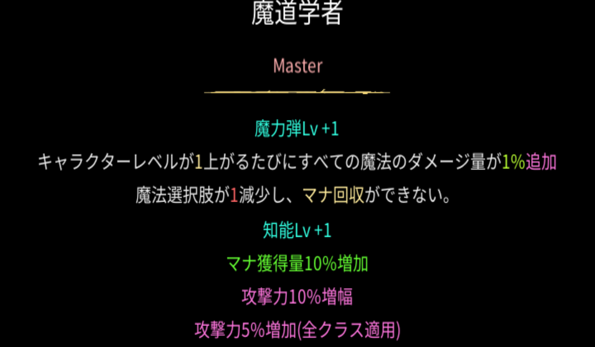
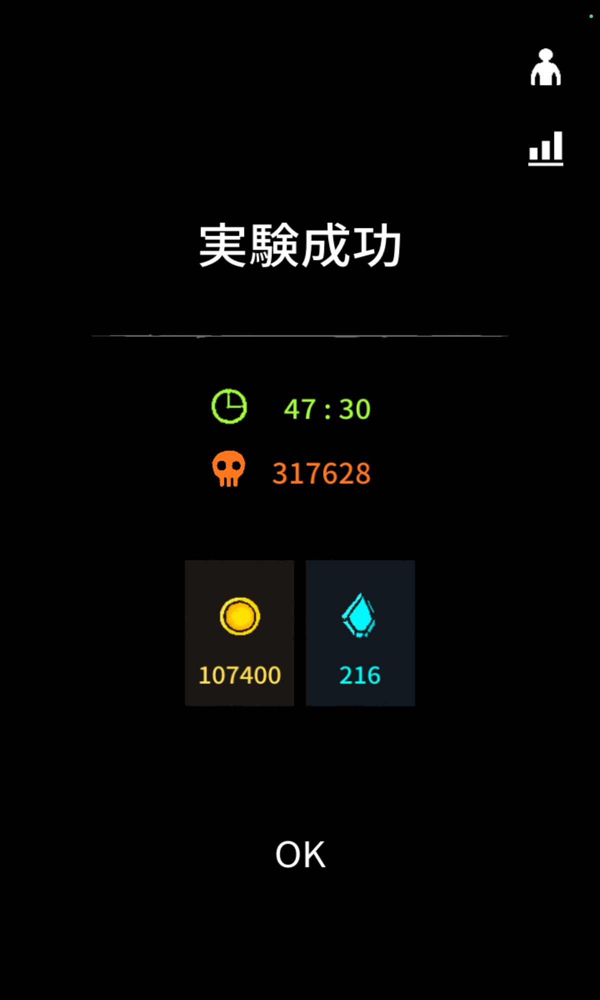
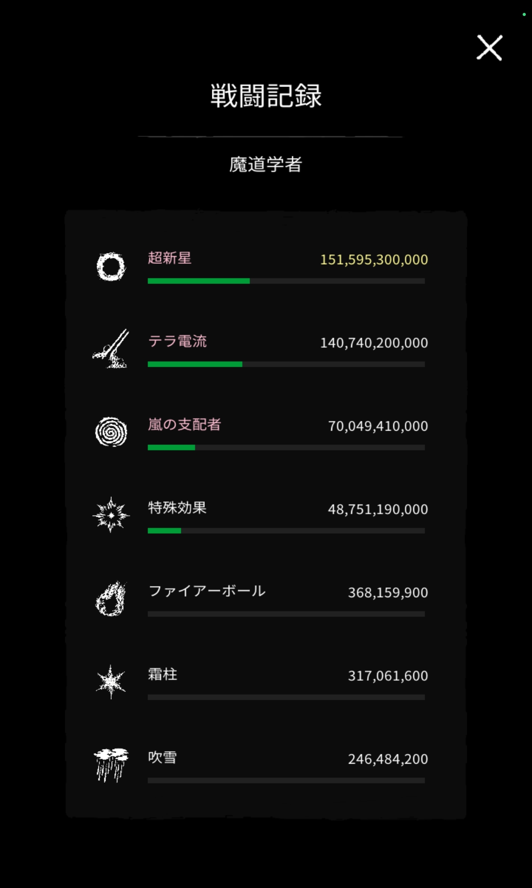
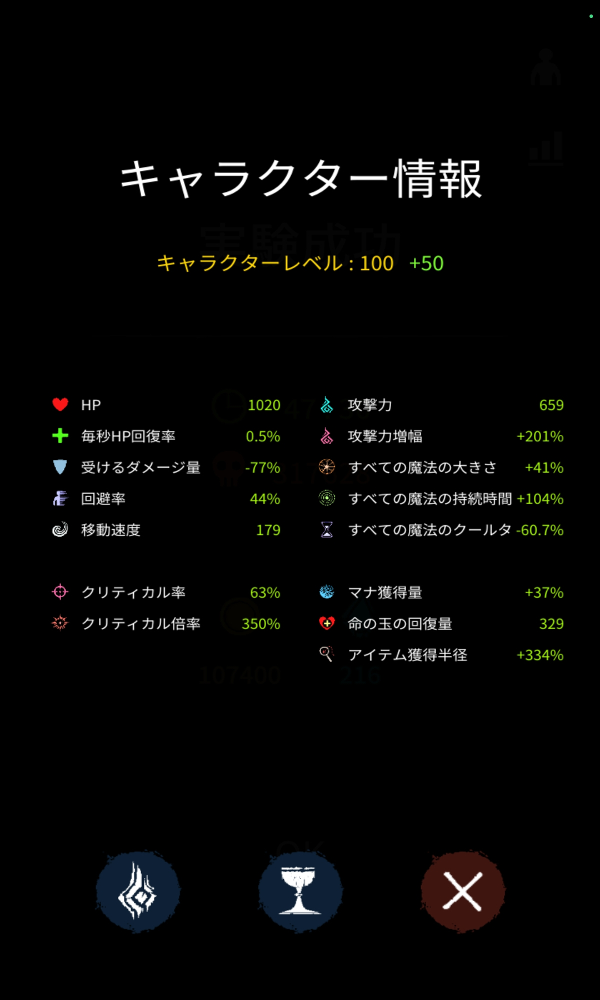
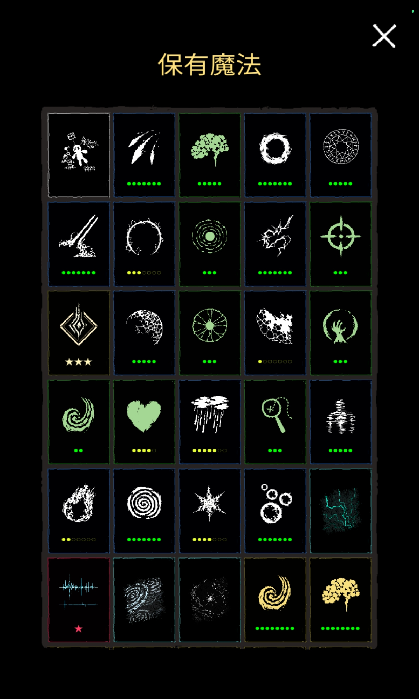
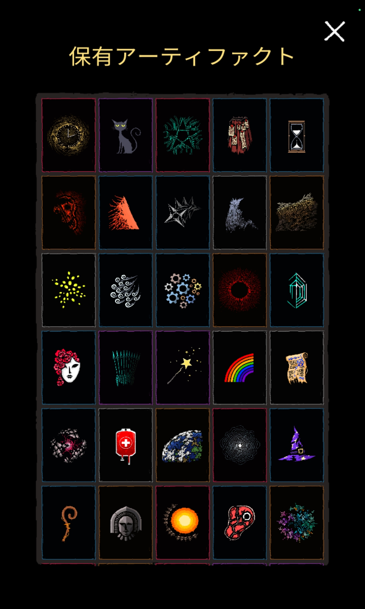
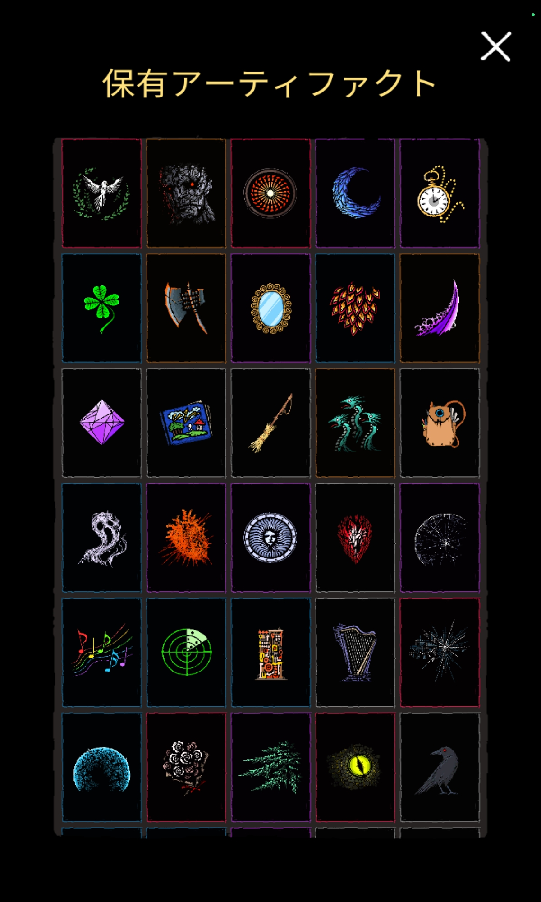
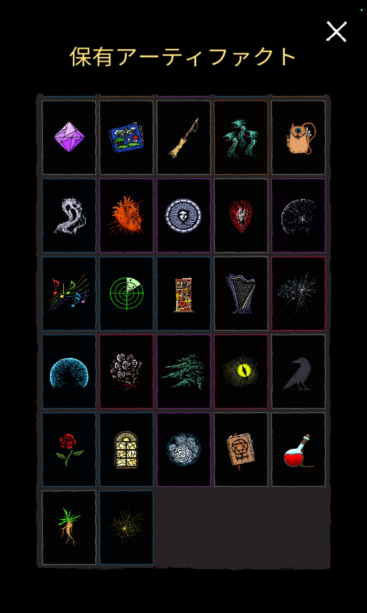

# 魔導学者

## 性能

要約すると、魔法のダメージが2倍になる代わりに魔法を狙い通りに取得出来なくなるというもの。

## 特徴

最初に書いた通り、最も走り辛い[クラス](../database/classes.md)である。

マナ回収が出来ない事による魔法取得の不安定さを補うためにはリセマラする（一旦アプリを終了し、再び開くことで出来る）しかないが、アプリ再開時のゲーム内時間は直近のウェーブ終了後5秒前後で固定されてしまうので、本気で望みの魔法を獲ろうとすると、平気で1日が終わってしまう。

このクラスで走るなんて、控えめにいって**苦行**。

## 魔導学者で走るには

気合い。

それしかない。

望みの魔法を取得する為にリセマラをして、最低限融合魔法を3つ取れば45分はいけるだろうが、おすすめはしない。魔導学者で良い記録を狙うには、あたかも他のクラスで走っているかのような無駄のない魔法取得状況でなければいけないのだ。記録を出すのに5、6時間かかるのは当たり前なので、時間に余裕のある時に走ろうね。

## atomonによる魔導学者の参考記録

度重なる妥協によって、非常に無駄のある魔法の取得状況となってしまってはいるが、融合魔法を3つ作れたのでなんとかなった。追走したいとい方がもしいれば、参考になると思います。
