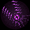
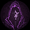
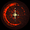
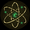
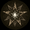
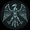
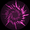

# アーティファクト(紹介&tier)

**大体の疑問は[よくある質問](../guide/faq.md)で解決しますよ！**

wiki内記事へのご意見・ご要望はdiscordにて受付中です。

## アーティファクト(AF)とは

アーティファクト(以下AFとする)は、キャラクターや魔法の性能に変化を及ぼすアイテムです。

- フィールドに出現する宝箱やウェーブクリア時に出現するオベリスク、商人から獲得できます。
  - 宝箱の場合は、選択肢がランダムに3つ表示され、その中から1つを選択する形になります。
    - 敵の殺害数や時間等の様々な条件で出現し、[クラス](classes.md):「考古学者」の使用や[研究](research.md):「戦利品」の研究によって出現率を高めることができます。
    - [クラス](classes.md):「考古学者」を使用中、レベルが20上がる度に、キャラクター周辺に宝箱が出現します。
  - 商人の場合は、選択肢がランダムに8つ表示され、その中から最大8つを購入する形になります。
    - 購入には獲得したマナオーブを使用します。
  - ステージ毎に一定の周期で生じるウェーブ(敵の大量発生)を生き延びると、伝説AFが取得できる**オベリスク**が出現します。
- AFの個人的tier(E〜S)は名称の横に記載しました。
  - なお、特定の魔法を強化するAFはビルドの構成によって評価が変動しますが、ここでは最も理想的なビルドで使用した上でどれだけ生き残ったか、を評価に反映させています。
  - tierの隣に、同レア度・同tier帯のAFの優先度を併記しています。優先度1が最も取るべきAFで、2,3,4…と数字がずれるにつれて、優先度が下がります。レア度の違う、同tierのAF同士を比べる場合は、レア度の高い方を選ぶようにすることをおすすめします。
- tierE,A,SのAFについては評価理由をそのAFの個別ページに記載しています。

## 記録を狙う走りでのtier

### アーティファクト一覧

**注意事項**

- 評価にはatomonによる独断と偏見が多分に含まれます。
- ゲーム終盤で評価が変わる場合は**A**(**S**)という風に、ゲーム終盤での評価を()の中に表記しています。
- ×はEより下、最悪、ゴミという意味です。

| レア度 | 名称 | tier | 優先度 | 効果 | シナジー |
| --- | --- | --- | --- | --- | --- |
| ノーマル | [血液パック](../artifacts/blood-pack.md) | **A** | 2 | 最大HP+30%、1秒当たりのHP回復率+0.3% | ヒーリングファクター |
| ノーマル | [影のマント](../artifacts/shadow-cloak.md) | **A** | 7 | 回避率+10% | ハートブレイカー |
| ノーマル | [火薬](../artifacts/gunpowder.md) | C | 2 | 全ての魔法のサイズ+10% | ニュークリア |
| ノーマル | [呪文のリュック](../artifacts/spell-backpack.md) | B | 2 | アイテム獲得半径+50% | トレジャーハンター |
| ノーマル | [標本](../artifacts/specimen.md) | D | 2 | 敵の最大HP-3% | ヴェノム |
| ノーマル | [ルビー](../artifacts/ruby.md) | D | 1 | 攻撃力+12% | モナーク |
| ノーマル | [標的紙](../artifacts/target-paper.md) | D | 4 | クリティカル率+6% | デッドアイ |
| ノーマル | [HPポーション](../artifacts/hp-potion.md) | **A** | 3 | HPが25%を下回った時、3秒かけてHPを50%回復(クールタイム:50秒) | エリクサー |
| ノーマル | [ほうき](../artifacts/broom.md) | **A** | 1 | 移動速度+10% | ゼロバック |
| ノーマル | マンドレイク | **A** | 4 | ライフオーブの回復量+50% | エリクサー |
| ノーマル | [魔法スクロール](../artifacts/magic-scroll.md) | **A** | 6 | 攻撃力+10%、全ての魔法のクールタイム-3% | 第5元素 |
| ノーマル | [虹](../artifacts/rainbow.md) | D | 5 | クリティカル倍率+30% | トリックスター |
| ノーマル | 松明 | E |  | [火炎球](../magic/fireball.md)、[焼却](../magic/incineration.md)のクールタイム-15% | 習熟(火炎球、焼却) |
| ノーマル | 避雷針 | E |  | [落雷](../magic/thunderstorm.md)、[電気ショック](../magic/electric-shock.md)のクールタイム-15% | 習熟（落雷、電気ショック） |
| ノーマル | [雪だるま](../artifacts/snowman.md) | B | 1 | [吹雪](../magic/blizzard.md)、[霜柱](../magic/frost-nova.md)のクールタイム-15% | 習熟（吹雪、霜柱） |
| ノーマル | 蛍 | E |  | [精霊](../magic/spirit.md)の数+2 | 習熟（精霊） |
| ノーマル | ガラス玉 | E |  | [衛星](../magic/satellite.md)の数+2 | 習熟（衛星） |
| ノーマル | 水晶プリズム | E |  | [怪光線](../magic/arcane-ray.md)の数+2 | 習熟（怪光線） |
| ノーマル | [カラス](../artifacts/crow.md) | D | 3 | クリティカル率+3%、クリティカル倍率+25% | デッドアイ、ブッチャー |
| ノーマル | [サファイア](../artifacts/sapphire.md) | C | 1 | マナ獲得量+12% | モナーク、ジン |
| ノーマル | [ハープ](../artifacts/harp.md) | **A** | 8 | 全ての魔法の持続時間+12% | カオス |
| ノーマル | [魔法の古書](../artifacts/ancient-grimoire.md) | **A** | 5 | 全ての魔法のクールタイム-5% | ジーニアス |
| レア | [ウイルス](../artifacts/virus.md) | C | 1 | エリートモンスターの最大HP-10% | ヴェノム |
| レア | [肉](../artifacts/meat.md) | **S** | 4 | プレイヤーの近くにライフオーブ生成(クールタイム:30秒) | ブッチャー |
| レア | [歯車](../artifacts/gear.md) | **S** | 3 | 全ての**アーティファクト**のクールタイム-20%[^1] | アンドロイド、スチームパンク、ウォーマシン |
| レア | [砂時計](../artifacts/hourglass.md) | **A** | 7 | 全ての魔法のクールタイム-6% | クロノス |
| レア | [力場](../artifacts/force-field.md) | **S** | 2 | 受けたダメージを無効化し、3秒間無敵になる(クールタイム:60秒) | パラディン |
| レア | トーテム | E | × | [つむじ風](../magic/cyclone.md)のダメージ+30%、クールタイム-10% | 習熟（つむじ風） |
| レア | [四つ葉のクローバー](../artifacts/four-leaf-clover.md) | C | 3 | 同じ敵が5回ダメージを受けるたびに必ずクリティカルが発生する | トリックスター |
| レア | [バラ](../artifacts/rose.md) | B | 9 | HP75%以上の敵に10%の追加ダメージを与える | スナイパー、ブローカー |
| レア | [学士帽](../artifacts/graduation-cap.md) | D | 1 | 魔法の選択肢が4つになる確率+33% | ジーニアス |
| レア | [変異因子](../artifacts/mutagen.md) | C | 2 | 大型モンスターの最大体力−15% |  |
| レア | [十字架](../artifacts/cross.md) | **A** | 8 | 受けるダメージ量-12%、1秒当たりのHP回復率+0.3% | アークエンジェル、ゴッドハンド |
| レア | [ランタン](../artifacts/lantern.md) | **A** | 9 | マナオーブ獲得量[^2]+10%、アイテム獲得範囲+20% | ネクロマンサー |
| レア | [ドラゴンの鱗](../artifacts/dragon-scale.md) | **A** | 2 | 受けるダメージ量-30% | レッドドラゴン |
| レア | [マナシールド](../artifacts/mana-shield.md) | **A** | 1 | 現在のマナ比率の50%分だけ受けるダメージ量が減少する | パラディン |
| レア | [生体シールド](../artifacts/bio-shield.md) | **S** | 1 | ライフオーブ獲得時に超過回復分のHPが追加される、追加HPの最大値は元の最大HP量と等しい | ホムンクルス、ヒーリングファクター |
| レア | [オーロラ](../artifacts/aurora.md) | B | 7 | マナ獲得量+15% | ジン |
| レア | [ゴーレムの核](../artifacts/golem-core.md) | B | 3 | 瀕死状態になっても画面が赤くならなくなる。　HP+50% | アーキテクト、ウォーマシン |
| レア | 魔術の弾丸 | E | × | [魔力弾](../magic/magic-bolt.md)のダメージ+30%、数+1 | 習熟（魔力弾） |
| レア | 天体カレンダー | E | × | [隕石落下](../magic/meteor.md)が3回発生するたび、次の隕石落下のダメージ量が1.5倍上昇 | 習熟（隕石落下） |
| レア | バッテリー | E | × | [感電地帯](../magic/electric-zone.md)のダメージ+30%、ダメージ間隔-15% | 習熟（感電地帯） |
| レア | 魔法工学モジュール | E | × | [エネルギー弾](../magic/energy-bolt.md)が22%の確率で2個に分裂する | 習熟（エネルギー弾） |
| レア | [古木の杖](../artifacts/ancient-staff.md) | **A** | 10 | [魔法陣](../magic/magic-circle.md)のクールタイム-25% | 第5元素 |
| レア | [ハーモニー](../artifacts/harmony.md) | **A** | 5 | 全ての魔法のクールタイム-3%、持続時間+12% | カオス |
| レア | [マナフレイム](../artifacts/mana-flame.md) | B | 5 | 全ての魔法ダメージ+15% | アービター |
| レア | [呪文のマント](../artifacts/spell-cloak.md) | B | 8 | 攻撃力+18% | ドミナス |
| レア | [そよ風](../artifacts/breeze.md) | **A** | 3 | 回避率、移動速度+8% | ゼロバック |
| レア | [爆弾](../artifacts/bomb.md) | B | 4 | 攻撃力、全ての魔法のサイズ+8% | ニュークリア |
| レア | [レーダー](../artifacts/radar.md) | B | 6 | クリティカル率+9% | スナイパー |
| レア | 聖杯 | B | 2 | 1秒当たりのHP回復率+0.5% | アヴァロン、ゴッドハンド |
| レア | [舞踏会の仮面](../artifacts/masquerade-mask.md) | B | 1 | クリティカル率、回避率+5% | ハートブレイカー |
| レア | [ステンドグラス](../artifacts/stained-glass.md) | **A** | 6 | [ルーン](glossary.md)の効果持続時間+25% | アークエンジェル |
| レア | [ミミック](../artifacts/mimic.md) | D | 2 | 宝箱獲得時、爆発を起こして敵を攻撃し、周囲に10個のランダムアイテムを生成する | トレジャーハンター |
| レア | 手裏剣 | E | × | [魔力弾](../magic/magic-bolt.md)、[精霊](../magic/spirit.md)のクリティカル率+15% | 習熟（魔力弾、精霊） |
| レア | サラマンダー | E | × | [焼却](../magic/incineration.md)数+5、[溶岩地帯](../magic/lava-zone.md)数+1 | 習熟（焼却、溶岩地帯） |
| レア | [フクロウ](../artifacts/owl.md) | **A** | 4 | 現在レベル+3、マナ獲得量+10% | オラクル、ジーニアス |
| エピック | [ダイヤモンド](../artifacts/diamond.md) | **A** | 10 | 攻撃力+10%、最大HP+20%、全ての魔法のクールタイム-3% | モナーク |
| エピック | ギロチン | E | × | HP75%以上の敵に15%追加ダメージ | ナイトメア、スナイパー |
| エピック | 電磁石 | E | × | 感電地帯、衛星ダメージ+50% | 習熟（衛星、感電地帯） |
| エピック | [オキュラス](../artifacts/oculus.md) | C | 1 | アイテム獲得範囲30%ごとにクリティカル率+1%。　アイテム獲得範囲+30% | AGI |
| エピック | [カーニバル](../artifacts/carnival.md) | **A** | 5 | 回避率3%ごとにクリティカル率+1%。　回避率+5% | ナイトメア、ハートブレイカー |
| エピック | [魔晶石](../artifacts/mana-crystal.md) | C | 2 | 攻撃力+25% | エゴソード、ドミナス |
| エピック | [タロットカード](../artifacts/tarot-card.md) | C | 4 | ランダムな3つの魔法を習得する[^3] | トリックスター |
| エピック | [重力球](../artifacts/gravity-orb.md) | **S** | 4 | 波動を形成し、敵の移動速度を一瞬低下させる(クールタイム:20秒) | グラビティ |
| エピック | [世界樹の葉](../artifacts/world-tree-leaf.md) | **S** | 7 | プレイヤーの近くに世界樹の果実生成(クールタイム:100秒) | アヴァロン、エリクサー |
| エピック | [ムーンクリスタル](../artifacts/moon-crystal.md) | **S** | 3 | 1度でも氷結状態になった敵の移動速度-10%。　[霜柱](../magic/frost-nova.md)のダメージ+50% | 習熟（霜柱） |
| エピック | [懐中時計](../artifacts/pocket-watch.md) | **S** | 5[^4] | 全ての魔法の持続時間+24% | スチームパンク |
| エピック | パンドラの箱 | E | 1 | つむじ風、津波、隕石落下のうちランダムに1つ発動(クールタイム:5秒) | カオス |
| エピック | [ゼンマイ装置](../artifacts/clockwork.md) | **S** | 5[^5] | 周囲の敵の動きを2秒間止める(クールタイム:18秒) | スチームパンク |
| エピック | [クモの巣](../artifacts/spider-web.md) | **S** | 2 | すべての敵の移動速度-10% | グラビティ |
| エピック | [二番目の心臓](../artifacts/second-heart.md) | **S** | 6 | 死亡時に復活できる数+1、最大HP+50% | ホムンクルス、ヒーリングファクター |
| エピック | 魔法のステッキ | E | × | [精霊](../magic/spirit.md)の数1つ毎に[精霊](../magic/spirit.md)のダメージ+10%、[精霊](../magic/spirit.md)の数+2 | 習熟（精霊） |
| エピック | [鍵束](../artifacts/key-ring.md) | **A** | 9 | 一般宝箱のアーティファクトを交換することができる(3回使用可能) | トレジャーハンター |
| エピック | エーテル矢 | E | × | [魔力弾](../magic/magic-bolt.md)、[精霊](../magic/spirit.md)のクールタイム-20% | 習熟（魔力弾、精霊） |
| エピック | [黒猫](../artifacts/black-cat.md) | **A** | 2 | 全ての魔法のクールタイム-9% | クロノス、ブローカー |
| エピック | [注視者の目](../artifacts/watchers-eye.md) | **A** | 3 | ライフオーブ獲得時に爆発を起こすようになる。　クリティカル倍率+50% | エゴソード、ブラッドムーン |
| エピック | [童話の本](../artifacts/fairy-tale-book.md) | **S** | 1 | プレイヤーのサイズ-25% | ワンダーランド |
| エピック | [イージス](../artifacts/aegis.md) | **A** | 7 | 受けるダメージの減少率-10%毎に攻撃力増幅値+3%。　受けるダメージ量-10% | パラディン、メデューサ |
| エピック | [霊魂](../artifacts/soul.md) | **S** | 1 | あらゆる敵や障害物を通過できるようになる | ネクロマンサー、レクイエム |
| エピック | コアエネルギー | E | × | [衛星](../magic/satellite.md)が敵にダメージを与えるたびに爆発を起こす。　[衛星](../magic/satellite.md)の数+2 | 習熟（衛星） |
| エピック | 異界の触手 | E | × | [怪光線](../magic/arcane-ray.md)1本ごとにダメージ+8%。　クールタイム-10% | 習熟（怪光線） |
| エピック | [攻城ハンマー](../artifacts/siege-hammer.md) | D |  | **非クリティカル時**に+20%の追加ダメージを与える。　クリティカル倍率+20% | ウォーマシン |
| エピック | 大釜 | E | × | [火炎球](../magic/fireball.md)、[隕石落下](../magic/meteor.md)、[焼却](../magic/incineration.md)、[溶岩地帯](../magic/lava-zone.md)のダメージ量+35% | ニンフ |
| エピック | 雷 | E | 2 | [落雷](../magic/thunderstorm.md)、[電気ショック](../magic/electric-shock.md)、[感電地帯](../magic/electric-zone.md)、[閃光ショック](../magic/flash-shock.md)のダメージ量+35% | ゴッドハンド、ニンフ、習熟（落雷、電気ショック、閃光ショック） |
| エピック | 気象調節器 | E | × | [つむじ風](../magic/cyclone.md)、[吹雪](../magic/blizzard.md)、[津波](../magic/tsunami.md)、[霜柱](../magic/frost-nova.md)のダメージ量+35% | ニンフ、習熟（津波、つむじ風） |
| エピック | 魔力の宝珠 | E | × | [エネルギー弾](../magic/energy-bolt.md)、[怪光線](../magic/arcane-ray.md)、[精霊](../magic/spirit.md)、[衛星](../magic/satellite.md)のダメージ量+35% | ニンフ |
| エピック | フェニックスの弓 | E | × | [火炎球](../magic/fireball.md)が直撃した敵に+50%の追加ダメージを与える。　貫通する敵の数+1 | 習熟（火炎球） |
| エピック | ミョルニル | E | × | [落雷](../magic/thunderstorm.md)の数+50% | 習熟（落雷） |
| エピック | 次元の扉 | E | × | [隕石落下](../magic/meteor.md)が20%の確率で1回追加発動する。　隕石落下のクールタイム-25% | 習熟（隕石落下） |
| エピック | 芭蕉扇 | E | × | [つむじ風](../magic/cyclone.md)を5回使うたびに、次に発動するつむじ風のダメージ量とサイズが2倍になる。　つむじ風ダメージ+50% | 習熟（つむじ風） |
| エピック | 電力ケーブル | E | × | [電気ショック](../magic/electric-shock.md)のダメージ+50%、数+2 | 習熟（電気ショック） |
| エピック | 機械の腕 | E | × | [エネルギー弾](../magic/energy-bolt.md)のダメージ+35%、数+35% | 習熟（エネルギー弾） |
| エピック | 龍の息吹 | **S** | × | [焼却](../magic/incineration.md)が同じ敵にダメージを与えるたびに、その敵に焼却が与える追加ダメージ+1%。　焼却のダメージ+50% | 習熟（焼却） |
| エピック | 雪の花の王冠 | E | × | [吹雪](../magic/blizzard.md)の数1ごとに吹雪のダメージ+1%。数+30% | 習熟（吹雪） |
| エピック | 萬波息笛 | E | × | [津波](../magic/tsunami.md)を発動するたびに津波のダメージ+12%、クールタイム-12%(４回発動でリセット) | 習熟（津波） |
| エピック | 丸のこ | E | × | 敵に[衛星](../magic/satellite.md)ダメージを与えるたび、その敵に[衛星](../magic/satellite.md)追加ダメージ+0.5%(最大50%まで重複可)。　衛星の回転速度50%増加 | 習熟（衛星） |
| エピック | 硫黄 | E | × | [溶岩地帯](../magic/lava-zone.md)を発動中、[溶岩地帯](../magic/lava-zone.md)のサイズが1秒ごとに+2%。　[溶岩地帯](../magic/lava-zone.md)のダメージ+80% | 習熟（溶岩地帯） |
| エピック | ゲイ・ボルグ | E | × | [閃光ショック](../magic/flash-shock.md)のダメージ量+100% | 習熟（閃光ショック） |
| エピック | 燭台 | E | × | [火炎球](../magic/fireball.md)、[隕石落下](../magic/meteor.md)の数+1 | 習熟（火炎球、隕石落下） |
| エピック | [千里眼](../artifacts/clairvoyance.md) | B | 1 | プレイヤーの視野半径+10%、アイテム獲得半径+100% | コズミックホラー |
| エピック | [烙印](../artifacts/brand.md) | B | 2 | 5秒以上生存した敵に15%の追加ダメージを与える | エゴソード、ファナティック |
| エピック | [マナ回路](../artifacts/mana-circuit.md) | C | 3 | マナオーブを獲得する毎に攻撃力増幅+1%(5秒でリセット) | コンフラックス |
| エピック | 鏡 | E | × | [エネルギー弾](../magic/energy-bolt.md)、[怪光線](../magic/arcane-ray.md)、[精霊](../magic/spirit.md)、[衛星](../magic/satellite.md)の数+1 | 習熟（エネルギー弾、怪光線） |
| エピック | [ピラミッド](../artifacts/pyramid.md) | **A** | 1 | 有効なシナジー1つにつき攻撃力が3%増幅される | オラクル、マグナムオプス |
| エピック | 戦争の旗 | E | × | 移動していない時、毎秒攻撃力増幅+2%(最大20%) | ウォーマシン |
| エピック | エクソシズム | E | × | 全ての敵の最大HP-3%、敵を倒すことで得られるマナ+20% | レクイエム |
| エピック | インプ |  |  | 全ボスウェーブモンスターの最大体力10%減少。通常ウェーブモンスターの最大体力10%増加 | エゴソード、カオス |
| エピック | [魔法使いの帽子](../artifacts/wizard-hat.md) | **A** | 4 | 全ての魔法のクールタイム-2%ごとに攻撃力+1% | クロノス |
| エピック | ロボット | E | × | 感電地帯がキャラクターレベルごとに0.5%追加ダメージ | 習熟（感電地帯） |
| エピック | [マーキュリー](../artifacts/mercury.md) | **A** | 6 | マナオーブ獲得量[^2]+20% | ジン |
| エピック | [魔力の泉](../artifacts/mana-fountain.md) | B | 2 | 所持中のマナオーブ200ごとに攻撃力+1%(最大20%重複可) | ジン |
| エピック | キメラ | E | × | 閃光ショック、溶岩地帯、津波のクールタイム-15% | 習熟（津波、溶岩地帯、閃光ショック） |
| エピック | 魔弾の射手 | E | × | 魔力弾のダメージ+100% | 習熟（魔力弾） |
| エピック | [コイン](../artifacts/coin.md) | C | 5 | マナオーブ通貨を獲得 | ギルガメッシュ |
| エピック | [ユニコーン](../artifacts/unicorn.md) | **A** | 8 | 特殊パッシブ魔法の選択肢獲得 | ワンダーランド |
| エピック | スカディ |  |  | 吹雪、霜柱のダメージ量50%増加 | 習熟(霜柱、吹雪) |
| エピック | スターライト |  |  | 攻撃力、攻撃力増幅、全ての魔法のダメージ量7%増加 | マトリックス、ゴッドハンド |
| スペシャル | [ASI](../artifacts/asi.md) | C | 3 | 攻撃力+30% | AGI、コンフラックス |
| スペシャル | [アンデッド](../artifacts/undead.md) | **S** | 10 | 復活回数+2、最大HP-25%[^6] | ネクロマンサー |
| スペシャル | [暗殺](../artifacts/assassination.md) | C | 4 | 敵が初めて受けるダメージが必ずクリティカルになる。　クリティカル倍率+25% | ハートブレイカー |
| スペシャル | [賢者の石](../artifacts/philosophers-stone.md) | D | 2 | 大量のマナオーブ(大)を生成 | マグナムオプス、ホムンクルス、ブローカー |
| スペシャル | [増幅器](../artifacts/amplifier.md) | **S** | 6 | 全ての魔法のサイズ×1.28 | ニュークリア、グラビティ |
| スペシャル | [エーテル](../artifacts/ether.md) | **A** | 3 | 1秒あたり1%のマナを獲得する | 第5元素、マグナムオプス |
| スペシャル | [死の鐘](../artifacts/death-bell.md) | **A** | 7 | マナオーブ444個獲得時、周囲の敵を消滅させる | レクイエム |
| スペシャル | [結界](../artifacts/barrier.md) | **S** | 1 | 1度に受けるダメージ量を最大HPの30%までに制限する | アーキテクト、パラディン |
| スペシャル | [時空間回路](../artifacts/spacetime-circuit.md) | **S** | 0 | 時間が24%速く進む。　獲得以降のゴールド獲得量+24% |  |
| スペシャル | [ヒドラ](../artifacts/hydra.md) | D | × | 敵にダメージを与えるたび、敵の現在体力を1%減少させる。(各敵ごとに最大20回発動) | メデューサ |
| スペシャル | [マーリンのマント](../artifacts/merlins-cloak.md) | C | 5 | 現在のマナ比率25%分攻撃力増幅 | アヴァロン |
| スペシャル | [ネクロノミコン](../artifacts/necronomicon.md) | E | × | 現在のHPが最大HPの50%を超えない。　攻撃力50%増幅 | コズミックホラー、ファナティック |
| スペシャル | [特異点](../artifacts/singularity.md) | B | 1 | 全てのマナの玉(小)が(中)に変換される | マグナムオプス、AGI |
| スペシャル | [幾何学](../artifacts/geometry.md) | D | 5 | マナ回収の効果量が常に100%になるが、連続して使用できる回数が1回減る(3回→2回) | アーキテクト、ジーニアス |
| スペシャル | [おもちゃの城](../artifacts/toy-castle.md) | **S** | 2 | エリート敵の最大体力とサイズ-15% | ワンダーランド |
| スペシャル | [狩人](../artifacts/hunter.md) | **S** | 3 | 敵を100体倒す毎に攻撃力増幅+1%(25%に達するとリセット) | ブラッドムーン、ブッチャー |
| スペシャル | [宝の地図](../artifacts/treasure-map.md) | **A** | 4 | ランダムな地点に通常宝箱を2つ生成する。　アイテム獲得半径+30% | トレジャーハンター |
| スペシャル | [サイボーグ](../artifacts/cyborg.md) | E | × | 生命のオーブで体力を回復できなくなる。攻撃力50%増加 | アンドロイド |
| スペシャル | [権能の領域](../artifacts/domain-of-authority.md) | E | 1 | 魔法融合の使用回数+1 | ドミナス |
| スペシャル | フェアリー | **S** | 9 | エンチャント効果2倍 | アービター、ワンダーランド |
| スペシャル | [人工知能魔法](../artifacts/ai-magic.md) | **S** | 7 | ランダムな4つの魔法を習得する[^7]。　すべての魔法のクールタイム-5% | コンフラックス |
| スペシャル | [用言](../artifacts/predicate.md) | E | 2 | 融合魔法のダメージ+40% | レッドドラゴン、ドミナス |
| スペシャル | [ヘイロー](../artifacts/halo.md) | **A** | 5 | 全ての魔法ダメージ+30% | アークエンジェル |
| スペシャル | [バジリスク](../artifacts/basilisk.md) | **A** | 8 | 全ての敵の最大体力-10% | ヴェノム |
| スペシャル | [冥府](../artifacts/underworld.md) | **S** | 8 | 100体の敵を倒すごとに発動、次に何らかのダメージを受けた50体の敵を即死させる | レクイエム |
| スペシャル | [ウェアウルフ](../artifacts/werewolf.md) | **S** | 4 | 敵を2500体倒すごとに狂奔のルーンの効果を発動。　クリティカル率+3% | ブラッドムーン |
| スペシャル | [アビス](../artifacts/abyss.md) | D | 3 | すべてのマナ獲得率が50%だけ攻撃力に**転換**される | マグナムオプス、コズミックホラー |
| スペシャル | [黄金のルーレット](../artifacts/golden-roulette.md) | **A** | 1 | ランダムなレジェンドアーティファクトを1つ獲得する[^8] | ギルガメッシュ |
| スペシャル | [ジェットエンジン](../artifacts/jet-engine.md) | **S** | 5 | 移動し続けると攻撃力増幅+15%。　移動速度+5% | ゼロバック |
| スペシャル | [ロングギヌスの窓](../artifacts/spear-of-longinus.md) | B | 4 | 強力な雷を落とす(クールタイム:12秒) | ゴッドハンド |
| スペシャル | [マトリックス](../artifacts/matrix.md) | C | 2 | 全ての魔法のサイズ増加率、持続時間増加率、クールタイム減少率の合計値20%ごとに全ての魔法のダメージ+1% | アービター |
| スペシャル | [花束](../artifacts/bouquet.md) | **A** | 2 | 商人が販売する全商品の販売価格-25% | ブローカー |
| スペシャル | [プラズマ](../artifacts/plasma.md) | E | × | 攻撃力増幅+40%、全ての魔法のサイズ-20%[^9] | アンドロイド |
| スペシャル | [オカルト](../artifacts/occult.md) | D | 4 | 全ての敵の最大HP減少率の同量分、最大HP増加。　全ての敵の最大HP-5% | ファナティック、メデューサ |
| レジェンド | [デスペラード](../artifacts/desperado.md) | D | 1 | 6秒間、敵に与える全てのダメージ2倍増加(30秒ごとに発動される、歯車の効果は適用されない)。　攻撃力増幅+30％) | デッドアイ |
| レジェンド | [創造術](../artifacts/creation-art.md) | C | 1 | 同じ魔法を5回発動するたびに、次の1回は半分のクールタイムで発動できる。　すべての魔法のダメージ量+50% | 第5元素 |
| レジェンド | [ウラン](../artifacts/uranium.md) | B | 3 | 攻撃力+100%、すべての魔法のサイズ+25%、1秒あたりの体力回復率-0.25% | ニュークリア |
| レジェンド | [魔剣](../artifacts/demon-sword.md) | **A** | 3[^10] | HPが20%未満になった敵を即死させる | エゴソード |
| レジェンド | [金銀財宝](../artifacts/treasure.md) | **A** | 4 | 周囲に通常宝箱を3つ,遺物箱[^11]を1つ出現させる | ギルガメッシュ |
| レジェンド | [アクセラレータ](../artifacts/accelerator.md) | **S** | 2 | 移動速度増加率3%ごとに全ての魔法のクールタイム-1% | ゼロバック |
| レジェンド | [超越体](../artifacts/transcendent.md) | B | 4 | 最大レベルのアクティブ魔法１つごとに全ての魔法のダメージ量+15% | アービター |
| レジェンド | [ゲノムマップ](../artifacts/genome-map.md) | **A** | 3[^12] | すべての敵の最大HP-20% | ヴェノム |
| レジェンド | [死神の鎌](../artifacts/reapers-scythe.md) | **S** | 5 | 初めて攻撃された敵が8%の確率で即死する。　全ての敵の最大HP-13% | ネクロマンサー |
| レジェンド | [アイアンメイデン](../artifacts/iron-maiden.md) | D | 3 | 15%の確率で倒した敵が爆発する(爆発ダメージ量は敵の最大HPの75%) | ナイトメア |
| レジェンド | [バリスタ](../artifacts/ballista.md) | E | 1 | HP75%以上の敵に50%追加ダメージ。　クリティカル倍率+50% | スナイパー |
| レジェンド | [処刑者の斧](../artifacts/executioners-axe.md) | C | 4 | クリティカル倍率+100% | ブッチャー |
| レジェンド | [アカシックレコード](../artifacts/akashic-records.md) | **S** | 6 | 現在レベル2につき攻撃力増幅+1%。　現在レベル、最大レベル+5 | オラクル |
| レジェンド | [DNA](../artifacts/dna.md) | **A** | 5 | 獲得したオベリスク１つごとに攻撃力増幅と最大HP+8%（適用するたびに効果-15％） | ホムンクルス |
| レジェンド | [キューブ](../artifacts/cube.md) | **S** | 4 | 全ての一般強化(パッシブ)魔法の現在レベルと最大レベル+1。　マナ獲得量+25% | オラクル |
| レジェンド | [神聖不可侵](../artifacts/sanctuary.md) | **A** | 1 | HPが最大のとき攻撃力増幅+50%、受けるダメージ量-20% | アークエンジェル |
| レジェンド | [ドラゴンの魔力](../artifacts/dragon-magic.md) | B | 6 | 攻撃力、攻撃力増幅+40% | レッドドラゴン |
| レジェンド | [ジョーカー](../artifacts/joker.md) | B | 8 | クリティカル発動時、50%の確率でクリティカル倍率が1回重複する[^13] | トリックスター |
| レジェンド | [タイタンの権能](../artifacts/titans-authority.md) | B | 1 | 攻撃力増加率×1.5 | アーキテクト |
| レジェンド | [ガイア](../artifacts/gaia.md) | **A** | 2 | 最大HP20ごとに攻撃力+3%。　最大HP+50% | アーキテクト |
| レジェンド | [契約の箱](../artifacts/ark-of-the-covenant.md) | **S** | 1 | ランダムな[ルーン](glossary.md)の効果が発動する(クールタイム:45秒)。　全ての敵のHP-10% | ギルガメッシュ |
| レジェンド | [王冠](../artifacts/crown.md) | B | 2 | 所持中のエピックAF1つにつき攻撃力増幅+1%、スペシャルAF1つにつき攻撃力増幅+5% | モナーク、ギルガメッシュ |
| レジェンド | [ウロボロス](../artifacts/ouroboros.md) | **S** | 3 | すべての魔法のクールタイム-15% | クロノス |
| レジェンド | [イクリプス](../artifacts/eclipse.md) | **S** | 7 | 敵が失っている体力に比例し最大+50%の追加ダメージを与える[^14] | ブラッドムーン |
| レジェンド | [エクスカリバー](../artifacts/excalibur.md) | B | 9 | キャラクターを中心にオーラが生成され、オーラ範囲内の敵に25%の追加ダメージを与える | アヴァロン |
| レジェンド | [ネクサス](../artifacts/nexus.md) | B | 5 | 攻撃魔法を1つ選択してダメージ量を240%増加 | コンフラックス |
| レジェンド | [龍の心](../artifacts/dragon-heart.md) | C | 3 | 攻撃力増幅量×1.3 | レッドドラゴン |
| レジェンド | [女伯爵](../artifacts/countess.md) | D | 2 | エリートモンスター撃破時爆発発生(爆発ダメージ量は敵最大HPの25%)[^15]    攻撃力増幅+20% | ナイトメア |
| レジェンド | [ウィドウメイカー](../artifacts/widowmaker.md) | B | 7 | クリティカル率1%ごとにクリティカル倍率+1%。　クリティカル率+10% | ハートブレイカー |

### シナジー

優先度欄に×が書かれているシナジーは、取得難易度と効果のつり合いの悪さから、狙わない方が良いと判断されたものたちです。ゴミです。

| 画像 | 名称 | tier | 優先度 | 効果 | 必要AF |
| --- | --- | --- | --- | --- | --- |
|  | エゴソード | C | 1 | 体力が25%未満の敵を即死させる | 魔剣、インプ、注視者の目、魔晶石 |
|  | ナイトメア | E | × | 死体爆発のサイズ+15%。　死体爆発の威力が時々大きく強化される | アイアンメイデン、女伯爵、カーニバル、ギロチン |
|  | [レッドドラゴン](../synergies/red-dragon.md) | E | × | 攻撃力、攻撃力増幅、すべての魔法ダメージ+40% | ドラゴンの魔力、龍の心、用言、ドラゴンの鱗 |
|  | ヴェノム | B | 1 | 敵最大HP減少率×1.15 | ゲノムマップ、バジリスク、ウイルス、標本 |
|  | アヴァロン | E | × | エクスカリバーの効果が1.5倍増加し、オーラ範囲が広くなる。　HP自動回復率0.1%増加 | エクスカリバー、マーリンのマント、世界樹の葉、聖杯 |
|  | オラクル | **S** | 4 | 通常パッシプ魔法の効果が25%増加する。 | アカシックレコード、キューブ、ピラミッド、フクロウ |
|  | [アークエンジェル](../synergies/archangel.md) | **A** | 7 | 復活回数+1、最大HP+100% | 神聖不可侵、ヘイロー、ステンドグラス、十字架 |
|  | 第5元素 | D | × | 各魔法の5回目の詠唱が50%の追加ダメージを与える。　すべての魔法のダメージ+50% | 創造術、エーテル、古木の杖、魔法スクロール |
|  | ネクロマンサー | B | 2 | 死神の鎌による即死時、死体爆発発生(75%分) | 死神の鎌、アンデッド、霊魂、ランタン |
|  | デッドアイ | E | × | デスペラード発動中は常にクリティカル発生。　クリティカル倍率+50% | デスペラード、烙印、カラス、ターゲットペーパー |
|  | トリックスター | D | × | 四つ葉のクローバーのクリティカルがジョーカーを発動させる。　クリティカル率7%増加 | ジョーカー、タロットカード、四つ葉のクローバー、虹 |
|  | スナイパー | E | × | 体力が75%以上の敵に25%追加ダメージ | バリスタ、ギロチン、バラ、レーダー |
|  | ニュークリア | D | × | 全ての魔法のサイズ増加率3%ごとに攻撃力+1%。　すべての魔法のサイズ20%増加 | ウラニウム、増幅器、爆弾、火薬 |
|  | ゼロバック | D | 1 | ジェットエンジンの効果量×3 | アクセラレータ、ジェットエンジン、そよ風、ほうき |
|  | アービター | D | × | すべての魔法のダメージ増加率×1.25 | 超越体、フェアリー、スターライト、マナフレイム |
|  | クロノス | **A** | 4 | すべての魔法のクールタイム減少率3%につき攻撃力増幅+1%、全ての魔法のクールタイム5%減少 | ウロボロス、魔法使いの帽子、黒猫、砂時計 |
|  | モナーク | D | × | 所持中の通常AF1つにつき攻撃力+1%、レアAF1つにつき攻撃力+3% | 王冠、ダイヤモンド、サファイア、ルビー |
|  | アーキテクト | E | × | 攻撃力100%増幅 | ガイア、タイタンの権能、幾何学、結界、ゴーレムの核 |
|  | ゴッドハンド | D | 2 | ロンギヌスの窓による雷が1つに統合され、強化される | ロンギヌスの窓、雷、聖杯、十字架 |
|  | マグナムオプス | D | × | 全てのシナジーの条件が１満たされる | 賢者の石、エーテル、アビス、特異点、ピラミッド |
|  | パラディン | D | 3 | 無敵状態時、攻撃力増幅+100%。　被ダメージ量-5% | 結界、イージス、マナシールド、フォースシールド |
|  | AGI | D | 4 | マトリックスの効果分だけ攻撃力が増加&増幅される | マトリックス、特異点、ASI、オキュラス |
|  | トレジャーハンター | **A** | 6 | ランダムな地点に通常宝箱を2つ生成する。　アイテム獲得半径+25% | 宝の地図、鍵束、ミミック、呪文のリュック |
|  | ブラッドムーン | **S** | 5 | 狂乱のルーンが非活性状態でも効果が適用され、狂乱のルーン発動中はさらに追加ダメージ+25% | イクリプス、ウェアウルフ、狩人、注視者の目 |
|  | ハートブレイカー | E | × | クリティカル倍率×1.25 | ウィドウメイカー、暗殺、カーニバル、舞踏会の仮面、影のマント |
|  | [ワンダーランド](../synergies/wonderland.md) | **S** | 1 | 全ての敵とキャラクターのサイズ、敵の最大HP-9% | おもちゃの城、フェアリー、ユニコーン、童話 |
|  | コズミックホラー | D | × | ネクロノミコンとアビスのデメリットが消滅する | ネクロノミコン、アビス、千里眼 |
|  | アンドロイド | E | × | プラズマのデメリットが消滅する。　攻撃力+20% | プラズマ、サイボーグ、歯車 |
|  | グラビティ | **S** | 6 | 重力球の範囲拡大。　すべての敵の移動速度-5% | 増幅器、重力球、クモの巣 |
|  | ジーニアス | E | × | 成長強化魔法のレベル上限+10。　マナ獲得量+25% | 幾何学、フクロウ、学士帽、魔法の古書 |
|  | コンフラックス | E | × | ネクサスの効果が1.5倍増加する | ネクサス、人工知能魔法、ASI、マナ回路 |
|  | ブッチャー | E | × | ボスウェーブモンスターに15%の追加ダメージを与える | 処刑者の斧、狩人、肉、カラス |
|  | ギルガメッシュ | E | × | 敵を2500体倒すと強欲のルーン効果が発動する | 金銀財宝、契約の箱、王冠、黄金のルーレット、コイン |
|  | ホムンクルス | **A** | 2 | 死亡時、30%の確率で復活する | DNA、賢者の石、二つ目の心臓、生体シールド |
|  | ブローカー | **A** | 3 | 商人の25%割引商品が無料になる | 花束、賢者の石、黒猫、バラ |
|  | レクイエム | C | × | 冥府の効果で即死させた敵が死の鐘のスタックを蓄積する | 死の鐘、冥府、霊魂、エクソシズム |
|  | ファナティック | E | × | 烙印の効果が2倍増加し、発動時間が2倍速くなる | オカルト、ネクロノミコン、烙印 |
|  | メデューサ | E | × | 対象に適用されたヒドラのスタック数だけ追加ダメージを与える | ヒドラ、オカルト、イージス、変異因子 |
|  | ドミナス | E | × | 有効な組み合わせ魔法1つにつき組み合わせ魔法のダメージ量が25%増加する | 権能の領域、用言、魔晶石、呪文のマント |
|  | エリクサー | **A** | 1 | HPポーションの回復が即時行われる。　HPポーションのクールタイム-20秒。　ライフオーブの回復量+50% | 世界樹の葉、マンドレイク、HPポーション |
|  | [ヒーリングファクター](../synergies/healing-factor.md) | **S** | 3 | 生体シールドによる追加HPにHP自動回復が適用される。　HP自動回復率+0.5% | 二つ目の心臓、生体シールド、血液パック |
|  | [スチームパンク](../synergies/steampunk.md) | **S** | 2 | すべてのアーティファクトのクールタイム-12%。　すべての魔法の持続時間+12% | ゼンマイ、懐中時計、歯車 |
|  | ニンフ | E | × | すべての魔法のダメージ+75% | 大釜、雷、気象調節機、魔力の宝珠 |
|  | カオス | E | × | パンドラの箱が発動した魔法の威力2倍 | パンドラの箱、ピラミッド、ハーモニー、ハープ |
|  | ジン | **A** | 5 | 通常敵がマナオーブ(大)をまれにドロップする。　マナ獲得量+10% | 魔力の泉、マーキュリー、オーロラ、サファイア |
|  | ウォーマシン | E | × | 戦争の旗の効果量が即時最大となる。　攻撃力+15% | 戦争の旗、攻城ハンマー、ゴーレムの核、歯車 |

## デウスエクスマキナ使用時のtier

### アーティファクト一覧

**注意事項**

- 評価にはatomonによる独断と偏見が多分に含まれます。
- ゲーム終盤で評価が変わる場合は**A**(**S**)という風に、ゲーム終盤での評価を()の中に表記しています。
- ×はEより下、最悪、ゴミという意味です。
- シナジー、伝説AFは優先度を表記していませんが、これはマグナムオプスを運用することを前提とした場合、優先度は一意に定まらないためです。

| レア度 | 名称 | tier | 優先度 | 効果 | シナジー |
| --- | --- | --- | --- | --- | --- |
| ノーマル | [血液パック](../artifacts/blood-pack.md) | **A** | 1 | 最大HP+30%、1秒当たりのHP回復率+0.3% | ヒーリングファクター |
| ノーマル | [影のマント](../artifacts/shadow-cloak.md) | **A** | 4 | 回避率+10% | ハートブレイカー |
| ノーマル | [火薬](../artifacts/gunpowder.md) | C | 1 | 全ての魔法のサイズ+10% | ニュークリア |
| ノーマル | [呪文のリュック](../artifacts/spell-backpack.md) | C | 3 | アイテム獲得半径+50% | トレジャーハンター |
| ノーマル | [標本](../artifacts/specimen.md) | D | 2 | 敵の最大HP-3% | ヴェノム |
| ノーマル | [ルビー](../artifacts/ruby.md) | D | 1 | 攻撃力+12% | モナーク |
| ノーマル | [標的紙](../artifacts/target-paper.md) | B | 2 | クリティカル率+6% | デッドアイ |
| ノーマル | [HPポーション](../artifacts/hp-potion.md) | **A** | 2 | HPが25%を下回った時、3秒かけてHPを50%回復(クールタイム:50秒) | エリクサー |
| ノーマル | [ほうき](../artifacts/broom.md) | **S** | 1 | 移動速度+10% | ゼロバック |
| ノーマル | マンドレイク | **A** | 3 | ライフオーブの回復量+50% | エリクサー |
| ノーマル | [魔法スクロール](../artifacts/magic-scroll.md) | **A** | 6 | 攻撃力+10%、全ての魔法のクールタイム-3% | 第5元素 |
| ノーマル | [虹](../artifacts/rainbow.md) | C | 4 | クリティカル倍率+30% | トリックスター |
| ノーマル | 松明 | E | × | [火炎球](../magic/fireball.md)、[焼却](../magic/incineration.md)のクールタイム-15% | 習熟(火炎球、焼却) |
| ノーマル | 避雷針 | E | × | [落雷](../magic/thunderstorm.md)、[電気ショック](../magic/electric-shock.md)のクールタイム-15% | 習熟（落雷、電気ショック） |
| ノーマル | [雪だるま](../artifacts/snowman.md) | E | × | [吹雪](../magic/blizzard.md)、[霜柱](../magic/frost-nova.md)のクールタイム-15% | 習熟（吹雪、霜柱） |
| ノーマル | 蛍 | E | × | [精霊](../magic/spirit.md)の数+2 | 習熟（精霊） |
| ノーマル | ガラス玉 | E | × | [衛星](../magic/satellite.md)の数+2 | 習熟（衛星） |
| ノーマル | 水晶プリズム | E | × | [怪光線](../magic/arcane-ray.md)の数+2 | 習熟（怪光線） |
| ノーマル | [カラス](../artifacts/crow.md) | B | 1 | クリティカル率+3%、クリティカル倍率+25% | デッドアイ、ブッチャー |
| ノーマル | [サファイア](../artifacts/sapphire.md) | C | 2 | マナ獲得量+12% | モナーク、ジン |
| ノーマル | [ハープ](../artifacts/harp.md) | E | × | 全ての魔法の持続時間+12% | カオス |
| ノーマル | [魔法の古書](../artifacts/ancient-grimoire.md) | **A** | 5 | 全ての魔法のクールタイム-5% | ジーニアス |
| レア | [ウイルス](../artifacts/virus.md) | D | 1 | エリートモンスターの最大HP-10% | ヴェノム |
| レア | [肉](../artifacts/meat.md) | **S** | 3 | プレイヤーの近くにライフオーブ生成(クールタイム:30秒) | ブッチャー |
| レア | [歯車](../artifacts/gear.md) | **A** | 5 | 全ての**アーティファクト**のクールタイム-20%[^16] | アンドロイド、スチームパンク、ウォーマシン |
| レア | [砂時計](../artifacts/hourglass.md) | **A** | 7 | 全ての魔法のクールタイム-6% | クロノス |
| レア | [力場](../artifacts/force-field.md) | **S** | 2 | 受けたダメージを無効化し、3秒間無敵になる(クールタイム:60秒) | パラディン |
| レア | トーテム | E | × | [つむじ風](../magic/cyclone.md)のダメージ+30%、クールタイム-10% | 習熟（つむじ風） |
| レア | [四つ葉のクローバー](../artifacts/four-leaf-clover.md) | C | 3 | 同じ敵が5回ダメージを受けるたびに必ずクリティカルが発生する | トリックスター |
| レア | [バラ](../artifacts/rose.md) | C | 2 | HP75%以上の敵に10%の追加ダメージを与える | スナイパー、ブローカー |
| レア | [学士帽](../artifacts/graduation-cap.md) | E | × | 魔法の選択肢が4つになる確率+33% | ジーニアス |
| レア | [変異因子](../artifacts/mutagen.md) | E | 1 | 大型モンスターの最大体力−15% |  |
| レア | [十字架](../artifacts/cross.md) | **A** | 4 | 受けるダメージ量-12%、1秒当たりのHP回復率+0.3% | アークエンジェル、ゴッドハンド |
| レア | [ランタン](../artifacts/lantern.md) | C | 1 | マナオーブ獲得量[^17]+10%、アイテム獲得範囲+20% | ネクロマンサー |
| レア | [ドラゴンの鱗](../artifacts/dragon-scale.md) | **A** | 3 | 受けるダメージ量-30% | レッドドラゴン |
| レア | [マナシールド](../artifacts/mana-shield.md) | **A** | 2 | 現在のマナ比率の50%分だけ受けるダメージ量が減少する | パラディン |
| レア | [生体シールド](../artifacts/bio-shield.md) | **S** | 1 | ライフオーブ獲得時に超過回復分のHPが追加される、追加HPの最大値は元の最大HP量と等しい | ホムンクルス、ヒーリングファクター |
| レア | [オーロラ](../artifacts/aurora.md) | C | 4 | マナ獲得量+15% | ジン |
| レア | [ゴーレムの核](../artifacts/golem-core.md) | B | 1 | 瀕死状態になっても画面が赤くならなくなる。　HP+50% | アーキテクト、ウォーマシン |
| レア | 魔術の弾丸 | E | × | [魔力弾](../magic/magic-bolt.md)のダメージ+30%、数+1 | 習熟（魔力弾） |
| レア | 天体カレンダー | E | × | [隕石落下](../magic/meteor.md)が3回発生するたび、次の隕石落下のダメージ量が1.5倍上昇 | 習熟（隕石落下） |
| レア | バッテリー | E | × | [感電地帯](../magic/electric-zone.md)のダメージ+30%、ダメージ間隔-15% | 習熟（感電地帯） |
| レア | 魔法工学モジュール | E | × | [エネルギー弾](../magic/energy-bolt.md)が22%の確率で2個に分裂する | 習熟（エネルギー弾） |
| レア | [古木の杖](../artifacts/ancient-staff.md) | E | × | [魔法陣](../magic/magic-circle.md)のクールタイム-25% | 第5元素 |
| レア | [ハーモニー](../artifacts/harmony.md) | **A** | 8 | 全ての魔法のクールタイム-3%、持続時間+12% | カオス |
| レア | [マナフレイム](../artifacts/mana-flame.md) | C | 5 | 全ての魔法ダメージ+15% | アービター |
| レア | [呪文のマント](../artifacts/spell-cloak.md) | C | 7 | 攻撃力+18% | ドミナス |
| レア | [そよ風](../artifacts/breeze.md) | **S** | 4 | 回避率、移動速度+8% | ゼロバック |
| レア | [爆弾](../artifacts/bomb.md) | B | 2 | 攻撃力、全ての魔法のサイズ+8% | ニュークリア |
| レア | [レーダー](../artifacts/radar.md) | B | 3 | クリティカル率+9% | スナイパー |
| レア | 聖杯 | B | 5 | 1秒当たりのHP回復率+0.5% | アヴァロン、ゴッドハンド |
| レア | [舞踏会の仮面](../artifacts/masquerade-mask.md) | **A** | 6 | クリティカル率、回避率+5% | ハートブレイカー |
| レア | [ステンドグラス](../artifacts/stained-glass.md) | B | 4 | [ルーン](glossary.md)の効果持続時間+25% | アークエンジェル |
| レア | [ミミック](../artifacts/mimic.md) | C | 6 | 宝箱獲得時、爆発を起こして敵を攻撃し、周囲に10個のランダムアイテムを生成する | トレジャーハンター |
| レア | 手裏剣 | E | × | [魔力弾](../magic/magic-bolt.md)、[精霊](../magic/spirit.md)のクリティカル率+15% | 習熟（魔力弾、精霊） |
| レア | サラマンダー | E | × | [焼却](../magic/incineration.md)数+5、[溶岩地帯](../magic/lava-zone.md)数+1 | 習熟（焼却、溶岩地帯） |
| レア | [フクロウ](../artifacts/owl.md) | **A** | 1 | 現在レベル+3、マナ獲得量+10% | オラクル、ジーニアス |
| エピック | [ダイヤモンド](../artifacts/diamond.md) | **A** | 7 | 攻撃力+10%、最大HP+20%、全ての魔法のクールタイム-3% | モナーク |
| エピック | ギロチン | E | × | HP75%以上の敵に15%追加ダメージ | ナイトメア、スナイパー |
| エピック | 電磁石 | E | × | 感電地帯、衛星ダメージ+50% | 習熟（衛星、感電地帯） |
| エピック | [オキュラス](../artifacts/oculus.md) | B | 2 | アイテム獲得範囲30%ごとにクリティカル率+1%。　アイテム獲得範囲+30% | AGI |
| エピック | [カーニバル](../artifacts/carnival.md) | **A** | 1 | 回避率3%ごとにクリティカル率+1%。　回避率+5% | ナイトメア、ハートブレイカー |
| エピック | [魔晶石](../artifacts/mana-crystal.md) | C | 4 | 攻撃力+25% | エゴソード、ドミナス |
| エピック | [タロットカード](../artifacts/tarot-card.md) | B | 1 | ランダムな3つの魔法を習得する[^18] | トリックスター |
| エピック | [重力球](../artifacts/gravity-orb.md) | **S** | 7 | 波動を形成し、敵の移動速度を一瞬低下させる(クールタイム:20秒) | グラビティ |
| エピック | [世界樹の葉](../artifacts/world-tree-leaf.md) | **S** | 8 | プレイヤーの近くに世界樹の果実生成(クールタイム:100秒) | アヴァロン、エリクサー |
| エピック | [ムーンクリスタル](../artifacts/moon-crystal.md) | E | × | 1度でも氷結状態になった敵の移動速度-10%。　[霜柱](../magic/frost-nova.md)のダメージ+50% | 習熟（霜柱） |
| エピック | [懐中時計](../artifacts/pocket-watch.md) | C | 3 | 全ての魔法の持続時間+24% | スチームパンク |
| エピック | パンドラの箱 | E | 1 | つむじ風、津波、隕石落下のうちランダムに1つ発動(クールタイム:5秒) | カオス |
| エピック | [ゼンマイ装置](../artifacts/clockwork.md) | **S** | 9 | 周囲の敵の動きを2秒間止める(クールタイム:18秒) | スチームパンク |
| エピック | [クモの巣](../artifacts/spider-web.md) | **S** | 2 | すべての敵の移動速度-10% | グラビティ |
| エピック | [二番目の心臓](../artifacts/second-heart.md) | **S** | 10 | 死亡時に復活できる数+1、最大HP+50% | ホムンクルス、ヒーリングファクター |
| エピック | 魔法のステッキ | E | × | [精霊](../magic/spirit.md)の数1つ毎に[精霊](../magic/spirit.md)のダメージ+10%、[精霊](../magic/spirit.md)の数+2 | 習熟（精霊） |
| エピック | [鍵束](../artifacts/key-ring.md) | **A** | 2 | 一般宝箱のアーティファクトを交換することができる(3回使用可能) | トレジャーハンター |
| エピック | エーテル矢 | E | × | [魔力弾](../magic/magic-bolt.md)、[精霊](../magic/spirit.md)のクールタイム-20% | 習熟（魔力弾、精霊） |
| エピック | [黒猫](../artifacts/black-cat.md) | **A** | 3 | 全ての魔法のクールタイム-9% | クロノス、ブローカー |
| エピック | [注視者の目](../artifacts/watchers-eye.md) | **S** | 6 | ライフオーブ獲得時に爆発を起こすようになる。　クリティカル倍率+50% | エゴソード、ブラッドムーン |
| エピック | [童話の本](../artifacts/fairy-tale-book.md) | **S** | 5 | プレイヤーのサイズ-25% | ワンダーランド |
| エピック | [イージス](../artifacts/aegis.md) | **A** | 4 | 受けるダメージの減少率-10%毎に攻撃力増幅値+3%。　受けるダメージ量-10% | パラディン、メデューサ |
| エピック | [霊魂](../artifacts/soul.md) | **S** | 1 | あらゆる敵や障害物を通過できるようになる | ネクロマンサー、レクイエム |
| エピック | コアエネルギー | E | × | [衛星](../magic/satellite.md)が敵にダメージを与えるたびに爆発を起こす。　[衛星](../magic/satellite.md)の数+2 | 習熟（衛星） |
| エピック | 異界の触手 | E | × | [怪光線](../magic/arcane-ray.md)1本ごとにダメージ+8%。　クールタイム-10% | 習熟（怪光線） |
| エピック | [攻城ハンマー](../artifacts/siege-hammer.md) | C | 7 | **非クリティカル時**に+20%の追加ダメージを与える。　クリティカル倍率+20% | ウォーマシン |
| エピック | 大釜 | E | × | [火炎球](../magic/fireball.md)、[隕石落下](../magic/meteor.md)、[焼却](../magic/incineration.md)、[溶岩地帯](../magic/lava-zone.md)のダメージ量+35% | ニンフ |
| エピック | 雷 | E | 2 | [落雷](../magic/thunderstorm.md)、[電気ショック](../magic/electric-shock.md)、[感電地帯](../magic/electric-zone.md)、[閃光ショック](../magic/flash-shock.md)のダメージ量+35% | ゴッドハンド、ニンフ、習熟（落雷、電気ショック、閃光ショック） |
| エピック | 気象調節器 | E | × | [つむじ風](../magic/cyclone.md)、[吹雪](../magic/blizzard.md)、[津波](../magic/tsunami.md)、[霜柱](../magic/frost-nova.md)のダメージ量+35% | ニンフ、習熟（津波、つむじ風） |
| エピック | 魔力の宝珠 | E | × | [エネルギー弾](../magic/energy-bolt.md)、[怪光線](../magic/arcane-ray.md)、[精霊](../magic/spirit.md)、[衛星](../magic/satellite.md)のダメージ量+35% | ニンフ |
| エピック | フェニックスの弓 | E | × | [火炎球](../magic/fireball.md)が直撃した敵に+50%の追加ダメージを与える。　貫通する敵の数+1 | 習熟（火炎球） |
| エピック | ミョルニル | E | × | [落雷](../magic/thunderstorm.md)の数+50% | 習熟（落雷） |
| エピック | 次元の扉 | E | × | [隕石落下](../magic/meteor.md)が20%の確率で1回追加発動する。　隕石落下のクールタイム-25% | 習熟（隕石落下） |
| エピック | 芭蕉扇 | E | × | [つむじ風](../magic/cyclone.md)を5回使うたびに、次に発動するつむじ風のダメージ量とサイズが2倍になる。　つむじ風ダメージ+50% | 習熟（つむじ風） |
| エピック | 電力ケーブル | E | × | [電気ショック](../magic/electric-shock.md)のダメージ+50%、数+2 | 習熟（電気ショック） |
| エピック | 機械の腕 | E | × | [エネルギー弾](../magic/energy-bolt.md)のダメージ+35%、数+35% | 習熟（エネルギー弾） |
| エピック | 龍の息吹 | **S** | × | [焼却](../magic/incineration.md)が同じ敵にダメージを与えるたびに、その敵に焼却が与える追加ダメージ+1%。　焼却のダメージ+50% | 習熟（焼却） |
| エピック | 雪の花の王冠 | E | × | [吹雪](../magic/blizzard.md)の数1ごとに吹雪のダメージ+1%。数+30% | 習熟（吹雪） |
| エピック | 萬波息笛 | E | × | [津波](../magic/tsunami.md)を発動するたびに津波のダメージ+12%、クールタイム-12%(４回発動でリセット) | 習熟（津波） |
| エピック | 丸のこ | E | × | 敵に[衛星](../magic/satellite.md)ダメージを与えるたび、その敵に[衛星](../magic/satellite.md)追加ダメージ+0.5%(最大50%まで重複可)。　衛星の回転速度50%増加 | 習熟（衛星） |
| エピック | 硫黄 | E | × | [溶岩地帯](../magic/lava-zone.md)を発動中、[溶岩地帯](../magic/lava-zone.md)のサイズが1秒ごとに+2%。　[溶岩地帯](../magic/lava-zone.md)のダメージ+80% | 習熟（溶岩地帯） |
| エピック | ゲイ・ボルグ | E | × | [閃光ショック](../magic/flash-shock.md)のダメージ量+100% | 習熟（閃光ショック） |
| エピック | 燭台 | E | × | [火炎球](../magic/fireball.md)、[隕石落下](../magic/meteor.md)の数+1 | 習熟（火炎球、隕石落下） |
| エピック | [千里眼](../artifacts/clairvoyance.md) | C | × | プレイヤーの視野半径+10%、アイテム獲得半径+100% | コズミックホラー |
| エピック | [烙印](../artifacts/brand.md) | D | × | 5秒以上生存した敵に15%の追加ダメージを与える | エゴソード、ファナティック |
| エピック | [マナ回路](../artifacts/mana-circuit.md) | C | 2 | マナオーブを獲得する毎に攻撃力増幅+1%(5秒でリセット) | コンフラックス |
| エピック | 鏡 | E | × | [エネルギー弾](../magic/energy-bolt.md)、[怪光線](../magic/arcane-ray.md)、[精霊](../magic/spirit.md)、[衛星](../magic/satellite.md)の数+1 | 習熟（エネルギー弾、怪光線） |
| エピック | [ピラミッド](../artifacts/pyramid.md) | **S** | 3 | 有効なシナジー1つにつき攻撃力が3%増幅される | オラクル、マグナムオプス |
| エピック | 戦争の旗 | E | × | 移動していない時、毎秒攻撃力増幅+2%(最大20%) | ウォーマシン |
| エピック | エクソシズム | E | × | 全ての敵の最大HP-3%、敵を倒すことで得られるマナ+20% | レクイエム |
| エピック | インプ | D | × | 全ボスウェーブモンスターの最大体力10%減少。通常ウェーブモンスターの最大体力10%増加 | エゴソード、カオス |
| エピック | [魔法使いの帽子](../artifacts/wizard-hat.md) | **A** | 6 | 全ての魔法のクールタイム-2%ごとに攻撃力+1% | クロノス |
| エピック | ロボット | E | × | 感電地帯がキャラクターレベルごとに0.5%追加ダメージ | 習熟（感電地帯） |
| エピック | [マーキュリー](../artifacts/mercury.md) | **A** | 5 | マナオーブ獲得量[^2]+20% | ジン |
| エピック | [魔力の泉](../artifacts/mana-fountain.md) | C | 5 | 所持中のマナオーブ200ごとに攻撃力+1%(最大20%重複可) | ジン |
| エピック | キメラ | E | × | 閃光ショック、溶岩地帯、津波のクールタイム-15% | 習熟（津波、溶岩地帯、閃光ショック） |
| エピック | 魔弾の射手 | E | × | 魔力弾のダメージ+100% | 習熟（魔力弾） |
| エピック | [コイン](../artifacts/coin.md) | C | 6 | マナオーブ通貨を獲得 | ギルガメッシュ |
| エピック | [ユニコーン](../artifacts/unicorn.md) | **S** | 4 | 特殊パッシブ魔法の選択肢獲得 | ワンダーランド |
| エピック | スカディ | E | × | 吹雪、霜柱のダメージ量50%増加 | 習熟(霜柱、吹雪) |
| エピック | スターライト | C | 1 | 攻撃力、攻撃力増幅、全ての魔法のダメージ量7%増加 | アービター、ゴッドハンド |
| スペシャル | [ASI](../artifacts/asi.md) | C | 3 | 攻撃力+30% | AGI、コンフラックス |
| スペシャル | [アンデッド](../artifacts/undead.md) | **A** | × | 復活回数+2、最大HP-25%[^19] | ネクロマンサー |
| スペシャル | [暗殺](../artifacts/assassination.md) | C | 2 | 敵が初めて受けるダメージが必ずクリティカルになる。　クリティカル倍率+25% | ハートブレイカー |
| スペシャル | [賢者の石](../artifacts/philosophers-stone.md) | **S** | 8 | 大量のマナオーブ(大)を生成 | マグナムオプス、ホムンクルス、ブローカー |
| スペシャル | [増幅器](../artifacts/amplifier.md) | **A** | 2 | 全ての魔法のサイズ×1.28 | ニュークリア、グラビティ |
| スペシャル | [エーテル](../artifacts/ether.md) | **S** | 7 | 1秒あたり1%のマナを獲得する | 第5元素、マグナムオプス |
| スペシャル | [死の鐘](../artifacts/death-bell.md) | C | 1 | マナオーブ444個獲得時、周囲の敵を消滅させる | レクイエム |
| スペシャル | [結界](../artifacts/barrier.md) | **S** | 1 | 1度に受けるダメージ量を最大HPの30%までに制限する | アーキテクト、パラディン |
| スペシャル | [時空間回路](../artifacts/spacetime-circuit.md) | **S** | 0 | 時間が24%速く進む。　獲得以降のゴールド獲得量+24% |  |
| スペシャル | [ヒドラ](../artifacts/hydra.md) | D | × | 敵にダメージを与えるたび、敵の現在体力を1%減少させる。(各敵ごとに最大20回発動) | メデューサ |
| スペシャル | [マーリンのマント](../artifacts/merlins-cloak.md) | D | 1 | 現在のマナ比率25%分攻撃力増幅 | アヴァロン |
| スペシャル | [ネクロノミコン](../artifacts/necronomicon.md) | E | × | 現在のHPが最大HPの50%を超えない。　攻撃力50%増幅 | コズミックホラー、ファナティック |
| スペシャル | [特異点](../artifacts/singularity.md) | **S** | 9 | 全てのマナの玉(小)が(中)に変換される | マグナムオプス、AGI |
| スペシャル | [幾何学](../artifacts/geometry.md) | E | × | マナ回収の効果量が常に100%になるが、連続して使用できる回数が1回減る(3回→2回) | アーキテクト、ジーニアス |
| スペシャル | [おもちゃの城](../artifacts/toy-castle.md) | **S** | 5 | エリート敵の最大体力とサイズ-15% | ワンダーランド |
| スペシャル | [狩人](../artifacts/hunter.md) | **S** | 4 | 敵を100体倒す毎に攻撃力増幅+1%(25%に達するとリセット) | ブラッドムーン、ブッチャー |
| スペシャル | [宝の地図](../artifacts/treasure-map.md) | **A** | 5 | ランダムな地点に通常宝箱を2つ生成する。　アイテム獲得半径+30% | トレジャーハンター |
| スペシャル | [サイボーグ](../artifacts/cyborg.md) | E | × | 生命のオーブで体力を回復できなくなる。攻撃力50%増加 | アンドロイド |
| スペシャル | [権能の領域](../artifacts/domain-of-authority.md) | E | × | 魔法融合の使用回数+1 | ドミナス |
| スペシャル | フェアリー | **S** | 6 | エンチャント効果2倍 | アービター、ワンダーランド |
| スペシャル | [人工知能魔法](../artifacts/ai-magic.md) | **A** | 4 | ランダムな4つの魔法を習得する[^20]。　すべての魔法のクールタイム-5% | コンフラックス |
| スペシャル | [用言](../artifacts/predicate.md) | E | 2 | 融合魔法のダメージ+40% | レッドドラゴン、ドミナス |
| スペシャル | [ヘイロー](../artifacts/halo.md) | B | 1 | 全ての魔法ダメージ+30% | アークエンジェル |
| スペシャル | [バジリスク](../artifacts/basilisk.md) | E | 1 | 全ての敵の最大体力-10% | ヴェノム |
| スペシャル | [冥府](../artifacts/underworld.md) | **A** | 3 | 100体の敵を倒すごとに発動、次に何らかのダメージを受けた50体の敵を即死させる | レクイエム |
| スペシャル | [ウェアウルフ](../artifacts/werewolf.md) | **S** | 3 | 敵を2500体倒すごとに狂奔のルーンの効果を発動。　クリティカル率+3% | ブラッドムーン |
| スペシャル | [アビス](../artifacts/abyss.md) | **S** | 10 | すべてのマナ獲得率が50%だけ攻撃力に**転換**される | マグナムオプス、コズミックホラー |
| スペシャル | [黄金のルーレット](../artifacts/golden-roulette.md) | **A** | 6 | ランダムなレジェンドアーティファクトを1つ獲得する[^21] | ギルガメッシュ |
| スペシャル | [ジェットエンジン](../artifacts/jet-engine.md) | **S** | 2 | 移動し続けると攻撃力増幅+15%。　移動速度+5% | ゼロバック |
| スペシャル | [ロングギヌスの窓](../artifacts/spear-of-longinus.md) | C | 4 | 強力な雷を落とす(クールタイム:12秒) | ゴッドハンド |
| スペシャル | [マトリックス](../artifacts/matrix.md) | B | 2 | 全ての魔法のサイズ増加率、持続時間増加率、クールタイム減少率の合計値20%ごとに全ての魔法のダメージ+1% | アービター |
| スペシャル | [花束](../artifacts/bouquet.md) | **A** | 1 | 商人が販売する全商品の販売価格-25% | ブローカー |
| スペシャル | [プラズマ](../artifacts/plasma.md) | E | × | 攻撃力増幅+40%、全ての魔法のサイズ-20%[^22] | アンドロイド |
| スペシャル | [オカルト](../artifacts/occult.md) | D | 2 | 全ての敵の最大HP減少率の同量分、最大HP増加。　全ての敵の最大HP-5% | ファナティック、メデューサ |
| レジェンド | [デスペラード](../artifacts/desperado.md) | D |  | 6秒間、敵に与える全てのダメージ2倍増加(30秒ごとに発動される、歯車の効果は適用されない)。　攻撃力増幅+30％) | デッドアイ |
| レジェンド | [創造術](../artifacts/creation-art.md) | E |  | 同じ魔法を5回発動するたびに、次の1回は半分のクールタイムで発動できる。　すべての魔法のダメージ量+50% | 第5元素 |
| レジェンド | [ウラン](../artifacts/uranium.md) | **A** |  | 攻撃力+100%、すべての魔法のサイズ+25%、1秒あたりの体力回復率-0.25% | ニュークリア |
| レジェンド | [魔剣](../artifacts/demon-sword.md) | D |  |  | エゴソード |
| レジェンド | [金銀財宝](../artifacts/treasure.md) | C |  | 周囲に通常宝箱を3つ,遺物箱[^23]を1つ出現させる | ギルガメッシュ |
| レジェンド | [アクセラレータ](../artifacts/accelerator.md) | **A** |  | 移動速度増加率3%ごとに全ての魔法のクールタイム-1% | ゼロバック |
| レジェンド | [超越体](../artifacts/transcendent.md) | C |  | 最大レベルのアクティブ魔法１つごとに全ての魔法のダメージ量+15% | アービター |
| レジェンド | [ゲノムマップ](../artifacts/genome-map.md) | C |  | すべての敵の最大HP-20% | ヴェノム |
| レジェンド | [死神の鎌](../artifacts/reapers-scythe.md) | D |  | 初めて攻撃された敵が8%の確率で即死する。　全ての敵の最大HP-13% | ネクロマンサー |
| レジェンド | [アイアンメイデン](../artifacts/iron-maiden.md) | E |  | 15%の確率で倒した敵が爆発する(爆発ダメージ量は敵の最大HPの75%) | ナイトメア |
| レジェンド | [バリスタ](../artifacts/ballista.md) | C |  | HP75%以上の敵に50%追加ダメージ。　クリティカル倍率+50% | スナイパー |
| レジェンド | [処刑者の斧](../artifacts/executioners-axe.md) | B |  | クリティカル倍率+100% | ブッチャー |
| レジェンド | [アカシックレコード](../artifacts/akashic-records.md) | **S** |  | 現在レベル2につき攻撃力増幅+1%。　現在レベル、最大レベル+5 | オラクル |
| レジェンド | [DNA](../artifacts/dna.md) | **A** |  | 獲得したオベリスク１つごとに攻撃力増幅と最大HP+8%（適用するたびに効果-15％） | ホムンクルス |
| レジェンド | [キューブ](../artifacts/cube.md) | **S** |  | 全ての一般強化(パッシブ)魔法の現在レベルと最大レベル+1。　マナ獲得量+25% | オラクル |
| レジェンド | [神聖不可侵](../artifacts/sanctuary.md) | **A** |  | HPが最大のとき攻撃力増幅+50%、受けるダメージ量-20% | アークエンジェル |
| レジェンド | [ドラゴンの魔力](../artifacts/dragon-magic.md) | **A** |  | 攻撃力、攻撃力増幅+40% | レッドドラゴン |
| レジェンド | [ジョーカー](../artifacts/joker.md) | **A** |  | クリティカル発動時、50%の確率でクリティカル倍率が1回重複する[^24] | トリックスター |
| レジェンド | [タイタンの権能](../artifacts/titans-authority.md) | **A** |  | 攻撃力増加率×1.5 | アーキテクト |
| レジェンド | [ガイア](../artifacts/gaia.md) | **A** |  | 最大HP20ごとに攻撃力+3%。　最大HP+50% | アーキテクト |
| レジェンド | [契約の箱](../artifacts/ark-of-the-covenant.md) | **A** | 1 | ランダムな[ルーン](glossary.md)の効果が発動する(クールタイム:45秒)。　全ての敵のHP-10% | ギルガメッシュ |
| レジェンド | [王冠](../artifacts/crown.md) | B |  | 所持中のエピックAF1つにつき攻撃力増幅+1%、スペシャルAF1つにつき攻撃力増幅+5% | モナーク、ギルガメッシュ |
| レジェンド | [ウロボロス](../artifacts/ouroboros.md) | **A** |  | すべての魔法のクールタイム-15% | クロノス |
| レジェンド | [イクリプス](../artifacts/eclipse.md) | **S** |  | 敵が失っている体力に比例し最大+50%の追加ダメージを与える[^25] | ブラッドムーン |
| レジェンド | [エクスカリバー](../artifacts/excalibur.md) | D |  | キャラクターを中心にオーラが生成され、オーラ範囲内の敵に25%の追加ダメージを与える | アヴァロン |
| レジェンド | [ネクサス](../artifacts/nexus.md) | **A** |  | 攻撃魔法を1つ選択してダメージ量を240%増加 | コンフラックス |
| レジェンド | [龍の心](../artifacts/dragon-heart.md) | **A** |  | 攻撃力増幅量×1.3 | レッドドラゴン |
| レジェンド | [女伯爵](../artifacts/countess.md) | D |  | エリートモンスター撃破時爆発発生(爆発ダメージ量は敵最大HPの25%)[^26]    攻撃力増幅+20% | ナイトメア |
| レジェンド | [ウィドウメイカー](../artifacts/widowmaker.md) | B |  | クリティカル率1%ごとにクリティカル倍率+1%。　クリティカル率+10% | ハートブレイカー |

### シナジー

優先度欄に×が書かれているシナジーは、取得難易度と効果のつり合いの悪さから、狙わない方が良いと判断されたものたちです。ゴミです。

| 画像 | 名称 | tier | 優先度 | 効果 | 必要AF |
| --- | --- | --- | --- | --- | --- |
|  | エゴソード | D | × | 体力が25%未満の敵を即死させる | 魔剣、インプ、注視者の目、魔晶石 |
|  | ナイトメア | E | × | 死体爆発のサイズ+15%。　死体爆発の威力が時々大きく強化される | アイアンメイデン、女伯爵、カーニバル、ギロチン |
|  | [レッドドラゴン](../synergies/red-dragon.md) | **A** |  | 攻撃力、攻撃力増幅、すべての魔法ダメージ+40% | ドラゴンの魔力、龍の心、用言、ドラゴンの鱗 |
|  | ヴェノム | B |  | 敵最大HP減少率×1.15 | ゲノムマップ、バジリスク、ウイルス、標本 |
|  | アヴァロン | E | × | エクスカリバーの効果が1.5倍増加し、オーラ範囲が広くなる。　HP自動回復率0.1%増加 | エクスカリバー、マーリンのマント、世界樹の葉、聖杯 |
|  | オラクル | **S** |  | 通常パッシプ魔法の効果が25%増加する。 | アカシックレコード、キューブ、ピラミッド、フクロウ |
|  | [アークエンジェル](../synergies/archangel.md) | **A** |  | 復活回数+1、最大HP+100% | 神聖不可侵、ヘイロー、ステンドグラス、十字架 |
|  | 第5元素 | D | × | 各魔法の5回目の詠唱が50%の追加ダメージを与える。　すべての魔法のダメージ+50% | 創造術、エーテル、古木の杖、魔法スクロール |
|  | ネクロマンサー | E |  | 死神の鎌による即死時、死体爆発発生(75%分) | 死神の鎌、アンデッド、霊魂、ランタン |
|  | デッドアイ | E | × | デスペラード発動中は常にクリティカル発生。　クリティカル倍率+50% | デスペラード、烙印、カラス、ターゲットペーパー |
|  | トリックスター | **A** |  | 四つ葉のクローバーのクリティカルがジョーカーを発動させる。　クリティカル率7%増加 | ジョーカー、タロットカード、四つ葉のクローバー、虹 |
|  | スナイパー | D | × | 体力が75%以上の敵に25%追加ダメージ | バリスタ、ギロチン、バラ、レーダー |
|  | ニュークリア | **A** |  | 全ての魔法のサイズ増加率3%ごとに攻撃力+1%。　すべての魔法のサイズ20%増加 | ウラニウム、増幅器、爆弾、火薬 |
|  | ゼロバック | D |  | ジェットエンジンの効果量×3 | アクセラレータ、ジェットエンジン、そよ風、ほうき |
|  | アービター | C |  | すべての魔法のダメージ増加率×1.25 | 超越体、フェアリー、スターライト、マナフレイム |
|  | クロノス | B |  | すべての魔法のクールタイム減少率3%につき攻撃力増幅+1%、全ての魔法のクールタイム5%減少 | ウロボロス、魔法使いの帽子、黒猫、砂時計 |
|  | モナーク | B |  | 所持中の通常AF1つにつき攻撃力+1%、レアAF1つにつき攻撃力+3% | 王冠、ダイヤモンド、サファイア、ルビー |
|  | アーキテクト | **A** |  | 攻撃力100%増幅 | ガイア、タイタンの権能、幾何学、結界、ゴーレムの核 |
|  | ゴッドハンド | D |  | ロンギヌスの窓による雷が1つに統合され、強化される | ロンギヌスの窓、雷、聖杯、十字架 |
|  | マグナムオプス | **S** |  | 全てのシナジーの条件が１満たされる | 賢者の石、エーテル、アビス、特異点、ピラミッド |
|  | パラディン | D |  | 無敵状態時、攻撃力増幅+100%。　被ダメージ量-5% | 結界、イージス、マナシールド、フォースシールド |
|  | AGI | C |  | マトリックスの効果分だけ攻撃力が増加&増幅される | マトリックス、特異点、ASI、オキュラス |
|  | トレジャーハンター | **A** |  | ランダムな地点に通常宝箱を2つ生成する。　アイテム獲得半径+25% | 宝の地図、鍵束、ミミック、呪文のリュック |
|  | ブラッドムーン | **S** |  | 狂乱のルーンが非活性状態でも効果が適用され、狂乱のルーン発動中はさらに追加ダメージ+25% | イクリプス、ウェアウルフ、狩人、注視者の目 |
|  | ハートブレイカー | B |  | クリティカル倍率×1.25 | ウィドウメイカー、暗殺、カーニバル、舞踏会の仮面、影のマント |
|  | [ワンダーランド](../synergies/wonderland.md) | **S** |  | 全ての敵とキャラクターのサイズ、敵の最大HP-9% | おもちゃの城、フェアリー、ユニコーン、童話 |
|  | コズミックホラー | C | × | ネクロノミコンとアビスのデメリットが消滅する | ネクロノミコン、アビス、千里眼 |
|  | アンドロイド | C | × | プラズマのデメリットが消滅する。　攻撃力+20% | プラズマ、サイボーグ、歯車 |
|  | グラビティ | **S** |  | 重力球の範囲拡大。　すべての敵の移動速度-5% | 増幅器、重力球、クモの巣 |
|  | ジーニアス | E | × | 成長強化魔法のレベル上限+10。　マナ獲得量+25% | 幾何学、フクロウ、学士帽、魔法の古書 |
|  | コンフラックス | B |  | ネクサスの効果が1.5倍増加する | ネクサス、人工知能魔法、ASI、マナ回路 |
|  | ブッチャー | D | × | ボスウェーブモンスターに15%の追加ダメージを与える | 処刑者の斧、狩人、肉、カラス |
|  | ギルガメッシュ | E | × | 敵を2500体倒すと強欲のルーン効果が発動する | 金銀財宝、契約の箱、王冠、黄金のルーレット、コイン |
|  | ホムンクルス | **A** |  | 死亡時、30%の確率で復活する | DNA、賢者の石、二つ目の心臓、生体シールド |
|  | ブローカー | **A** |  | 商人の25%割引商品が無料になる | 花束、賢者の石、黒猫、バラ |
|  | レクイエム | C | × | 冥府の効果で即死させた敵が死の鐘のスタックを蓄積する | 死の鐘、冥府、霊魂、エクソシズム |
|  | ファナティック | E | × | 烙印の効果が2倍増加し、発動時間が2倍速くなる | オカルト、ネクロノミコン、烙印 |
|  | メデューサ | E | × | 対象に適用されたヒドラのスタック数だけ追加ダメージを与える | ヒドラ、オカルト、イージス、変異因子 |
|  | ドミナス | E | × | 有効な組み合わせ魔法1つにつき組み合わせ魔法のダメージ量が25%増加する | 権能の領域、用言、魔晶石、呪文のマント |
|  | エリクサー | **A** |  | HPポーションの回復が即時行われる。　HPポーションのクールタイム-20秒。　ライフオーブの回復量+50% | 世界樹の葉、マンドレイク、HPポーション |
|  | [ヒーリングファクター](../synergies/healing-factor.md) | **S** |  | 生体シールドによる追加HPにHP自動回復が適用される。　HP自動回復率+0.5% | 二つ目の心臓、生体シールド、血液パック |
|  | [スチームパンク](../synergies/steampunk.md) | **S** |  | すべてのアーティファクトのクールタイム-12%。　すべての魔法の持続時間+12% | ゼンマイ、懐中時計、歯車 |
|  | ニンフ | E | × | すべての魔法のダメージ+75% | 大釜、雷、気象調節機、魔力の宝珠 |
|  | カオス | E | × | パンドラの箱が発動した魔法の威力2倍 | パンドラの箱、ピラミッド、ハーモニー、ハープ |
|  | ジン | **A** |  | 通常敵がマナオーブ(大)をまれにドロップする。　マナ獲得量+10% | 魔力の泉、マーキュリー、オーロラ、サファイア |
|  | ウォーマシン | E | × | 戦争の旗の効果量が即時最大となる。　攻撃力+15% | 戦争の旗、攻城ハンマー、ゴーレムの核、歯車 |

## ビルド別必須AF・シナジー

走る上で欠けてはいけない、欠けると一気に苦しくなるものを列挙しています。

### 記録を狙う場合

- 伝説

契約の箱、アクセラレータ、ウロボロス、キューブ、アカシックレコード、イクリプス、死神の鎌

- スペシャル

結界、おもちゃの城、フェアリー、ウェアウルフ、狩人、ジェットエンジン

- エピック

霊魂、世界樹の葉、二番目の心臓、クモの巣、重力球、ゼンマイ装置、懐中時計、ムーンクリスタル、黒猫、注視者の目、童話の本、ピラミッド、ユニコーン、カーニバル

- レア

生体シールド、マナシールド、ドラゴンの鱗、力場、砂時計、肉、歯車、ハーモニー、そよ風、ステンドグラス、舞踏会の仮面

- ノーマル

血液パック、影のマント、HPポーション、ほうき、マンドレイク、ハープ、魔法の古書

- シナジー

オラクル、ブラッドムーン、ワンダーランド、グラビティ、ヒーリングファクター、スチームパンク

### デウスエクスマキナを使って走る場合

- 伝説

キューブ、アカシックレコード、イクリプス

- スペシャル

結界、賢者の石、エーテル、特異点、狩人、ウェアウルフ、アビス、ジェットエンジン

- エピック

ピラミッド、霊魂、注視者の目、クモの巣、世界樹の葉

- レア

フクロウ、生体シールド、そよ風、力場、肉、

- ノーマル

ほうき、HPポーション

- シナジー

ブラッドムーン、オラクル、マグナムオプス

## 習熟

その魔法に関連するアーティファクトを集めることで発動する特別なシナジーです。

| 魔法 | 効果 | 必要AF |
| --- | --- | --- |
| 魔力弾 | 魔力弾のダメージ量50%増加 | 魔弾の射手、エーテルの矢、魔法の弾丸、手裏剣 |
| 火炎球 | 火炎球のダメージ量50%増加 | フェニックスの弓、燭台、たいまつ |
| 精霊 | 精霊のダメージ量50%増加 | ワンド、エーテルの矢、手裏剣、蛍 |
| 衛星 | 衛星のダメージ量50%増加 | 丸のこ、コアエネルギー、電磁石、ガラス玉 |
| 霜柱 | 霜柱のダメージ量50%増加 | ムーンクリスタル、気象調節器、雪だるま |
| 落雷 | 落雷のダメージ量50%増加 | ミョルニル、雷、避雷針 |
| 感電地帯 | 感電地帯のダメージ量50%増加 | ロボット、電磁石、バッテリー |
| 津波 | 津波のダメージ量50%増加 | 萬波息笛、キメラ、気象調節器 |
| 隕石落下 | 隕石落下のダメージ量50%増加 | 次元の扉、燭台、天体カレンダー |
| つむじ風 | つむじ風のダメージ量50%増加 | 芭蕉扇、気象調節器、トーテム |
| 電気ショック | 電気ショックのダメージ量50%増加 | 電力ケーブル、雷、避雷針 |
| 焼却 | 焼却のダメージ量50%増加 | 龍の息吹、サラマンダー、たいまつ |
| エネルギー弾 | エネルギー弾のダメージ量50%増加 | 機械の腕、鏡、魔法工学モジュール |
| 吹雪 | 吹雪のダメージ量50%増加 | 雪花の冠、気象調節器、雪だるま |
| 怪光線 | 怪光線のダメージ量50%増加 | 異界の触手、鏡、水晶プリズム |
| 溶岩地帯 | 溶岩地帯のダメージ量50%増加 | 硫黄、キメラ、サラマンダー |
| 閃光ショック | 閃光ショックのダメージ量50%増加 | ゲイ・ボルグ、キメラ、雷 |

[^1]: デスペラードには効果が無い。
[^2]: 商人との取引に使用するマナオーブの獲得量と、マナオーブからの経験値の獲得量が増加する。
[^3]: 習得を拒否することもできる。
[^4]: ゼンマイと同価値で、同時にピックする必要がある。
[^5]: 懐中時計と同価値で、同時にピックする必要がある。
[^6]: プレイヤーの最大HP×0.75
[^7]: 習得を拒否することもできる。
[^8]: 獲得を拒否することはできない。
[^9]: ×0.8からの-20%
[^10]: ゲノムマップと二者択一
[^11]: 選択肢が全て特別AFの宝箱。
[^12]: 魔剣と二者択一
[^13]: 効果発動時、現在のクリティカル倍率の2倍から初期値である100%を引いた値が、最終的なクリティカル倍率として適用される。
[^14]: 敵hp50%で効果量22.5%、敵HP0%で効果量45%
[^15]: アイアンメイデンや黒魔法使いの死体爆発効果と同時に発動した場合、爆発ダメージ量は敵最大HPの75%。
[^16]: デスペラードには効果が無い。
[^17]: 商人との取引に使用するマナオーブの獲得量と、マナオーブからの経験値の獲得量が増加する。
[^18]: 習得を拒否することもできる。
[^19]: プレイヤーの最大HP×0.75
[^20]: 習得を拒否することもできる。
[^21]: 獲得を拒否することはできない。
[^22]: ×0.8からの-20%
[^23]: 選択肢が全て特別AFの宝箱。
[^24]: 効果発動時、現在のクリティカル倍率の2倍から初期値である100%を引いた値が、最終的なクリティカル倍率として適用される。
[^25]: 敵hp50%で効果量22.5%、敵HP0%で効果量45%
[^26]: アイアンメイデンや黒魔法使いの死体爆発効果と同時に発動した場合、爆発ダメージ量は敵最大HPの75%。
