# 基礎情報

**大体の疑問は[よくある質問](../guide/faq.md)で解決しますよ！**

## システム

### 経験値

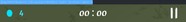

経験値メーター

- 画面上部にメーターが表示されており、ゲージが右端まで到達するとレベルが1上がる。
- 敵を倒したり、マナオーブや世界樹の果実を獲得したりすることで貯めることができる。

#### レベル

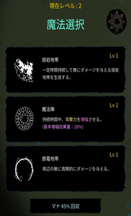

レベルアップ画面

- 1上がる毎に**魔法**の中からランダムに3つが選出されて、選択した魔法のレベルを1上げることができる。
  - 既に選んだことのある魔法が選ばれやすい。
  - 一部の**アーティファクト**(以下**AF**という)や**[クラス](classes.md)**、**[研究](research.md)**で4択にすることもできる。
- マナ回収を選択すると、レベルアップを見送って魔法の選択肢をリロールすることができる。
  - 選択時に経験値が一部戻ってくるが、その量は見送る毎に少なくなる。
    - 通常時の例:20%→10%→4%、そして4回目には必ずどれか選択しなければならない。
- レベル25、50、75に到達すると**魔法融合**可能回数がそれぞれ1回分ずつ増加し、レベルアップ時に右上のボタンから魔法融合を行うことができるようになる。

#### 魔法

- レベルアップによって習得することができる、プレイヤーの戦闘手段。
  - 詳しい説明は魔法ページに記載。

### ゴールド

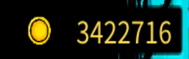

ゴールド

- ゲームオーバー時に獲得することができる。
- 敵を倒す、セルを取る、時間が経過することで加算されていく。
- 新たな[研究](research.md)を開放するのに必要。
- ジェムで買ったり、課金やAFで獲得量を増やしたりすることもできる。

#### 研究

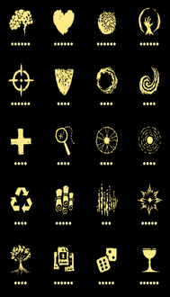

研究一覧

- ゴールドで購入したポイントを割り振ることで、ステータス等を強化した状態でゲームをスタートできる機能。
  - 詳しい説明は[研究](research.md)ページに記載。

### ジェム

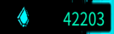

ジェム

- ゴールドと同様に獲得することができる。
- オベリスクの選択肢をリロールすることができる[^1]。
- ショップにて、**[クラス](classes.md)**のレベルを上げるガチャを引いたり、金と交換したりすることができる。
- 800ジェムを支払って**[実験体](test-subjects.md)**を1体解放することができる。

#### クラス

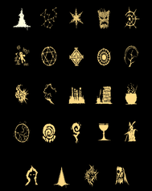

クラス一覧

- 特定の魔法を強化したり、特殊な能力を獲得したりした状態でゲームをスタートできる機能。
  - 詳しい説明は[クラス](classes.md)ページに記載。

#### 実験体

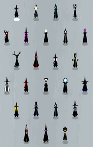

実験体一覧

- ある実験体を選択することにより、特定のアーティファクトを所持した状態でゲームをスタートできる機能。

また、実験体を解放するだけで特定のステータスを強化することも出来る。

- - 詳しい説明は[実験体](test-subjects.md)ページに記載。

### エリア

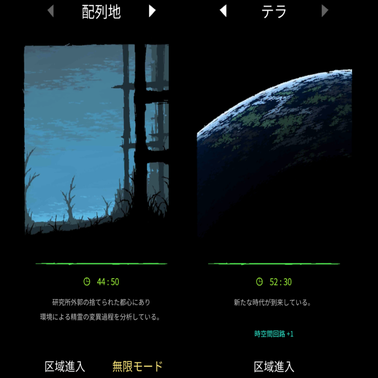

配列地　　　　　　　　　　　テラ

- [配列地](../stages/array.md)～[テラ(ハード)](terra-hard.md)まで全15個のエリア（区域）がある。
  - 一定時間の生存で強制的にクリアとなる区域侵入と、クリア判定となる時間を越えても死ぬまで続けられる無限モードがある[^2]。
    - 各エリアには初回クリア報酬があり、ジェムや[研究資料](classes.md)を獲得することができるほか、クリアしたエリアの無限モードが解放される。

#### ウェーブ

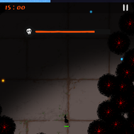

ウェーブ

- エリアごとにウェーブの開始時間が定められており、ウェーブ中は時間が経過しなくなる。
  - ウェーブが開始すると周囲が黒い領域に覆われ、それに触れるとダメージを受ける。
- 敵を一定数倒してゲージを削ることで攻略できる。
  - ボスモンスターがいる場合は、ボスモンスターも全て倒しきる必要がある。
- 攻略するとオベリスクが出現し、伝説AFを獲得することが出来る。
  - オベリスクが出現する数はエリアごとに固定されており、その数を超えると代わりに壊れたオベリスクが出現するようになる。

## アイテム

### オーブ

#### マナオーブ

- エリア侵入時や地形読み込み時の自然生成、物質錬成やミミックの効果、敵からのドロップによって出現する。
- 獲得することで、レベルアップに使用する経験値と、商人との取引で通貨として使用するマナオーブが手に入る。
  - 複数のグレードが存在し、それぞれ経験値やマナオーブの獲得量が異なる。
    - マナオーブ小の経験値獲得量を1とした時、中は1.5、大は3.5程度（要検証）

小

- 少ない量の経験値と1個のマナオーブを獲得可能。

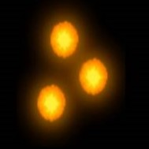

中

- 多い量の経験値と1個のマナオーブを獲得可能。

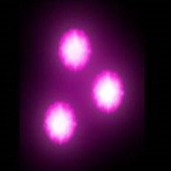

大

- 膨大な量の経験値と5個のマナオーブを獲得可能。

#### ライフオーブ

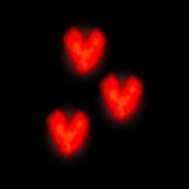

ライフオーブ

- hpを回復する。
  - **パッシブ魔法**や研究、AFやシナジーの効果によって回復量を増やすことができる。
- 物質錬成、ミミック、肉の効果や敵からのドロップによって出現する。

### 特殊効果

#### 世界樹の果実

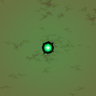

世界樹の果実

- 獲得するとHPが全回復[^3]し、莫大な量の経験値[^4]が手に入る。
  - [創造の扉](../magic/door-of-creation.md)、ミミック、世界樹の葉の効果や、ネメシス、アポストル[^5]からのドロップによって出現する。

#### ルーン

- 獲得すると様々な特殊効果が発動する。
- [創造の扉](../magic/door-of-creation.md)やミミックの効果、エリートモンスターからのドロップによって出現する。エリア侵入時に出現していることもある。
  - ルーンの効果のみを発動させるAFもある。

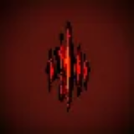

狂奔のルーン

- 攻撃力50%増幅、移動速度25%増加（持続時間：9秒）

無敵のルーン

- 無敵状態の継続（持続時間：9秒）

貪欲のルーン

- アイテム獲得半径200％増加（持続時間：5秒）

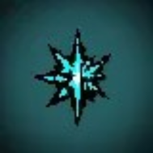

浄化のルーン

- 獲得時に一部の敵を除くフィールドのすべての敵を倒す。

#### セル

- ゴールドを獲得することができる。
  - 複数のグレードが存在し、それぞれ獲得できるゴールドの量が異なる。
- 創造の扉やミミックの効果、敵からのドロップによって出現する。

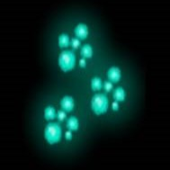

α

- 200前後のゴールドを獲得できる。

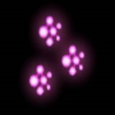

β

- 2000前後のゴールドを獲得できる。

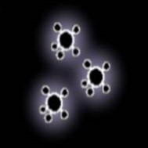

γ

- 10000前後のゴールドを獲得できる。

### AF関連

#### アーティファクト

- 獲得することで、ステータスの強化をはじめとした恩恵を受けられるアイテム。
  - 詳しい説明はアーティファクトページに記載。

#### シナジー

アイコン

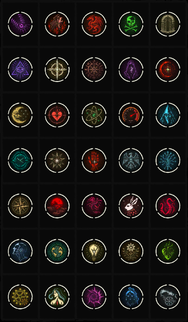

一覧

- 条件となるAFを全て獲得することによって自動で発動する追加効果。
  - 個々の性能、Tierはアーティファクトページに記載。
- 1つのAFが複数のシナジーの発動条件に含まれる場合もある。
- シナジーの発動によってAFが失われることはない。

#### 宝箱

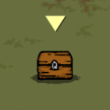

通常宝箱

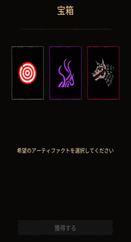

獲得画面

- AFを獲得可能。
  - 通常～特別等級のAFが選択肢としてランダムに3つ提示され、その中から1つを選択して獲得することができる。
- 敵のキル数、転移石の攻略、AFや魔法、シナジーの効果、クラスの能力など、様々な条件、方法によって出現する。

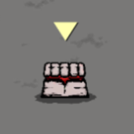

遺物箱

- 選択肢が全て特別AFによって構成される稀少な宝箱。
- 出現するかどうかはエリア侵入時点で決まっている。
  - AFによって出現させることも可能。
- リロールすることはできない。
- 出現確率は、1回のランにつき1回出現する程度。

#### オベリスク

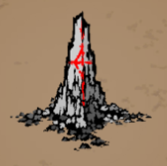

オベリスク

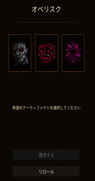

獲得画面

- ボスウェーブを攻略すると出現する、選択肢が全て**伝説AF**の宝箱。
  - エリアごとに出現する回数が決まっており、それを超えると壊れたオベリスクが代わりに出現するようになる。
- 獲得時に周囲のアイテムを回収する[^6]。
- ジェムでリロールすることができる。
  - 最大4回（50→100→150→200）

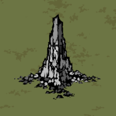

壊れたオベリスク

- 中身は通常のアーティファクトだが、選択肢が1つ多い。
  - ゴールドでリロールすることができる。
    - 最大4回（5000→10000→15000→20000）
- 獲得時に周囲のアイテムを回収する。

#### 転移石

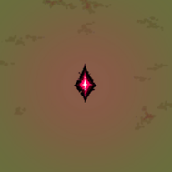

転移石

- 獲得するとエリートモンスターが多数出現し、一定時間内にそれらを全て倒すと宝箱が出現する。
- エリアごとに出現する時間が決まっている。

#### 商人

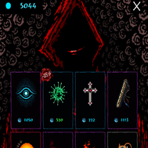

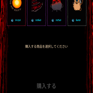

購入画面

- 獲得したマナオーブを通貨として、通常〜特別等級のAFを最大8個購入することができる。
  - 8個のうちランダムな1つは25%割引された状態で販売される。
- 1部のAF[^7]は出現しない。
- エリアごとに出現する時間が決まっている。
  - 出現するたびに販売価格が上昇する。
- 出現から40秒ほどが経過すると自動で発動する。発動までの猶予はゲージとして表示される。

## ステータス

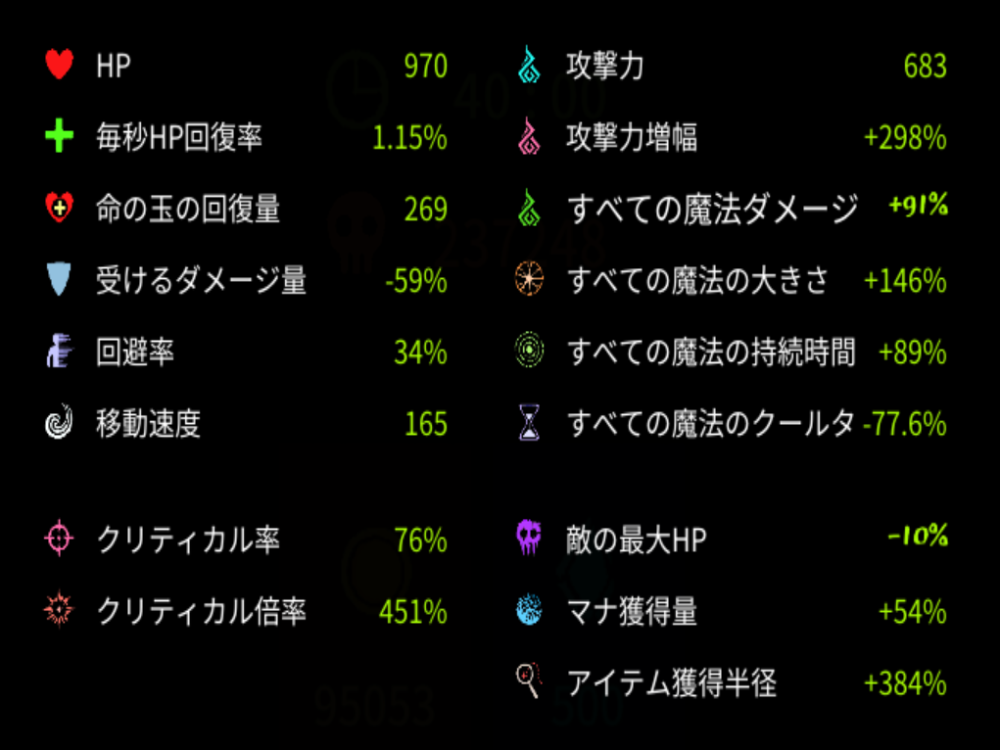

ステータス表示

| 各ステータス名称 | 説明 | 初期値 |
| --- | --- | --- |
| HP | 0になるとゲームオーバー | 200 |
| 1秒当たりのHP回復率 | 1秒毎に最大HPのx%を回復 | ±0% |
| ライフオーブの回復量 | ライフオーブの回復量係数 | 30(最大体力の15%分) |
| 受けるダメージ量 | 被ダメージを軽減する割合 | ±0% |
| 回避率 | 被ダメージを無効にする確率 | 0% |
| 移動速度 | プレイヤーの移動速度係数 | 100 |
| 攻撃力 | 威力係数 | 100 |
| 攻撃力増幅 | ダメージ倍率係数 | 0% |
| すべての魔法のダメージ | ダメージ倍率係数 | 0% |
| すべての魔法のサイズ | 魔法の効果範囲係数 | ±0% |
| すべての魔法の持続時間 | 魔法の持続時間係数 | 0% |
| すべての魔法のクールタイム | 魔法のクールダウン時間係数 | ±0% |
| クリティカル率 | 会心攻撃発生確率 | 3% |
| クリティカル倍率 | 会心攻撃威力係数 | 200% |
| 敵の最大HP | 敵最大HPの増減量係数 | 0% |
| マナ獲得量 | 経験値獲得量係数 | 0% |
| アイテム獲得半径 | アイテム獲得範囲係数 | 0% |

### 魔法の最終ダメージ

最終ダメージ＝攻撃力

×攻撃力増幅（％）

×魔法攻撃係数[^8]（％）

×魔法ダメージ増加率（％）×魔法ダメージ減少率（%）

×クラスによる追加ダメージ（%）（要検証）

×追加ダメージ増減率（％）

×クリティカル倍率（％）

- [参考ウェブページ](https://m.cafe.naver.com/ca-fe/web/cafes/30012128/articles/18001?tc=cafe_member_profile)
- [参考ウェブページ](https://m.cafe.naver.com/ca-fe/web/cafes/30012128/articles/24648?fromList=true&menuId=2&tc=cafe_article_list)

### 各種補正値計算方法

**検証中なのでしばらくお待ちください**

## モンスター

### ノーマルモンスター

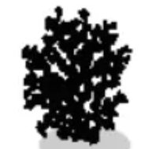

スウォーム

- スウォームを基本として、オーバロードやハウリング、ウィザードなど様々な種類が存在する。
  - 敵によって移動速度やサイズ、HPなど様々な違いがある。
- マナオーブ（小、中、大[^9]）、ライフオーブなどをドロップする。

### エリートモンスター

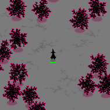

エリートモンスター

- 転移石の効果や時間の経過によってスポーンする、赤く縁取られた強力な敵。
- 通常敵よりHPが高く移動速度が速いうえ、状態異常と即死に対して50%の耐性を持つ。
- マナオーブ（中、大）、ライフオーブ、ルーンなどをドロップする。

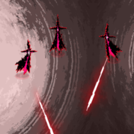

サーヴァント

- 投射体を発射するエリートモンスター。

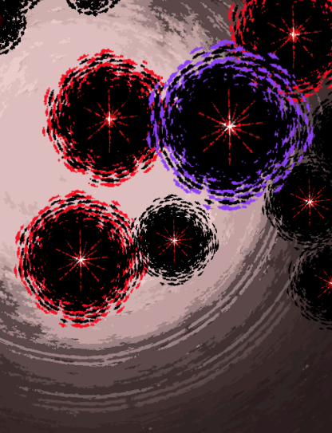

スーパーエリートモンスター

- 紫で縁取られた強力なエリートモンスター。
- 移動速度は遅いが、HPとサイズが強化されている。
- マナオーブをより多くドロップする(要検証、キル時の経験値のこと？)。

### ボスモンスター

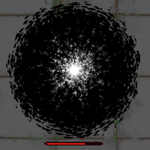

シタデル

- 時間の経過やウェーブの開始によってスポーンする。
- HPが高く、即死と状態異常に耐性を持つ[^10]。
- 死亡時に爆発を起こし、周囲の敵にダメージを与える。
- 複数個のマナオーブ（大）をドロップする。

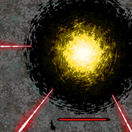

ネメシス

- ウェーブのボスとしてのみスポーンする。
- 複数の投射体を決まった方向に発射する。
- HPが高く、即死と状態異常に耐性を持つ。
- 死亡時に爆発を起こし、周囲の敵にダメージを与える。
- 世界樹の果実をドロップする。

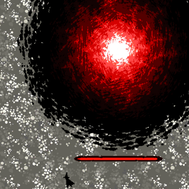

アポストル

- ウェーブのボスとしてのみスポーンする。
  - ネメシスの強化版。
- 大量の投射体を発射する。
- HPが高く、即死と状態異常に耐性を持つ。
- 死亡時に爆発を起こし、周囲の敵にダメージを与える。
- 世界樹の果実をドロップする。

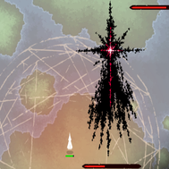

アマデウス

- ウェーブのボスとしてのみスポーンする。
- 投射体を発射する。
- HPが高く、即死と状態異常に耐性を持つが、移動しない。
- 世界樹の果実をドロップする。

[^1]: 1オベリスクにつき1回。リロール可能回数は2回で、1回目が50、2回目が100ジェム
[^2]: 仮想生態系、深層区域、テラは無限モードのみ。
[^3]: 生体シールドによる追加HPも回復する。
[^4]: マナオーブ大の数倍？　要検証
[^5]: ウェーブ中にボスとして出現する強力なモンスター
[^6]: テラの0秒時点で出現するオベリスクは、獲得してもアイテム回収の効果は発動しないが、代わりに大量の経験値を獲得することができる。
[^7]: フクロウ、タロットカード、ユニコーン、コイン、人工知能魔法、黄金のルーレット、花束
[^8]: 魔法のレベルを上げた際に増加するパラメータ。
[^9]: 超低確率？　要検証
[^10]: 浄化のルーンは有効
