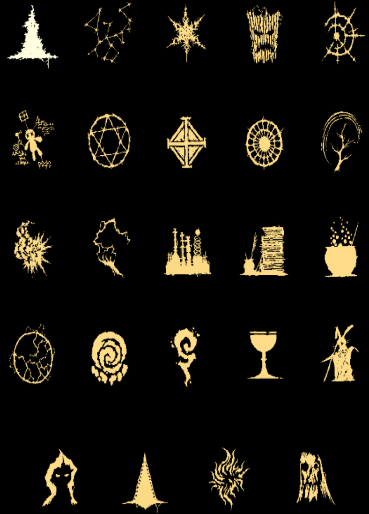
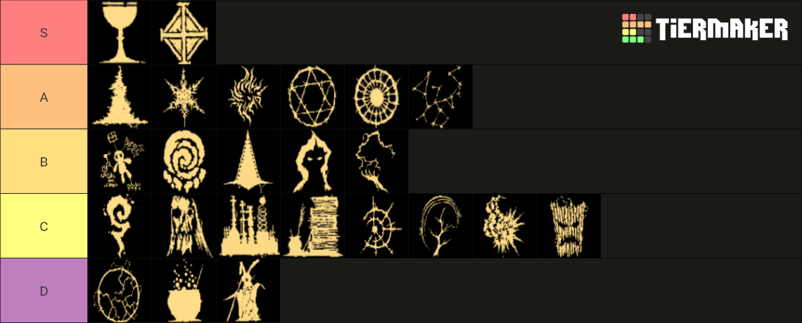

# クラス

**大体の疑問は[よくある質問](../guide/faq.md)で解決しますよ！**

## クラスについて

{ width="788" height="1096" }

操作するキャラクターはクラスによって性能が異なり、得意な魔法や固有の特殊能力を持っています。

各ステージの初回クリア報酬、または**ショップのガチャで研究資料を集めること**でさらに強化が可能です。

最大レベルで得られる能力は**他のクラスを使用しているときにも**有効になります。

下の表で強化による変化を記載しています。

(なお、初期2については『キャラクターレベルが3上がる毎に〇のダメージ量5%追加』という効果が多いので、該当するクラスについては『ダメージ量5%追加/3Lv』と省略させていただきます。)

また、ダメージ量の追加はクラス独自の数値であるため、他の数値に掛け算する形で計算されます。

例えば、100レベルの場合、魔法使いであれば1.6倍、魔道学者であれば2倍となります。

## クラス一覧

| 画像 | クラス名 | Tier | 優先度 | 初期1 | 初期2 | 強化1【データ×3で習得】 | 強化2【データ×6で習得】 | 強化3【データ×12で習得】 | 強化4(全役職に適用)【データ×24で習得】 |
| --- | --- | --- | --- | --- | --- | --- | --- | --- | --- |
| { width="40" height="40" } | 魔法使い | A | 1 | [魔力弾](../magic/magic-bolt.md)Lv+1 | ダメージ量5%追加/3Lv | 魔力弾Lv+1 | 魔力弾のクールタイム-20% | 魔力弾数+1 | 魔力弾のダメージ量+20% |
| { width="40" height="40" } | 天文学者 | A | 6 | [衛星](../magic/satellite.md)Lv+1 | ダメージ量5%追加/3Lv | 衛星Lv+1 | 衛星の回転速度+50% | 衛星数+35% | 衛星のダメージ量+20% |
| { width="40" height="40" } | 氷結師 | A | 2 | [霜柱](../magic/frost-nova.md)Lv+1 | ダメージ量5%追加/3Lv | 霜柱Lv+1 | 霜柱のクールタイム-20% | 霜柱のサイズ+25% | 霜柱のダメージ量+20% |
| { width="40" height="40" } | 呪術師 | C | 8 | [落雷](../magic/thunderstorm.md)Lv+1 | ダメージ量5%追加/3Lv | 落雷Lv+1 | 落雷のクールタイム-20% | 落雷数+35% | 落雷のダメージ量+20% |
| { width="40" height="40" } | ウォーロック | C | 5 | [隕石落下](../magic/meteor.md)Lv+1 | ダメージ量5%追加/3Lv | 隕石落下Lv+1 | 隕石落下のクールタイム-20% | 隕石落下数+1 | 隕石落下のダメージ量+20% |
| { width="40" height="40" } | 魔導学者 | B | 1 | [魔力弾](../magic/magic-bolt.md)Lv+1 | 全魔法のダメージ量1%追加/1Lv、魔法の選択肢-2、マナ回収が使用不可になる | 知能Lv+1 | マナ獲得量+10% | 攻撃力増幅+10% | 攻撃力+5% |
| { width="40" height="40" } | 召喚師 | A | 4 | [精霊](../magic/spirit.md)Lv+1 | ダメージ量5%追加/3Lv | 精霊Lv+1 | 精霊のクールタイム-20% | 精霊数+35% | 精霊のダメージ量+20% |
| { width="40" height="40" } | ビショップ | S | 2 | [魔力弾](../magic/magic-bolt.md)&[シールド](../magic/shield.md)Lv+1 | 攻撃力増幅値+10%/1有効シールド数 | 守護天使Lv+1 | シールドのクールタイム-20% | シールドの最大数+1 | 受けるダメージ量-5% |
| { width="40" height="40" } | 神秘術師 | A | 5 | [怪光線](../magic/arcane-ray.md)Lv+1 | ダメージ量5%追加/3Lv | 怪光線Lv+1 | 怪光線のクールタイム-20% | 怪光線数+35% | 怪光線のダメージ量+20% |
| { width="40" height="40" } | ドルイド | C | 6 | [つむじ風](../magic/cyclone.md)Lv+1 | ダメージ量5%追加/3Lv | つむじ風Lv+1 | つむじ風のクールタイム-20% | つむじ風の数+1 | つむじ風のダメージ量+20% |
| { width="40" height="40" } | 火炎術師 | C | 7 | [火炎球](../magic/fireball.md)Lv+1 | ダメージ量5%追加/3Lv | 火炎球Lv+1 | 火炎球のクールタイム-20% | 火炎球数+1 | 火炎球のダメージ量20% |
| { width="40" height="40" } | ソーサラー | B | 5 | [電気ショック](../magic/electric-shock.md)Lv+1 | ダメージ量5%追加/3Lv | 電気ショックLv+1 | 電気ショックのクールタイム-20% | 電気ショック数+35% | 電気ショックのダメージ量+20% |
| { width="40" height="40" } | 錬金術師 | C | 3 | [エネルギー弾](../magic/energy-bolt.md)Lv+1 | ダメージ量5%追加/3Lv | エネルギー弾Lv+1 | エネルギー弾のクールタイム-20% | エネルギー弾数+35% | エネルギー弾のダメージ量+20% |
| { width="40" height="40" } | 学者 | C | 4 | 初期レベル3増加 | 全魔法のダメージ量+1%/1Lv | 博士Lv+1 | マナ回収効果量+30% | 魔法選択肢の増加確率+50% | マナ獲得量+5% |
| { width="40" height="40" } | 魔女 | D | 2 | [溶岩地帯](../magic/lava-zone.md)Lv+1 | ダメージ量5%追加/3Lv | 溶岩地帯Lv+1 | 溶岩地帯のクールタイム-20% | 溶岩地帯の数+1 | 溶岩地帯のダメージ量+20% |
| { width="40" height="40" } | 電荷術師 | D | 1 | [感電地帯](../magic/electric-zone.md)Lv+1 | ダメージ量5%追加/3Lv | 感電地帯Lv+1 | 感電地帯のダメージ間隔-20% | 感電地帯のサイズ+25% | 感電地帯のダメージ量+20% |
| { width="40" height="40" } | 調律者 | B | 2 | [津波](../magic/tsunami.md)Lv+1 | ダメージ量5%追加/3Lv | 津波Lv+1 | 津波のクールタイム-20% | 津波の数+35% | 津波のダメージ量+20% |
| { width="40" height="40" } | 大魔法使い | C | 1 | 初期レベル3増加 | 融合魔法のダメージ+50% | 魔法陣Lv+1 | 無言詠唱Lv+1 | 融合魔法のダメージ量+50% | すべての魔法のクールタイム-3% |
| { width="40" height="40" } | 考古学者 | S | 1 | [魔力弾](../magic/magic-bolt.md)Lv+1 | Lv+20毎に近くに宝箱を生成する | 探索Lv+1 | マナ獲得量+10% | 宝箱ドロップ率+10% | アイテム獲得半径+20% |
| { width="40" height="40" } | 魔術師 | D | 3 | [魔力弾](../magic/magic-bolt.md)Lv+1 | 20%の確率で魔力弾がランダム投射体に変化する | 魔力弾Lv+1 | 変化確率+5% | 変化確率+5% | クリティカル率+3% |
| { width="40" height="40" } | メイジ | B | 4 | [吹雪](../magic/blizzard.md)Lv+1 | ダメージ量5%追加/3Lv | 吹雪Lv+1 | 吹雪のクールタイム-20% | 吹雪の数+35% | 吹雪のダメージ量+20% |
| { width="40" height="40" } | 戦闘魔法使い | B | 3 | [閃光ショック](../magic/flash-shock.md)Lv+1 | ダメージ量5%追加/3Lv | 閃光ショックLv+1 | 閃光ショックのクールタイム-20% | 閃光ショックのサイズ+25% | 閃光ショックのダメージ量+20% |
| { width="40" height="40" } | ウォーロード | A | 3 | [焼却](../magic/incineration.md)Lv+1 | ダメージ量5%追加/3Lv | 焼却Lv+1 | 焼却のクールタイム-20% | 焼却のサイズ+25% | 焼却のダメージ量+20% |
| { width="40" height="40" } | 黒魔法使い | C | 2 | [魔力弾](../magic/magic-bolt.md)Lv+1 | 10%の確率で倒した敵が爆発する(爆発ダメージ量は敵の最大HPの75%) | 魔力発散Lv+1 | 爆発確率+5% | 爆発確率+5% | すべての魔法のサイズ+3% |

{ width="1140" height="460" }
