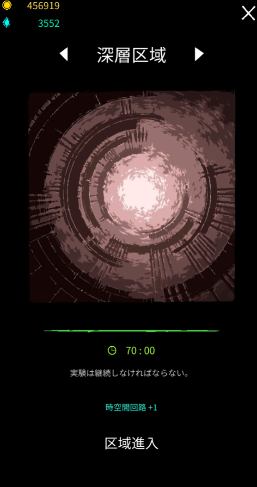
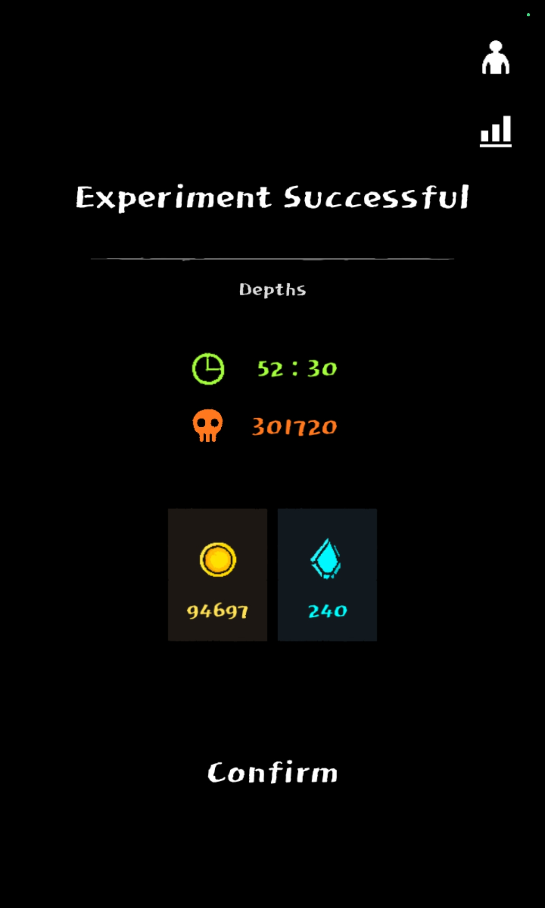
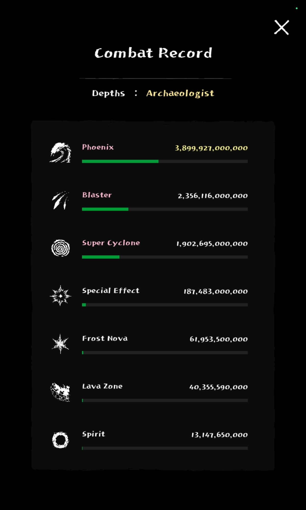
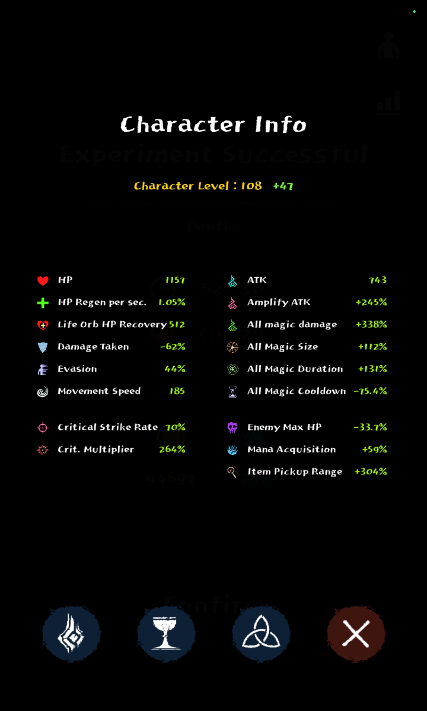
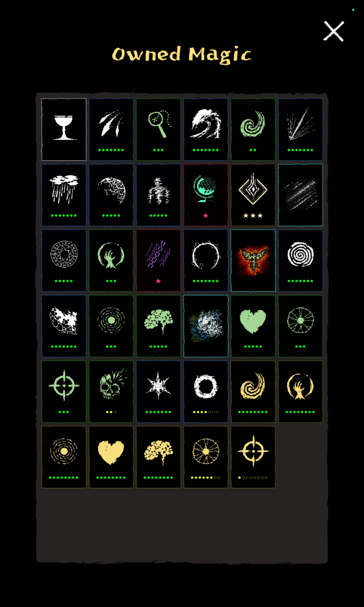
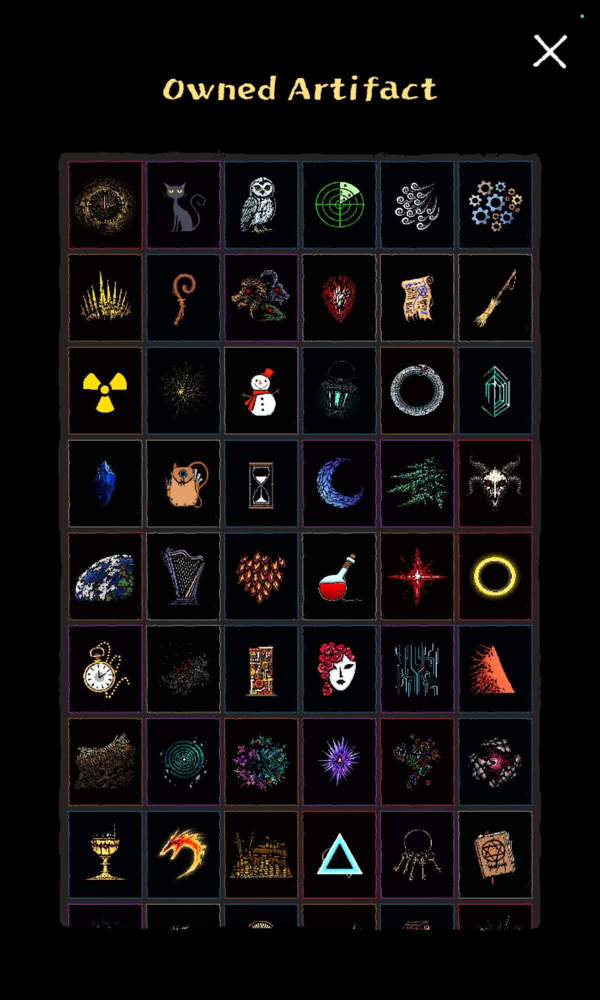
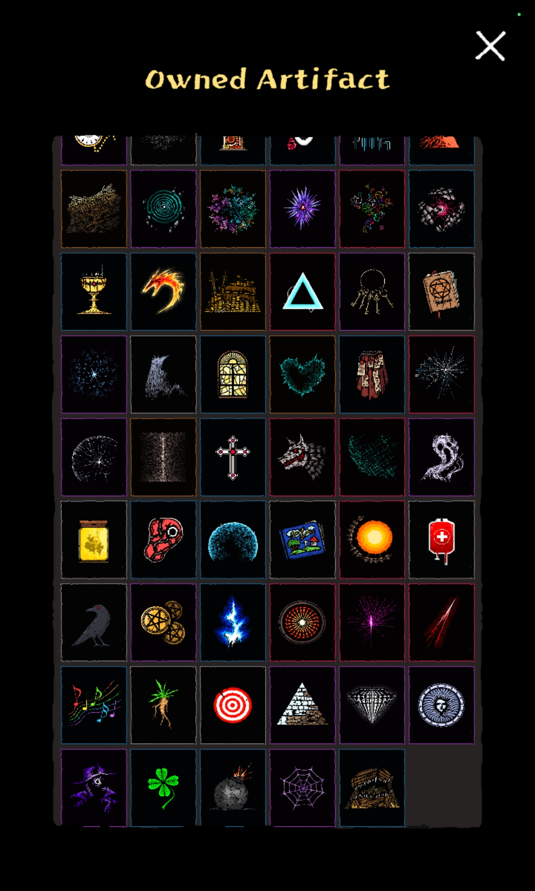
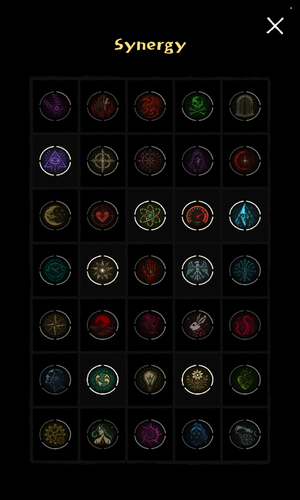

# 深層区域

**大体の疑問は[よくある質問](../guide/faq.md)で解決しますよ！**

現在更新作業中…

{ width="556" height="1052" }

## 攻略(最新環境)

### v0.982

### v0.964

### 開始〜2分半のウェーブまで

クールタイムの短い魔法([魔力弾](../magic/magic-bolt.md)Lv4以上、精霊、[電気ショック](../magic/electric-shock.md)、[感電地帯](../magic/electric-zone.md)等)を複数揃えていれば、ここでやられる事は無いだろう。

### 2分半〜7分半のウェーブまで

Lv7の魔法を複数揃えたり、融合魔法を作る等すれば良いだろう。4分辺りで出現する商人からAFを買うことも忘れずに｛なるべくマナを集めてから(700ほど)買うと良いが、欲張り過ぎてタイミングを逃す事の無いように〘n敗〙｝。

### 7分半〜12分半まで

癒し区間。余程変なビルドで走っていない限りやられないだろう。9分からの商人さんを忘れずにね。

### 12分半〜15分まで

最初の再走判断基準時間。この時点で必須伝説AF5つ(詳細は参考記録を参照)が揃っていなければ再走するべきだろう。商人の販売価格も高くなってくるので、AF購入は吟味の上でどうぞ。

### 17分半〜25分のウェーブ終了まで

この時点で必須伝説AF5つが揃っていなければ再走。また、一部の弱い融合魔法(魔法のtier表でご確認下さい)では25分のウェーブは突破出来ない。高頻度に攻撃する融合、広範囲に攻撃する融合どちらも取得しておくのがおすすめ(セオリーガン無視で[融合を1つも取らないプレイ](../builds/no-fusion-run.md)でも突破は出来るが、未来は無い)。

### 25分〜37分半ウェーブ終了まで

25分のウェーブを突破したビルドなら、大抵37分までは楽にいけるだろう。問題は37分半のウェーブ。圧倒的な足切りウェーブであり、生半可なビルドの通過を許さない。融合魔法tier表のA〜Sランクの融合を1つ、2つは入れておく事をおすすめする。また、これまでのウェーブは立ち回りを拘る必要は無かったが、ここからはいつルーンを使うか、敵の群れをどう避けるか等、考えて動く必要がある。

何度も挑戦しても突破出来ない時はまずビルドを省みて、次に立ち回りを省みて、何故失敗したのかを明文化出来る様になっておけば、来る47分半という壁にも自分の好きなビルドで立ち向かっていける様になるだろう(参考記録のビルドをそっくりそのまま真似するのも１つの手)。

### 37分半〜45分ウェーブ終了まで

37分半を突破したビルドであっても油断の出来ない区間。火力不足やクールタイム減少値の低さ等、ステータスの不足を咎めてくる。ステ向上系のAFが揃っていなければ、潔く再走するのも視野に入る。逆に、ステータスが整っていれば、ここまではまだ楽な区間だろう。

### 45分〜47分半ウェーブ終了まで

普通にテラ40よりつらい。

3融合での突破はかなりPS要求高いのでおすすめしない。

アバター(派生は花火)デウスエクスマキナが楽らしい。

動画はこちら→<https://youtu.be/fAtOrs5OmFE?feature=shared>

それはそれとしてatomonは3融合でこえたので、3融合の立ち回りを解説する。

例のごとく、契約の箱のクールタイムを争う時間。

所謂"VT"(VTについての解説はここ　[テラ](terra.md))が始まるわけだがテラ40のそれとは違って、敵の攻撃は痛いわ自分の攻撃は通らないわで大変。

しっかり敵避けしていかないとすぐ力場を吐き出すことになって、どうにもならなくなる。

ワンダーランド持っていればかなり楽になると思うので、そこを目指してみると良いんじゃなかろうか。

ビルド例貼っておくので、参考までに。

<iframe class="video" src="https://www.youtube.com/embed/fAtOrs5OmFE" allowfullscreen loading="lazy"></iframe>

---

貰える報酬や生存の簡単さを考えれば、深層区域で47より先に行く意味はないけどね。

## 旧環境

| + | v0.958 | v0.958開始〜2分半のウェーブまで クールタイムの短い魔法([魔力弾](../magic/magic-bolt.md)Lv4以上、精霊、[電気ショック](../magic/electric-shock.md)、[感電地帯](../magic/electric-zone.md)等)を複数揃えていれば、ここでやられる事は無いだろう。 2分半〜7分半のウェーブまで Lv7の魔法を複数揃えたり、融合魔法を作る等すれば良いだろう。4分辺りで出現する商人からAFを買うことも忘れずに｛なるべくマナを集めてから(700ほど)買うと良いが、欲張り過ぎてタイミングを逃す事の無いように〘n敗〙｝。 7分半〜12分半まで 癒し区間。余程変なビルドで走っていない限りやられないだろう。9分からの商人さんを忘れずにね。 12分半〜15分まで 最初の再走判断基準時間。この時点で必須伝説AF5つ(詳細は参考記録を参照)が揃っていなければ再走するべきだろう。商人の販売価格も高くなってくるので、AF購入は吟味の上でどうぞ。 17分半〜25分のウェーブ終了まで この時点で必須伝説AF5つが揃っていなければ再走。また、一部の弱い融合魔法(魔法のtier表でご確認下さい)では25分のウェーブは突破出来ない。高頻度に攻撃する融合、広範囲に攻撃する融合どちらも取得しておくのがおすすめ(セオリーガン無視で[融合を1つも取らないプレイ](../builds/no-fusion-run.md)でも突破は出来るが、未来は無い)。 25分〜37分半ウェーブ終了まで 25分のウェーブを突破したビルドなら、大抵37分までは楽にいけるだろう。問題は37分半のウェーブ。圧倒的な足切りウェーブであり、生半可なビルドの通過を許さない。融合魔法tier表のA〜Sランクの融合を1つ、2つは入れておく事をおすすめする。また、これまでのウェーブは立ち回りを拘る必要は無かったが、ここからはいつルーンを使うか、敵の群れをどう避けるか等、考えて動く必要がある。   何度も挑戦しても突破出来ない時はまずビルドを省みて、次に立ち回りを省みて、何故失敗したのかを明文化出来る様になっておけば、来る47分半という壁にも自分の好きなビルドで立ち向かっていける様になるだろう(参考記録のビルドをそっくりそのまま真似するのも１つの手)。 37分半〜45分ウェーブ終了まで 37分半を突破したビルドであっても油断の出来ない区間。火力不足やクールタイム減少値の低さ等、ステータスの不足を咎めてくる。ステ向上系のAFが揃っていなければ、潔く再走するのも視野に入る。逆に、ステータスが整っていれば、ここまではまだ楽な区間だろう。 45分〜47分半ウェーブ終了まで **持ち物検査のお時間**。必須伝説AFはもちろん、おもちゃの城(以下城)無しでの突破は非常に困難。よしんば突破しても50分のウェーブでは更に城の重要性が高まるので、城無しでの突破には未来が無い。また、移動速度は160を超えていなければ敵から逃げるのが大変。契約の箱による敵全撃破の効果以外でウェーブを時間を進めるのも非常に困難なので、お祈りゲーであることを覚悟しておこう。どうしたって突破に10分以上かかるので、気長に耐久しよう(霊魂、力場、生体シールド等のAF無しでの耐久はとても辛いので、しっかり取っておこう)。   また、47分半ウェーブ以降、[幽体化](../magic/cloaking.md)や[シールド](../magic/shield.md)等を駆使して契約の箱のクールタイム開けまで延命する立ち回りが必要となる。参考動画を載せておくので、立ち回りに悩んでいる時は参考にしてみてほしい。   → <iframe class="video" src="https://www.youtube.com/embed/PoUZz09ShGU" allowfullscreen loading="lazy"></iframe>  47分半ウェーブ終了後〜52分半のウェーブ前 癒し区間。47分半のウェーブを突破したビルドでやられる事は無いだろう。 52分半〜55分ウェーブ終了まで ステータス、AF共に高水準である必要がある。その上、契約の箱ガチャの出目次第では突破出来ない区間なので、失敗しても「運ゲーに負けただけだし」と割り切ろう。   ちなみに、商人さんが出現するのはこの区間が最後である。 55分ウェーブ終了後～67分半ウェーブ終了まで **二度目の持ち物検査のお時間**。   平和条約をもっていない場合は突破できない。また、平和条約を持っていても、契約の箱が青ルーンあるいは白ルーンを発動し続けなければ突破は難しい。とにかく祈ろう。 67分半ウェーブ終了後～70分まで 終着点。正規の手段ではどうやってもここから先へはいけない。   🚙運転お疲れ様でした。ナビゲートを終了します。 |
| --- | --- | --- |
