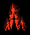
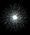
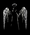
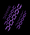
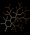
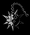

# 魔法(紹介&tier)

**大体の疑問は[よくある質問](../guide/faq.md)で解決しますよ！**

解決しなければこっちまで初心者向け情報まとめ

魔法のtier議論はこちらでしています > <https://discord.gg/w7XCY2nY>

初心者かどうか,アンケート実施中! > <https://forms.gle/RUKgiSCvaE2LHMdN7>

wiki内記事へのご意見・ご要望はdiscordにて受付中です。

## 魔法の種類について

- このゲームの魔法は、**戦闘魔法**(アクティブ魔法)と**強化魔法**(パッシブ魔法)の2つに分けられます。
  - **戦闘魔法**は敵との戦闘に直接関わる魔法です。一部を除いてクールタイムが存在します。レベルを最大にすると3種の派生から1種を選択できます。
    - **攻撃魔法**は敵にダメージを与える魔法です。
    - **補助魔法**は戦闘の効率を高めるさまざまな特殊効果を発生させる魔法です。
  - **強化魔法**はキャラクターのステータスや戦闘魔法の効果を強化します。クールタイムはなく、ゲーム中は常に効果を発揮します。
    - **通常強化魔法**は、キャラクターの基本ステータスを強化する魔法です。
    - **特殊強化魔法**は、複数のステータスを強化する、特定の魔法のみを大幅に強化する、特殊な能力を獲得するといった魔法です。
    - **成長強化魔法**は通常強化魔法と同様に、キャラクターの基本ステータスを強化する魔法ですが、効果は低くなっています(調査中)。**最大レベル到達後はこの魔法しか習得できなくなります。**
    - プレイヤーの基本最大レベルは100で、アーティファクトや、特殊パッシブ魔法、融合魔法等で増やす事ができます。

## 戦闘魔法 | アクティブ魔法

### 攻撃魔法

- 最大レベルは7です。また、最大レベル到達時に派生効果を獲得できます。
- 個人的TIer表では各魔法の進化先について、**E**~**S**まで評価しました。
  - **S**,**A**のみ色を付けました。
  - **E/D**の魔法は基本的に使用せずにビルド構築をしています。
- 注意事項
  - あくまで管理人や編集者個人(2026/05/28時点でatomon)の意見です。
  - Tierは、対応アーティファクト(以下**AF**)取得時の評価です。
  - ビルドとして使用する際の強さで評価しています。
    - 何らかの構成に入れ込むことを前提にしています。
  - 以下は**融合を考えない**時の評価です.

| 魔法名 | 特性 | tier | 対応アーティファクト |
| --- | --- | --- | --- |
| [魔力弾](../magic/magic-bolt.md) | 魔力の矢 | B | 魔術の弾丸、手裏剣、エーテルの矢、魔弾の射手 |
| [魔力弾](../magic/magic-bolt.md) | 花火 | C | 魔術の弾丸、手裏剣、エーテルの矢、魔弾の射手 |
| [魔力弾](../magic/magic-bolt.md) | 分裂 | D | 魔術の弾丸、手裏剣、エーテルの矢、魔弾の射手 |
| [魔力弾](../magic/magic-bolt.md) | 連続詠唱 | D | 魔術の弾丸、手裏剣、エーテルの矢、魔弾の射手 |
| [魔力弾](../magic/magic-bolt.md) | 乱射 | C | 魔術の弾丸、手裏剣、エーテルの矢、魔弾の射手 |
| [魔力弾](../magic/magic-bolt.md) | ドッペルゲンガー | B | 魔術の弾丸、手裏剣、エーテルの矢、魔弾の射手 |
| [火炎球](../magic/fireball.md) | 大爆発 | D | たいまつ、大釜、フェニックスの弓、燭台 |
| [火炎球](../magic/fireball.md) | 毒ガス | C | たいまつ、大釜、フェニックスの弓、燭台 |
| [火炎球](../magic/fireball.md) | 星座 | E | たいまつ、大釜、フェニックスの弓、燭台 |
| [落雷](../magic/thunderstorm.md) | 晴天の霹靂 | C | 避雷針、雷、ミョルニル |
| [落雷](../magic/thunderstorm.md) | 雷爆発 | C | 避雷針、雷、ミョルニル |
| [落雷](../magic/thunderstorm.md) | 審判 | C | 避雷針、雷、ミョルニル |
| [隕石落下](../magic/meteor.md) | 火山爆発 | C | 天体カレンダー、パンドラの箱、大釜、次元の扉、燭台 |
| [隕石落下](../magic/meteor.md) | 流星群 | D | 天体カレンダー、パンドラの箱、大釜、次元の扉、燭台 |
| [隕石落下](../magic/meteor.md) | 小惑星 | C | 天体カレンダー、パンドラの箱、大釜、次元の扉、燭台 |
| [つむじ風](../magic/cyclone.md) | 気象異変 | B | トーテム、パンドラの箱、気象調節器、芭蕉扇 |
| [つむじ風](../magic/cyclone.md) | 電気球体 | B | トーテム、パンドラの箱、気象調節器、芭蕉扇 |
| [つむじ風](../magic/cyclone.md) | ボイド | E | トーテム、パンドラの箱、気象調節器、芭蕉扇 |
| [電気ショック](../magic/electric-shock.md) | 連鎖する雷 | B | 避雷針、雷、ケーブル |
| [電気ショック](../magic/electric-shock.md) | 高出力 | C | 避雷針、雷、ケーブル |
| [電気ショック](../magic/electric-shock.md) | 超伝導 | C | 避雷針、雷、ケーブル |
| [エネルギー弾](../magic/energy-bolt.md) | 荷電粒子 | D | 魔法工学モジュール、魔力の宝珠、機械の腕、鏡 |
| [エネルギー弾](../magic/energy-bolt.md) | スパーク | E | 魔法工学モジュール、魔力の宝珠、機械の腕、鏡 |
| [エネルギー弾](../magic/energy-bolt.md) | フレア | D | 魔法工学モジュール、魔力の宝珠、機械の腕、鏡 |
| [焼却](../magic/incineration.md) | 火炎強打 | B | たいまつ、サラマンダー、大釜、龍の息吹 |
| [焼却](../magic/incineration.md) | 放火魔 | **S** | たいまつ、サラマンダー、大釜、龍の息吹 |
| [焼却](../magic/incineration.md) | ケルベロスの炎 | C | たいまつ、サラマンダー、大釜、龍の息吹 |
| [吹雪](../magic/blizzard.md) | 極寒期 | **S** | 雪だるま、気象調節器、雪花の冠、スカディ |
| [吹雪](../magic/blizzard.md) | 流れ星 | D | 雪だるま、気象調節器、雪花の冠、スカディ |
| [吹雪](../magic/blizzard.md) | 火災 | E | 雪だるま、気象調節器、雪花の冠、スカディ |
| [津波](../magic/tsunami.md) | 極点 | **A** | パンドラの箱、気象調節器、萬波息笛、キメラ |
| [津波](../magic/tsunami.md) | セイレーンの歌 | E | パンドラの箱、気象調節器、萬波息笛、キメラ |
| [津波](../magic/tsunami.md) | 大噴火 | E | パンドラの箱、気象調節器、萬波息笛、キメラ |
| [精霊](../magic/spirit.md) | 魔法ミサイル | C | 蛍、手裏剣、ワンド、エーテルの矢、魔力の宝珠、鏡 |
| [精霊](../magic/spirit.md) | 魔力の刃 | C | 蛍、手裏剣、ワンド、エーテルの矢、魔力の宝珠、鏡 |
| [精霊](../magic/spirit.md) | 使い魔 | C | 蛍、手裏剣、ワンド、エーテルの矢、魔力の宝珠、鏡 |
| [衛星](../magic/satellite.md) | 反重力 | E | ガラス玉、電磁石、コアエネルギー、魔力の宝珠、丸のこ、鏡 |
| [衛星](../magic/satellite.md) | 鬼火 | E | ガラス玉、電磁石、コアエネルギー、魔力の宝珠、丸のこ、鏡 |
| [衛星](../magic/satellite.md) | 核融合 | B | ガラス玉、電磁石、コアエネルギー、魔力の宝珠、丸のこ、鏡 |
| [怪光線](../magic/arcane-ray.md) | 反射 | B | 水晶プリズム、異界の触手、魔力の宝珠、鏡 |
| [怪光線](../magic/arcane-ray.md) | 破壊光線 | C | 水晶プリズム、異界の触手、魔力の宝珠、鏡 |
| [怪光線](../magic/arcane-ray.md) | 電磁波放射 | B | 水晶プリズム、異界の触手、魔力の宝珠、鏡 |
| [感電地帯](../magic/electric-zone.md) | 電荷放出 | E | バッテリー、電磁石、雷、ロボット |
| [感電地帯](../magic/electric-zone.md) | EMP | B | バッテリー、電磁石、雷、ロボット |
| [感電地帯](../magic/electric-zone.md) | 火のオーラ | E | バッテリー、電磁石、雷、ロボット |
| [霜柱](../magic/frost-nova.md) | 絶対零度 | **S** | 雪だるま、ムーンクリスタル、気象調節器、スカディ |
| [霜柱](../magic/frost-nova.md) | 氷河期 | B | 雪だるま、ムーンクリスタル、気象調節器、スカディ |
| [霜柱](../magic/frost-nova.md) | 地震 | C | 雪だるま、ムーンクリスタル、気象調節器、スカディ |
| [溶岩地帯](../magic/lava-zone.md) | 融解 | E | サラマンダー、大釜、硫黄、キメラ |
| [溶岩地帯](../magic/lava-zone.md) | 噴火口 | E | サラマンダー、大釜、硫黄、キメラ |
| [溶岩地帯](../magic/lava-zone.md) | マグマ噴出 | E | サラマンダー、大釜、硫黄、キメラ |
| [閃光ショック](../magic/flash-shock.md) | 殲滅 | C | 雷、ゲイ・ボルグ、キメラ |
| [閃光ショック](../magic/flash-shock.md) | ラグナロク | C | 雷、ゲイ・ボルグ、キメラ |
| [閃光ショック](../magic/flash-shock.md) | 悪魔の爪 | D | 雷、ゲイ・ボルグ、キメラ |

### 補助魔法

- 最大レベルは5です。また、最大レベル到達時に派生効果を獲得できます。
- 個人的TIer表では各魔法の進化先について、**E**~**S**まで評価しました。
  - **S**,**A**のみ色を付けました。
  - **E/D**の魔法は基本的に使用せずにビルド構築をしています。
- 注意事項
  - あくまで管理人や編集者個人(2025/4/5時点でatomon)の意見です。
  - ビルドとして使用する際の強さで評価しています。
    - 何らかの構成に入れ込むことを前提にしています。
  - 以下は**融合を考えない**時の評価です.

| 魔法名 | 特性 | tier | 対応アーティファクト |
| --- | --- | --- | --- |
| [シールド](../magic/shield.md) | バリア | **A** | 無し |
| [シールド](../magic/shield.md) | 再構築 | **S** | 無し |
| [シールド](../magic/shield.md) | 破壊場 | D | 無し |
| [幽体化](../magic/cloaking.md) | 蜃気楼 | **S** | 無し |
| [幽体化](../magic/cloaking.md) | 空間歪曲 | C | 無し |
| [幽体化](../magic/cloaking.md) | 魂収穫 | D | 無し |
| [魔法陣](../magic/magic-circle.md) | 魔力開放 | **S** | 古木の杖 |
| [魔法陣](../magic/magic-circle.md) | 物質錬成 | D | 古木の杖 |
| [魔法陣](../magic/magic-circle.md) | 大魔法陣 | D | 古木の杖 |
| [アルマゲドン](../magic/armageddon.md) | アポカリプス | B | 無し |
| [アルマゲドン](../magic/armageddon.md) | 携挙 | B | 無し |
| [アルマゲドン](../magic/armageddon.md) | 終末の予言 | **S** | 無し |

## 強化魔法 | パッシブ魔法

### 通常強化魔法

- 特定のステータスを強化するパッシブ魔法です。
- 使用中の融合魔法次第で大きく評価が異なるので、tier表はありません。
  - ただし、多くのビルドで有用な魔法は色を変えています。
  - atomonによる独断と偏見に基づいていることにはご留意ください。

| 魔法名 | 最大Lv | 効果 |
| --- | --- | --- |
| 上級魔法 | 3 | 全ての魔法のダメージ+15% |
| **知能** | 5 | 攻撃力+10% |
| **高速発動** | 3 | クールダウン-5% |
| **生命力** | 5 | 最大HP+20% ライフオーブの回復量+10% |
| **加速** | 2 | 移動速度+10% |
| 魔力発散 | 3 | 魔法の大きさ+5% |
| 集中 | 3 | 魔法の持続時間+10% |
| **狙撃** | 3 | クリティカル率+5% |
| 探索 | 3 | アイテム獲得範囲+33% |
| 破裂 | 3 | クリティカル倍率+15% |

### 特殊強化魔法

- 特殊な効果を持つ強力なパッシブ魔法です。
  - プレイごとに出現するレベルが決まっており、最大で十数回出現します。
    - アーティファクト**「ユニコーン」**からも入手する事ができます。
    - マナ回収時は出現しません。
  - atomonによる独断と偏見に基づいていることにはご留意ください。

| 画像 | 魔法名 | Tier | 効果 |
| --- | --- | --- | --- |
|  | 火の支配者 | E | [火炎球](../magic/fireball.md)、[隕石落下](../magic/meteor.md)、[焼却](../magic/incineration.md)、[溶岩地帯](../magic/lava-zone.md)のダメージ+25% |
|  | 雷雲 | E | [落雷](../magic/thunderstorm.md)、[電気ショック](../magic/electric-shock.md)、[感電地帯](../magic/electric-zone.md)、[閃光ショック](../magic/flash-shock.md)のダメージ+25% |
|  | 自然の怒り | E | [つむじ風](../magic/cyclone.md)、[吹雪](../magic/blizzard.md)、[津波](../magic/tsunami.md)、[霜柱](../magic/frost-nova.md)のダメージ+25% |
|  | エネルギー工学 | E | [エネルギー弾](../magic/energy-bolt.md)、[怪光線](../magic/arcane-ray.md)、[精霊](../magic/spirit.md)、[衛星](../magic/satellite.md)のダメージ+25% |
|  | アルカナ | E | 攻撃力+15% |
|  | 守護天使 | **S** | 復活できる回数+1、最大HP+30% |
|  | 無言詠唱 | **S** | すべての魔法クールタイム-7% |
|  | 戦争魔法 | E | 攻撃力+8%、すべての魔法サイズ+8% |
|  | タイムキーパー | **S** | ルーン効果時間&すべての魔法持続時間+12% |
|  | 開拓者 | **S** | 移動速度+3%、アイテム獲得半径+50% |
|  | 強打 | E | クリティカル倍率+30% |
|  | 封印 | **S** | すべての敵の移動速度-8% |
|  | 呪い | D | すべての敵の最大HP-6% |
|  | チャクラ | E | すべての魔法ダメージ+20% |
|  | マナ工場 | **S** | マナビーズのドロップ率+20% |
|  | 博士 | D | 最大レベル+3 |
|  | 血魔法 | E | 攻撃力増幅+10%、毎秒体力回復率-0.25% |
|  | アドレナリン | **S** | 攻撃力&クリティカル率&移動速度+5% |
|  | ジャガーノート | **A** | 攻撃力+10%、受けるダメージ-15% |
|  | プリースト | C | すべての敵の最大HP-3%、毎秒体力回復率+0.3% |
|  | エルドリッチ | D | エリートモンスターの最大HP-10% |
|  | ノーブレス | **S** | 近くに通常宝箱を1つ作成する |
|  | 道士 | B | 全ての成長強化魔法を1レベルずつ獲得する |
|  | フローリスト | **S** | 商人が販売するすべての商品が7%割引される |
|  | エンチャント | C | 戦闘魔法を1つ選択し、選択した魔法を強化する |

#### エンチャント

- 攻撃魔法を1つ選択し、そのダメージと特定のステータスを1つ強化するパッシブ魔法です。
  - プレイごとに出現するレベルが決まっており、2~3回出現します。
    - マナ回収時は出現しません。

| 魔法名 | 効果 |
| --- | --- |
| 魔力弾 | 魔力弾のダメージ+50%、クールタイム-5% |
| 火炎球 | 火炎球のダメージ+50%、サイズ+10% |
| 精霊 | 精霊のダメージ+50%、クールタイム-5% |
| 衛星 | 衛星のダメージ+50%、回転速度+25% |
| 霜柱 | 霜柱のダメージ+50%、サイズ+10% |
| 落雷 | 落雷のダメージ+50%、クールタイム-5% |
| 津波 | 津波のダメージ+50%、クールタイム-5% |
| 焼却 | 焼却のダメージ+50%、クールタイム-5% |
| 吹雪 | 吹雪のダメージ+50%、クールタイム-5% |
| 感電地帯 | 感電地帯のダメージ+50%、サイズ+10% |
| 隕石落下 | 隕石落下のダメージ+50%、クールタイム-5% |
| つむじ風 | つむじ風のダメージ+50%、持続時間+15% |
| 電気ショック | 電気ショックのダメージ+50%、クールタイム-5% |
| エネルギー弾 | エネルギー弾のダメージ+50%、サイズ+10% |
| 怪光線 | 怪光線のダメージ+50%、クールタイム-5% |
| 溶岩地帯 | 溶岩地帯のダメージ+50%、クールタイム-5% |
| 閃光ショック | 閃光ショックのダメージ+50%、クールタイム-5% |

### 成長強化魔法

- 最大レベル到達後に習得することができるパッシブ魔法です。
  - 最大で50レベルまで習得することができ、シナジー効果**「ジーニアス」**で増やす事ができます。
- 使用中の融合魔法次第で評価が異なるので、tier表はありません。
  - ただし、すべてのビルドで有用な魔法は色を変えています。
  - atomonによる独断と偏見に基づいていることにはご留意ください。

| 魔法名 | 最大Lv | 効果 |
| --- | --- | --- |
| **知能** | 8 | 攻撃力+3% |
| **高速詠唱** | 8 | クールタイム-1% |
| **生命力** | 8 | 最大HP+10% |
| **加速** | 8 | 移動速度+2% |
| 魔力発散 | 8 | 魔法の大きさ+2% |
| **集中** | 8 | 魔法の持続時間+3% |
| **狙撃** | 8 | クリティカル率+1% |
| 探索 | 8 | アイテム獲得範囲+10% |
| 破裂 | 8 | クリティカル倍率+5% |

## 融合魔法&究極魔法

**概要**

- **Lv.7**の魔法を**2つ**融合し[^1]、より強力な魔法を習得します。
- キャラクタのレベルが25/50/75になった時、融合可能数が1増えます。
  - そのため、通常は融合魔法を**3回**習得できます。
    - 一部の融合魔法やAFによって融合可能回数を増加させることもできます。
- レベルアップ時、上部のボタンから行えます.
  - ただし、**最大レベル到達後は実行不可**です。
- **基本的に、通常の攻撃魔法に比べて格段に強力です。**

**融合する魔法の扱い**

- 融合する2つの魔法は、**強化主体**と**素材**に分かれています。
  - 融合後の魔法には**強化主体に応じたAF**のみ効果があります。
  - よって、素材関連のAFは無駄になります。
- 魔法は**正しい派生である必要があります。**
  - [魔力弾](../magic/magic-bolt.md)の場合、合致させる必要があるのは1段階目の派生である場合と、2段階目の派生である場合の両方が存在します。

### 融合魔法の動画

[再生リスト](https://youtube.com/playlist?list=PL7Nm7vv8wC9mSUN_1PhO3AauzegWQ5RgN&si=3h42DjZNU3EW1sVF)

- 究極魔法

特定の融合魔法を大幅に強化する機能です。

融合魔法に必要なクラスと実験体を使用した状態で100レベルに到達することで発動します。100レベル目は究極魔法を習得するために使用されるので、他の魔法を習得することはできません。

究極魔法は都市をクリアすることで解放されます。

究極魔法のダメージ倍率は他の数値と乗算されます。

### 究極魔法の動画

<iframe class="video" src="https://www.youtube.com/embed/2u78nk3HDYw" allowfullscreen loading="lazy"></iframe>

### **評価基準**

**先ず第一に、このページでは長時間生存するために必要な魔法を評価していますが、それを皆さんに推奨するものではないことを断っておきます。**

現在の環境ではコスモスとアセンション、二つの究極魔法のどちらかを軸に走るのが最も簡単です。

そこで、究極魔法はコスモス・アセンションと比較して評価をして、通常の融合魔法はコスモス・アセンションのどちらか、あるいは両方について、併用が可能か、併用時の性能はどうか、ということを評価していきます。それにあたって、以下のような基準を設けています。

- 出力:ステータス画面を元に考えます。
- 競合相手との比較:素材を同じくする魔法(例:ブラスターと花火、炎の嵐とヘルファイア等)について、どちらがより、上記の評価項目に沿って考えた時に良いと言えるのか考えます。
- クラスの縛りについて:究極魔法を使用することで考古学者が使えなくなりますが、果たして考古学者を使用出来なくなることが許容出来るほどの性能かを勘案します。

上記のような基準でtierを考え、一部の魔法に関しては、その評価の内訳を個別のページに書いておきます。

その他、魔法の持つ特筆すべき性能については特記事項として記載してあります。

### Tier

**注意事項**

- 評価にはatomonによる独断と偏見が多分に含まれます。
- ゲーム終盤で評価が変わる場合は**A**(**S**)という風に、ゲーム終盤での評価を()の中に表記しています。
- ×はEより下、最悪、ゴミという意味です。

| 融合魔法 | tier | 素材魔法[^2] | 対応アーティファクト/究極強化 |
| --- | --- | --- | --- |
| [蒼天の怒り](../magic/wrath-of-the-heavens.md) | E | [落雷](../magic/thunderstorm.md)/雷爆発　[隕石落下](../magic/meteor.md)/流星群 | 避雷針、雷、ミョルニル |
| [以気御剣](../magic/flying-swords.md) | E | [精霊](../magic/spirit.md)/魔力の刃　[電気ショック](../magic/electric-shock.md)/連鎖する雷 | 蛍、手裏剣、ワンド、エーテルの矢、魔力の宝珠、鏡 |
| [光弾乱射](../magic/light-barrage.md) | E | [エネルギー弾](../magic/energy-bolt.md)/荷電粒子　[精霊](../magic/spirit.md)/使い魔 | 魔法工学モジュール、魔力の宝珠、機械の腕、鏡 |
| [テラ電流](../magic/tera-current.md) | D | [怪光線](../magic/arcane-ray.md)/電磁波放射　[電気ショック](../magic/electric-shock.md)/超伝導 | 水晶プリズム、異界の触手、魔力の宝珠、鏡 |
| [戦争気候](../magic/war-climate.md) | E | [隕石落下](../magic/meteor.md)/流星群　[吹雪](../magic/blizzard.md)/流れ星 | 天体カレンダー、パンドラの箱、大釜、次元の扉、燭台 |
| [デーモンの方程式](../magic/demon-equation.md) | E | [火炎球](../magic/fireball.md)/大爆発　[エネルギー弾](../magic/energy-bolt.md)/フレア | たいまつ、大釜、フェニックスの弓、燭台 |
| [フレンジー](../magic/frenzy.md) | E | [閃光ショック](../magic/flash-shock.md)/悪魔の爪　[魔力弾](../magic/magic-bolt.md)/乱射 | 雷、ゲイ・ボルグ、キメラ |
| [百鬼夜行](../magic/night-parade.md) | D | [火炎球](../magic/fireball.md)/星座　[衛星](../magic/satellite.md)/鬼火 | たいまつ、大釜、フェニックスの弓、燭台 |
| [反作用](../magic/reaction.md) | E | [エネルギー弾](../magic/energy-bolt.md)/スパーク　[シールド](../magic/shield.md)/破壊場 | 魔法工学モジュール、魔力の宝珠、機械の腕、鏡 |
| [ボルテックス](../magic/vortex.md) | E | [つむじ風](../magic/cyclone.md)/ボイド　[衛星](../magic/satellite.md)/反重力 | トーテム、パンドラの箱、気象調節器、芭蕉扇 |
| [火の息](../magic/fire-breath.md) | D | [焼却](../magic/incineration.md)/ケルベロスの炎　[怪光線](../magic/arcane-ray.md)/反射 | たいまつ、サラマンダー、大釜、龍の息吹 |
| [エーテル放火](../magic/ether-arson.md) | E | [吹雪](../magic/blizzard.md)/火災　[焼却](../magic/incineration.md)/火炎強打 | 雪だるま、気象調節器、雪花の冠 |
| [軌道爆撃](../magic/orbital-bombardment.md) | E | [落雷](../magic/thunderstorm.md)/審判　[吹雪](../magic/blizzard.md)/流れ星 | 避雷針、雷、ミョルニル |
| [中性子発生](../magic/neutron-emission.md) | E | [つむじ風](../magic/cyclone.md)/電気球体　[衛星](../magic/satellite.md)/核融合 | トーテム、パンドラの箱、気象調節器、芭蕉扇 |
| [冬の嵐](../magic/winter-storm.md) | D | [吹雪](../magic/blizzard.md)/極寒期　[火炎球](../magic/fireball.md)/毒ガス | 雪だるま、気象調節器、雪花の冠 |
| [プラズマ光線](../magic/plasma-ray.md) | E | [怪光線](../magic/arcane-ray.md)/破壊光線　[衛星](../magic/satellite.md)/核融合 | 水晶プリズム、異界の触手、魔力の宝珠、鏡 |
| [雷炸裂](../magic/thunder-burst.md) | E | [落雷](../magic/thunderstorm.md)/晴天の霹靂　[電気ショック](../magic/electric-shock.md)/連鎖する雷 | 避雷針、雷、ミョルニル |
| [量子爆発](../magic/quantum-explosion.md) | E | [シールド](../magic/shield.md)/破壊場　パッシブ魔法/魔力発散 |  |
| [インフェルノ](../magic/inferno.md) | D | [焼却](../magic/incineration.md)/火炎強打　[溶岩地帯](../magic/lava-zone.md)/融解 | たいまつ、サラマンダー、大釜、龍の息吹 |
| [雷の調律](../magic/thunder-attunement.md) | × | [感電地帯](../magic/electric-zone.md)/電荷放出　[衛星](../magic/satellite.md)/鬼火 | バッテリー、電磁石、雷、ロボット |
| [溶鉱炉](../magic/furnace.md) | E | [溶岩地帯](../magic/lava-zone.md)/マグマ噴出　[隕石落下](../magic/meteor.md)/火山爆発 | サラマンダー、大釜、硫黄、キメラ |
| [電流暴走](../magic/power-surge.md) | E | [電気ショック](../magic/electric-shock.md)/連鎖する雷　[精霊](../magic/spirit.md)/使い魔 | 避雷針、雷、ケーブル |
| [大洪水](../magic/deluge.md) | E | [津波](../magic/tsunami.md)/セイレーンの歌　[つむじ風](../magic/cyclone.md)/気象異変 | パンドラの箱、気象調節器、萬波息笛、キメラ |
| [雪花開花](../magic/snowflake-bloom.md) | E | [霜柱](../magic/frost-nova.md)/氷河期　[津波](../magic/tsunami.md)/極点 | 雪だるま,ムーンクリスタル,気象調節器 |
| [嵐の支配者](../magic/storm-ruler.md) | E | [つむじ風](../magic/cyclone.md)/気象異変　[魔力弾](../magic/magic-bolt.md)/乱射 | トーテム、パンドラの箱、気象調節器、芭蕉扇 |
| [オーバーマインド](../magic/overmind.md)[^3] | × | [魔法陣](../magic/magic-circle.md)/大魔法陣　強化魔法:知能 |  |
| [無限動力](../magic/infinite-power.md)[^4] | **S** | [魔法陣](../magic/magic-circle.md)/魔力開放　強化魔法:知能 | 古木の杖 |
| [創造の扉](../magic/door-of-creation.md)[^5] | × | [魔法陣](../magic/magic-circle.md)/物質錬成　強化魔法:知能 |  |
| [原点爆発](../magic/origin-blast.md) | E | [エネルギー弾](../magic/energy-bolt.md)/フレア　[火炎球](../magic/fireball.md)/星座 | 魔法工学モジュール、魔力の宝珠、機械の腕、鏡 |
| [プリズム乱射](../magic/prism-barrage.md) | E | [怪光線](../magic/arcane-ray.md)/反射　[魔力弾](../magic/magic-bolt.md)/乱射 | 水晶プリズム、異界の触手、魔力の宝珠、鏡 |
| [大亀裂](../magic/great-rift.md) | E | [霜柱](../magic/frost-nova.md)/地震　[隕石落下](../magic/meteor.md)/火山爆発 | 雪だるま,ムーンクリスタル,気象調節器 |
| [ヒュペリオン](../magic/hyperion.md) | C | [衛星](../magic/satellite.md)/核融合　[隕石落下](../magic/meteor.md)/小惑星 | ガラス玉、電磁石、コアエネルギー、魔力の宝珠、丸のこ、鏡 |
| [アバター](../magic/avatar.md) | E | [魔力弾](../magic/magic-bolt.md)/ドッペルゲンガー　[精霊](../magic/spirit.md)/魔力ミサイル | 魔術の弾丸、手裏剣、エーテルの矢、魔弾の射手 |
| [雷の心臓](../magic/heart-of-thunder.md) | E | [電気ショック](../magic/electric-shock.md)/連続稲妻　[エネルギー弾](../magic/energy-bolt.md)/荷電粒子 | 避雷針、雷、ケーブル |
| [大衝突](../magic/great-collision.md) | B | [隕石落下](../magic/meteor.md)/小惑星　[吹雪](../magic/blizzard.md)/流れ星 | 天体カレンダー、パンドラの箱、大釜、次元の扉、燭台 |
| [氷の心臓](../magic/heart-of-ice.md) | E | [感電地帯](../magic/electric-zone.md)/火のオーラ　[霜柱](../magic/frost-nova.md)/氷河期 | バッテリー、電磁石、雷、ロボット |
| [マイスナー効果](../magic/meissner-effect.md) | D | [感電地帯](../magic/electric-zone.md)/EMP　[電気ショック](../magic/electric-shock.md)/超電導 | バッテリー、電磁石、雷、ロボット |
| [エネルギー飽和](../magic/energy-saturation.md) | B | [怪光線](../magic/arcane-ray.md)/破壊光線　[閃光ショック](../magic/flash-shock.md)/ラグナロク | 水晶プリズム、異界の触手、魔力の宝珠、鏡 |
| [スーパー台風](../magic/super-typhoon.md) | D | [つむじ風](../magic/cyclone.md)/気象異変　[感電地帯](../magic/electric-zone.md)/火のオーラ | トーテム、パンドラの箱、気象調節器、芭蕉扇 |
| [テレポート](../magic/teleport.md) | E | [幽体化](../magic/cloaking.md)/空間歪曲　パッシブ魔法/集中 |  |
| [炎の嵐](../magic/firestorm.md) | B | [隕石落下](../magic/meteor.md)/火山爆発　[焼却](../magic/incineration.md)/ケルベロスの炎 | 天体カレンダー、パンドラの箱、大釜、次元の扉、燭台 |
| [花火](../magic/fireworks.md) | **A**[^6] | [魔力弾](../magic/magic-bolt.md)/爆竹　[エネルギー弾](../magic/energy-bolt.md)/フレア | 魔術の弾丸、手裏剣、エーテルの矢、魔弾の射手 |
| [魔力の槍](../magic/spear-of-magic.md) | E | [精霊](../magic/spirit.md)/魔法ミサイル　[閃光ショック](../magic/flash-shock.md)/殲滅 | 蛍、手裏剣、ワンド、エーテルの矢、魔力の宝珠、鏡 |
| [ゲート](../magic/gate.md) | **A** | [閃光ショック](../magic/flash-shock.md)/ラグナロク　[精霊](../magic/spirit.md)/魔法ミサイル | 雷、ゲイ・ボルグ、キメラ |
| [磁場](../magic/magnetic-field.md) | D | [衛星](../magic/satellite.md)/反重力　[感電地帯](../magic/electric-zone.md)/電荷放出 | ガラス玉、電磁石、コアエネルギー、魔力の宝珠、丸のこ、鏡 |
| [黒死病](../magic/black-death.md) | D | [火炎球](../magic/fireball.md)/毒ガス　[魔力弾](../magic/magic-bolt.md)/乱射 | たいまつ、大釜、フェニックスの弓、燭台 |
| [雷の息吹](../magic/thunder-breath.md) | D | [電気ショック](../magic/electric-shock.md)/超電導　[焼却](../magic/incineration.md)/火炎強打 | 避雷針、雷、ケーブル |
| [不死鳥](../magic/phoenix.md) | B | [津波](../magic/tsunami.md)/大噴火　[吹雪](../magic/blizzard.md)/火災 | パンドラの箱、気象調節器、萬波息笛、キメラ |
| [ブランディッシュ](../magic/brandish.md) | B | [閃光ショック](../magic/flash-shock.md)/殲滅　[精霊](../magic/spirit.md)/魔力の刃 | 雷、ゲイ・ボルグ、キメラ |
| [ブラックホール](../magic/black-hole.md) | C | [つむじ風](../magic/cyclone.md)/ボイド　[衛星](../magic/satellite.md)/核融合 | トーテム、パンドラの箱、気象調節器、芭蕉扇 |
| [ジェネシス](../magic/genesis.md) | D | [吹雪](../magic/blizzard.md)/流れ星　[火炎球](../magic/fireball.md)/星座 | 雪だるま、気象調節器、雪花の冠 |
| [アストラぺ](../magic/astrape.md) | C | [落雷](../magic/thunderstorm.md)/審判　[隕石落下](../magic/meteor.md)/小惑星 | 避雷針、雷、ミョルニル |
| [超新星](../magic/supernova.md) | E | [精霊](../magic/spirit.md)/使い魔　[エネルギー弾](../magic/energy-bolt.md)/フレア | 蛍、手裏剣、ワンド、エーテルの矢、魔力の宝珠、鏡 |
| [ブラスター](../magic/blaster.md) | C | [魔力弾](../magic/magic-bolt.md)/魔力の矢　[閃光ショック](../magic/flash-shock.md)/殲滅 | 魔術の弾丸、手裏剣、エーテルの矢、魔弾の射手 |
| [ヘルファイア](../magic/hellfire.md) | **S** | [焼却](../magic/incineration.md)/放火魔　[吹雪](../magic/blizzard.md)/火災 | たいまつ、サラマンダー、大釜、龍の息吹 |
| [太陽の時代](../magic/age-of-the-sun.md) | E | [溶岩地帯](../magic/lava-zone.md)/噴火口　[衛星](../magic/satellite.md)/核融合 | サラマンダー、大釜、硫黄、キメラ |
| [デストロイヤー](../magic/destroyer.md) | × | [感電地帯](../magic/electric-zone.md)/電荷放出　[シールド](../magic/shield.md)/破壊場 | バッテリー、電磁石、雷、ロボット |
| [ジェノサイド](../magic/genocide.md) | E | [怪光線](../magic/arcane-ray.md)/破壊光線　[精霊](../magic/spirit.md)/使い魔 | 水晶プリズム、異界の触手、魔力の宝珠、鏡 |
| [エクシディウム](../magic/excidium.md) | D | [閃光ショック](../magic/flash-shock.md)/殲滅　[アルマゲドン](../magic/armageddon.md)/携挙 | 雷、ゲイ・ボルグ、キメラ |
| [デウス・エクス・マキナ](../magic/deus-ex-machina.md)[^7] | B[^8] | オーバーマインド　3番目の融合としてのみ使用可能 |  |
| グレイシウム | E | [津波](../magic/tsunami.md)/極点　[霜柱](../magic/frost-nova.md)/氷河期 | パンドラの箱、気象調節器、萬波息笛、キメラ |
| ソウルブレード | D | [衛星](../magic/satellite.md)/鬼火　[精霊](../magic/spirit.md)/魔力の刃 | ガラス玉、電磁石、コアエネルギー、魔力の宝珠、丸のこ、鏡 |
| ディスチャージ | **A** | [電気ショック](../magic/electric-shock.md)/高出力　[落雷](../magic/thunderstorm.md)/雷爆発 | 避雷針、雷、ケーブル |
| [ストームブリンガー](../magic/stormbringer.md) | D | 蒼天の怒り | 落雷の個数が20%増加し、同時に6個ずつ生成される。落雷ダメージ3倍増加 |
| [オーラブレード](../magic/aura-blade.md) | C | 以気御剣 | 各精霊投射体は、8%の確率でダメージが5倍、サイズが4倍に増加する。精霊ダメージ1.5倍増加 |
| グラウンドゼロ | E | 戦争気候 | 隕石落下の最終サイズとヒットボックスサイズが大幅に増加する。隕石落下の乱数クールタイム除去。隕石落下ダメージ9倍増加 |
| [ネメシス](../magic/nemesis.md) | D | デーモンの方程式 | 火炎球が敵を貫通する度にダメージが25%、サイズが15%増加する。火炎球ダメージ2.5倍増加、貫通力1増加 |
| ベルセルク | D | フレンジー | 閃光ショックの詠唱回数の重なりが常に最大値の7に維持される。クリティカル率が100%に達すると、閃光ショックの詠唱回数が最大3.5倍まで増加する。閃光ショックダメージ3.5倍増加 |
| [ダークネス](../magic/darkness.md) | D | ボルテックス | 2回目に詠唱されるつむじ風は統合され、4倍の威力を持つ。つむじ風の生成半径が増加する。つむじ風ダメージ4.25倍増加​ |
| [オメガ](../magic/omega.md) | D | 中性子発生 | つむじ風の持続時間終了時、3倍のダメージを与える爆発を起こす。つむじ風ダメージ4倍増加 |
| [クアンタムレーザー](../magic/quantum-laser.md) | D | プラズマ光線 | 怪光線の回転速度とサイズ、ダメージ半径が大幅に増加する。怪光線ダメージ4倍増加 |
| [デスストーム](../magic/death-storm.md) | D | 雷炸裂 | 落雷が密集して生成され、生成速度が25%増加し、連続生成回数が3回増加する。雷炸裂の効果による連続生成毎の数増加量が30%から20%に減少する。落雷のダメージ2.5倍増加 |
| [インクィジター](../magic/inquisitor.md) | D | インフェルノ | 焼却の強化倍率が50％適用された状態で始まり、サイズ倍率が増加する。焼却生成速度が3倍増加し、生成角度がより広くなる。焼却ダメージ3倍増加 |
| [メガツナミ](../magic/mega-tsunami.md) | D | 大洪水 | 津波が一度に長く形成され、フィールド全体を横切る。津波の長さが増加する。津波ダメージ7.5倍増加 |
| [ゼロノヴァ](../magic/zero-nova.md) | D | 雪花開花 | 爆発ごとの威力減少率が半減する。爆発回数が24回から40回に増加し、生成速度がより速くなる。霜柱ダメージ1.5倍増加 |
| [ブリッツ](../magic/blitz.md) | E | 原点爆発 | エネルギー弾が分裂するたびに[^9]威力が30%減少する。エネルギー弾のダメージ2倍増加 |
| アバドン | D | ヒュペリオン | 衛星が1つに統合され、直接攻撃に加えて全ての敵に毎秒ダメージを与える(全体ダメージはコアエネルギーと丸鋸の効果を受けない)。衛星サイズ3倍増加。衛星ダメージ3.3倍増加 |
| [イクイリブリウム](../magic/equilibrium.md) | D | アバター | ドッペルゲンガーの幻影が3つ追加され、キャラクターからより遠く離れる。ドッペルゲンガーが敵をより速く追跡する。魔力弾のクールタイム25%増加。魔力弾ダメージ4倍増加 |
| [アーク](../magic/ark.md) | C | 雷の心臓 | 電気ショックのサイズとダメージ範囲が大幅に増加する。電気ショックが連鎖する時、投射体が2つに分からない代わりに威力が失われない。電気ショックダメージ9倍増加 |
| [ジャイアントインパクト](../magic/giant-impact.md) | **A** | 大衝突 | 隕石落下が一つに統合され、サイズとダメージ範囲が大幅に増加する。隕石落下が爆発すると、フィールド内の全ての敵が短時間気絶する。隕石落下ダメージ4倍増加 |
| ロックダウン | D | マイスナー効果 | 感電地帯が波動形態で生成され、大きさが拡大する。波動生成クールタイムは3秒で、全ての魔法のクールタイム増減率の適用を受ける。感電地帯ダメージ6倍増加。感電地帯ダメージ間隔3倍増加 |
| [ハルシネーション](../magic/hallucination.md) | B | テレポート | 幽体化の爆発が発生した地点に残像の爆発が4回発生し、発生するたびに威力が20%減少する |
| [アセンション](../magic/ascension.md) | **S** | ゲート | 閃光ショックのクールタイムが生成頻度と同じになり、数に比例して減少する。閃光ショックダメージ2倍増加 |
| [コア](../magic/core.md) | E | 磁場 | 衛星のサイズと回転速度が大幅に増加する。衛星の回転半径が増加する。衛星ダメージ5倍増加 |
| [コスモス](../magic/cosmos.md) | **S** | ジェネシス | 吹雪がさらに50個生成され、クールタイムがこれに比例して増加する。吹雪が33%早く落下する。吹雪ダメージ3倍増加 |
| [オーバーロード](../magic/overlord.md) | E | 太陽の時代 | 溶岩地帯のクールタイムが生成された2秒後から計算される。溶岩地帯ダメージ1.5倍増加 |
| [ターミネーター](../magic/terminator.md) | E | デストロイヤー | 感電地帯のクールタイムが7秒から2秒に減少する。感電地帯の持続時間が3秒から2秒に短縮される。感電地帯のサイズが増加する。感電地帯ダメージ5倍増加 |

### デウスエクスマキナ使用時のtier

|  | 融合魔法 | tier | 素材魔法[^1] | 対応アーティファクト/究極強化 |
| --- | --- | --- | --- | --- |
|  | [蒼天の怒り](../magic/wrath-of-the-heavens.md) | E | [落雷](../magic/thunderstorm.md)/雷爆発 | 避雷針、雷、ミョルニル |
|  | [蒼天の怒り](../magic/wrath-of-the-heavens.md) | E | [隕石落下](../magic/meteor.md)/流星群 | 避雷針、雷、ミョルニル |
|  | [以気御剣](../magic/flying-swords.md) | E | [精霊](../magic/spirit.md)/魔力の刃 | 蛍、手裏剣、ワンド、エーテルの矢、魔力の宝珠、鏡 |
|  | [以気御剣](../magic/flying-swords.md) | E | [電気ショック](../magic/electric-shock.md)/連鎖する雷 | 蛍、手裏剣、ワンド、エーテルの矢、魔力の宝珠、鏡 |
|  | [光弾乱射](../magic/light-barrage.md) | E | [エネルギー弾](../magic/energy-bolt.md)/荷電粒子 | 魔法工学モジュール、魔力の宝珠、機械の腕、鏡 |
|  | [光弾乱射](../magic/light-barrage.md) | E | [精霊](../magic/spirit.md)/使い魔 | 魔法工学モジュール、魔力の宝珠、機械の腕、鏡 |
|  | [テラ電流](../magic/tera-current.md) | E | [怪光線](../magic/arcane-ray.md)/電磁波放射 | 水晶プリズム、異界の触手、魔力の宝珠、鏡 |
|  | [テラ電流](../magic/tera-current.md) | E | [電気ショック](../magic/electric-shock.md)/超伝導 | 水晶プリズム、異界の触手、魔力の宝珠、鏡 |
|  | [戦争気候](../magic/war-climate.md) | E | [隕石落下](../magic/meteor.md)/流星群 | 天体カレンダー、パンドラの箱、大釜、次元の扉、燭台 |
|  | [戦争気候](../magic/war-climate.md) | E | [吹雪](../magic/blizzard.md)/流れ星 | 天体カレンダー、パンドラの箱、大釜、次元の扉、燭台 |
|  | [デーモンの方程式](../magic/demon-equation.md) | E | [火炎球](../magic/fireball.md)/大爆発 | たいまつ、大釜、フェニックスの弓、燭台 |
|  | [デーモンの方程式](../magic/demon-equation.md) | E | [エネルギー弾](../magic/energy-bolt.md)/フレア | たいまつ、大釜、フェニックスの弓、燭台 |
|  | [フレンジー](../magic/frenzy.md) | E | [閃光ショック](../magic/flash-shock.md)/悪魔の爪 | 雷、ゲイ・ボルグ、キメラ |
|  | [フレンジー](../magic/frenzy.md) | E | [魔力弾](../magic/magic-bolt.md)/乱射 | 雷、ゲイ・ボルグ、キメラ |
|  | [百鬼夜行](../magic/night-parade.md) | E | [火炎球](../magic/fireball.md)/星座 | たいまつ、大釜、フェニックスの弓、燭台 |
|  | [百鬼夜行](../magic/night-parade.md) | E | [衛星](../magic/satellite.md)/鬼火 | たいまつ、大釜、フェニックスの弓、燭台 |
|  | [反作用](../magic/reaction.md) | B | [エネルギー弾](../magic/energy-bolt.md)/スパーク | 魔法工学モジュール、魔力の宝珠、機械の腕、鏡 |
|  | [反作用](../magic/reaction.md) | B | [シールド](../magic/shield.md)/破壊場 | 魔法工学モジュール、魔力の宝珠、機械の腕、鏡 |
|  | [ボルテックス](../magic/vortex.md) | E | [つむじ風](../magic/cyclone.md)/ボイド | トーテム、パンドラの箱、気象調節器、芭蕉扇 |
|  | [ボルテックス](../magic/vortex.md) | E | [衛星](../magic/satellite.md)/反重力 | トーテム、パンドラの箱、気象調節器、芭蕉扇 |
|  | [火の息](../magic/fire-breath.md) | E | [焼却](../magic/incineration.md)/ケルベロスの炎 | たいまつ、サラマンダー、大釜、龍の息吹 |
|  | [火の息](../magic/fire-breath.md) | E | [怪光線](../magic/arcane-ray.md)/反射 | たいまつ、サラマンダー、大釜、龍の息吹 |
|  | [エーテル放火](../magic/ether-arson.md) | E | [吹雪](../magic/blizzard.md)/火災 | 雪だるま、気象調節器、雪花の冠 |
|  | [エーテル放火](../magic/ether-arson.md) | E | [焼却](../magic/incineration.md)/火炎強打 | 雪だるま、気象調節器、雪花の冠 |
|  | [軌道爆撃](../magic/orbital-bombardment.md) | E | [落雷](../magic/thunderstorm.md)/審判 | 避雷針、雷、ミョルニル |
|  | [軌道爆撃](../magic/orbital-bombardment.md) | E | [吹雪](../magic/blizzard.md)/流れ星 | 避雷針、雷、ミョルニル |
|  | [中性子発生](../magic/neutron-emission.md) | E | [つむじ風](../magic/cyclone.md)/電気球体 | トーテム、パンドラの箱、気象調節器、芭蕉扇 |
|  | [中性子発生](../magic/neutron-emission.md) | E | [衛星](../magic/satellite.md)/核融合 | トーテム、パンドラの箱、気象調節器、芭蕉扇 |
|  | [冬の嵐](../magic/winter-storm.md) | D | [吹雪](../magic/blizzard.md)/極寒期 | 雪だるま、気象調節器、雪花の冠 |
|  | [冬の嵐](../magic/winter-storm.md) | D | [火炎球](../magic/fireball.md)/毒ガス | 雪だるま、気象調節器、雪花の冠 |
|  | [プラズマ光線](../magic/plasma-ray.md) | E | [怪光線](../magic/arcane-ray.md)/破壊光線 | 水晶プリズム、異界の触手、魔力の宝珠、鏡 |
|  | [プラズマ光線](../magic/plasma-ray.md) | E | [衛星](../magic/satellite.md)/核融合 | 水晶プリズム、異界の触手、魔力の宝珠、鏡 |
|  | [雷炸裂](../magic/thunder-burst.md) | E | [落雷](../magic/thunderstorm.md)/晴天の霹靂 | 避雷針、雷、ミョルニル |
|  | [雷炸裂](../magic/thunder-burst.md) | E | [電気ショック](../magic/electric-shock.md)/連鎖する雷 | 避雷針、雷、ミョルニル |
|  | [量子爆発](../magic/quantum-explosion.md) | E | [シールド](../magic/shield.md)/破壊場 |  |
|  | [量子爆発](../magic/quantum-explosion.md) | E | パッシブ魔法/魔力発散 |  |
|  | [インフェルノ](../magic/inferno.md) | E | [焼却](../magic/incineration.md)/火炎強打 | たいまつ、サラマンダー、大釜、龍の息吹 |
|  | [インフェルノ](../magic/inferno.md) | E | [溶岩地帯](../magic/lava-zone.md)/融解 | たいまつ、サラマンダー、大釜、龍の息吹 |
|  | [雷の調律](../magic/thunder-attunement.md) | × | [感電地帯](../magic/electric-zone.md)/電荷放出 | バッテリー、電磁石、雷、ロボット |
|  | [雷の調律](../magic/thunder-attunement.md) | × | [衛星](../magic/satellite.md)/鬼火 | バッテリー、電磁石、雷、ロボット |
|  | [溶鉱炉](../magic/furnace.md) | E | [溶岩地帯](../magic/lava-zone.md)/マグマ噴出 | サラマンダー、大釜、硫黄、キメラ |
|  | [溶鉱炉](../magic/furnace.md) | E | [隕石落下](../magic/meteor.md)/火山爆発 | サラマンダー、大釜、硫黄、キメラ |
|  | [電流暴走](../magic/power-surge.md) | E | [電気ショック](../magic/electric-shock.md)/連鎖する雷 | 避雷針、雷、ケーブル |
|  | [電流暴走](../magic/power-surge.md) | E | [精霊](../magic/spirit.md)/使い魔 | 避雷針、雷、ケーブル |
|  | [大洪水](../magic/deluge.md) | E | [津波](../magic/tsunami.md)/セイレーンの歌 | パンドラの箱、気象調節器、萬波息笛、キメラ |
|  | [大洪水](../magic/deluge.md) | E | [つむじ風](../magic/cyclone.md)/気象異変 | パンドラの箱、気象調節器、萬波息笛、キメラ |
|  | [雪花開花](../magic/snowflake-bloom.md) | E | [霜柱](../magic/frost-nova.md)/氷河期 | 雪だるま,ムーンクリスタル,気象調節器 |
|  | [雪花開花](../magic/snowflake-bloom.md) | E | [津波](../magic/tsunami.md)/極点 | 雪だるま,ムーンクリスタル,気象調節器 |
|  | [嵐の支配者](../magic/storm-ruler.md) | E | [つむじ風](../magic/cyclone.md)/気象異変 | トーテム、パンドラの箱、気象調節器、芭蕉扇 |
|  | [嵐の支配者](../magic/storm-ruler.md) | E | [魔力弾](../magic/magic-bolt.md)/乱射 | トーテム、パンドラの箱、気象調節器、芭蕉扇 |
|  | [原点爆発](../magic/origin-blast.md) | E | [エネルギー弾](../magic/energy-bolt.md)/フレア | 魔法工学モジュール、魔力の宝珠、機械の腕、鏡 |
|  | [原点爆発](../magic/origin-blast.md) | E | [火炎球](../magic/fireball.md)/星座 | 魔法工学モジュール、魔力の宝珠、機械の腕、鏡 |
|  | [プリズム乱射](../magic/prism-barrage.md) | E | [怪光線](../magic/arcane-ray.md)/反射 | 水晶プリズム、異界の触手、魔力の宝珠、鏡 |
|  | [プリズム乱射](../magic/prism-barrage.md) | E | [魔力弾](../magic/magic-bolt.md)/乱射 | 水晶プリズム、異界の触手、魔力の宝珠、鏡 |
|  | [大亀裂](../magic/great-rift.md) | E | [霜柱](../magic/frost-nova.md)/地震 | 雪だるま,ムーンクリスタル,気象調節器 |
|  | [大亀裂](../magic/great-rift.md) | E | [隕石落下](../magic/meteor.md)/火山爆発 | 雪だるま,ムーンクリスタル,気象調節器 |
|  | [ヒュペリオン](../magic/hyperion.md) | E | [衛星](../magic/satellite.md)/核融合 | ガラス玉、電磁石、コアエネルギー、魔力の宝珠、丸のこ、鏡 |
|  | [ヒュペリオン](../magic/hyperion.md) | E | [隕石落下](../magic/meteor.md)/小惑星 | ガラス玉、電磁石、コアエネルギー、魔力の宝珠、丸のこ、鏡 |
|  | [アバター](../magic/avatar.md) | B[^10] | [魔力弾](../magic/magic-bolt.md)/ドッペルゲンガー | 魔術の弾丸、手裏剣、エーテルの矢、魔弾の射手 |
|  | [アバター](../magic/avatar.md) | B[^10] | [精霊](../magic/spirit.md)/魔力ミサイル | 魔術の弾丸、手裏剣、エーテルの矢、魔弾の射手 |
|  | [雷の心臓](../magic/heart-of-thunder.md) | E | [電気ショック](../magic/electric-shock.md)/連続稲妻 | 避雷針、雷、ケーブル |
|  | [雷の心臓](../magic/heart-of-thunder.md) | E | [エネルギー弾](../magic/energy-bolt.md)/荷電粒子 | 避雷針、雷、ケーブル |
|  | [大衝突](../magic/great-collision.md) | E | [隕石落下](../magic/meteor.md)/小惑星 | 天体カレンダー、パンドラの箱、大釜、次元の扉、燭台 |
|  | [大衝突](../magic/great-collision.md) | E | [吹雪](../magic/blizzard.md)/流れ星 | 天体カレンダー、パンドラの箱、大釜、次元の扉、燭台 |
|  | [氷の心臓](../magic/heart-of-ice.md) | E | [感電地帯](../magic/electric-zone.md)/火のオーラ | バッテリー、電磁石、雷、ロボット |
|  | [氷の心臓](../magic/heart-of-ice.md) | E | [霜柱](../magic/frost-nova.md)/氷河期 | バッテリー、電磁石、雷、ロボット |
|  | [マイスナー効果](../magic/meissner-effect.md) | E | [感電地帯](../magic/electric-zone.md)/EMP | バッテリー、電磁石、雷、ロボット |
|  | [マイスナー効果](../magic/meissner-effect.md) | E | [電気ショック](../magic/electric-shock.md)/超電導 | バッテリー、電磁石、雷、ロボット |
|  | [エネルギー飽和](../magic/energy-saturation.md) | B | [怪光線](../magic/arcane-ray.md)/破壊光線 | 水晶プリズム、異界の触手、魔力の宝珠、鏡 |
|  | [エネルギー飽和](../magic/energy-saturation.md) | B | [閃光ショック](../magic/flash-shock.md)/ラグナロク | 水晶プリズム、異界の触手、魔力の宝珠、鏡 |
|  | [スーパー台風](../magic/super-typhoon.md) | E | [つむじ風](../magic/cyclone.md)/気象異変 | トーテム、パンドラの箱、気象調節器、芭蕉扇 |
|  | [スーパー台風](../magic/super-typhoon.md) | E | [感電地帯](../magic/electric-zone.md)/火のオーラ | トーテム、パンドラの箱、気象調節器、芭蕉扇 |
|  | [テレポート](../magic/teleport.md) | E | [幽体化](../magic/cloaking.md)/空間歪曲 |  |
|  | [テレポート](../magic/teleport.md) | E | 強化魔法:集中 |  |
|  | [炎の嵐](../magic/firestorm.md) | **S** | [隕石落下](../magic/meteor.md)/火山爆発 | 天体カレンダー、パンドラの箱、大釜、次元の扉、燭台 |
|  | [炎の嵐](../magic/firestorm.md) | **S** | [焼却](../magic/incineration.md)/ケルベロスの炎 | 天体カレンダー、パンドラの箱、大釜、次元の扉、燭台 |
|  | [花火](../magic/fireworks.md) | **S**[^11] | [魔力弾](../magic/magic-bolt.md)/爆竹 | 魔術の弾丸、手裏剣、エーテルの矢、魔弾の射手 |
|  | [花火](../magic/fireworks.md) | **S**[^11] | [エネルギー弾](../magic/energy-bolt.md)/フレア | 魔術の弾丸、手裏剣、エーテルの矢、魔弾の射手 |
|  | [魔力の槍](../magic/spear-of-magic.md) | E | [精霊](../magic/spirit.md)/魔法ミサイル | 蛍、手裏剣、ワンド、エーテルの矢、魔力の宝珠、鏡 |
|  | [魔力の槍](../magic/spear-of-magic.md) | E | [閃光ショック](../magic/flash-shock.md)/殲滅 | 蛍、手裏剣、ワンド、エーテルの矢、魔力の宝珠、鏡 |
|  | [ゲート](../magic/gate.md) | **A** | [閃光ショック](../magic/flash-shock.md)/ラグナロク | 雷、ゲイ・ボルグ、キメラ |
|  | [ゲート](../magic/gate.md) | **A** | [精霊](../magic/spirit.md)/魔法ミサイル | 雷、ゲイ・ボルグ、キメラ |
|  | [磁場](../magic/magnetic-field.md) | E | [衛星](../magic/satellite.md)/反重力 | ガラス玉、電磁石、コアエネルギー、魔力の宝珠、丸のこ、鏡 |
|  | [磁場](../magic/magnetic-field.md) | E | [感電地帯](../magic/electric-zone.md)/電荷放出 | ガラス玉、電磁石、コアエネルギー、魔力の宝珠、丸のこ、鏡 |
|  | [黒死病](../magic/black-death.md) | E | [火炎球](../magic/fireball.md)/毒ガス | たいまつ、大釜、フェニックスの弓、燭台 |
|  | [黒死病](../magic/black-death.md) | E | [魔力弾](../magic/magic-bolt.md)/乱射 | たいまつ、大釜、フェニックスの弓、燭台 |
|  | [雷の息吹](../magic/thunder-breath.md) | E | [電気ショック](../magic/electric-shock.md)/超電導 | 避雷針、雷、ケーブル |
|  | [雷の息吹](../magic/thunder-breath.md) | E | [焼却](../magic/incineration.md)/火炎強打 | 避雷針、雷、ケーブル |
|  | [不死鳥](../magic/phoenix.md) | **A** | [津波](../magic/tsunami.md)/大噴火 | パンドラの箱、気象調節器、萬波息笛、キメラ |
|  | [不死鳥](../magic/phoenix.md) | **A** | [吹雪](../magic/blizzard.md)/火災 | パンドラの箱、気象調節器、萬波息笛、キメラ |
|  | [ブランディッシュ](../magic/brandish.md) | E | [閃光ショック](../magic/flash-shock.md)/殲滅 | 雷、ゲイ・ボルグ、キメラ |
|  | [ブランディッシュ](../magic/brandish.md) | E | [精霊](../magic/spirit.md)/魔力の刃 | 雷、ゲイ・ボルグ、キメラ |
|  | [ブラックホール](../magic/black-hole.md) | E | [つむじ風](../magic/cyclone.md)/ボイド | トーテム、パンドラの箱、気象調節器、芭蕉扇 |
|  | [ブラックホール](../magic/black-hole.md) | E | [衛星](../magic/satellite.md)/核融合 | トーテム、パンドラの箱、気象調節器、芭蕉扇 |
|  | [ジェネシス](../magic/genesis.md) | E | [吹雪](../magic/blizzard.md)/流れ星 | 雪だるま、気象調節器、雪花の冠 |
|  | [ジェネシス](../magic/genesis.md) | E | [火炎球](../magic/fireball.md)/星座 | 雪だるま、気象調節器、雪花の冠 |
|  | [アストラぺ](../magic/astrape.md) | E | [落雷](../magic/thunderstorm.md)/審判 | 避雷針、雷、ミョルニル |
|  | [アストラぺ](../magic/astrape.md) | E | [隕石落下](../magic/meteor.md)/小惑星 | 避雷針、雷、ミョルニル |
|  | [超新星](../magic/supernova.md) | E | [精霊](../magic/spirit.md)/使い魔 | 蛍、手裏剣、ワンド、エーテルの矢、魔力の宝珠、鏡 |
|  | [超新星](../magic/supernova.md) | E | [エネルギー弾](../magic/energy-bolt.md)/フレア | 蛍、手裏剣、ワンド、エーテルの矢、魔力の宝珠、鏡 |
|  | [ブラスター](../magic/blaster.md) | C[^12] | [魔力弾](../magic/magic-bolt.md)/魔力の矢 | 魔術の弾丸、手裏剣、エーテルの矢、魔弾の射手 |
|  | [ブラスター](../magic/blaster.md) | C[^12] | [閃光ショック](../magic/flash-shock.md)/殲滅 | 魔術の弾丸、手裏剣、エーテルの矢、魔弾の射手 |
|  | [ヘルファイア](../magic/hellfire.md) | B | [焼却](../magic/incineration.md)/放火魔 | たいまつ、サラマンダー、大釜、龍の息吹 |
|  | [ヘルファイア](../magic/hellfire.md) | B | [吹雪](../magic/blizzard.md)/火災 | たいまつ、サラマンダー、大釜、龍の息吹 |
|  | [太陽の時代](../magic/age-of-the-sun.md) | E | [溶岩地帯](../magic/lava-zone.md)/噴火口 | サラマンダー、大釜、硫黄、キメラ |
|  | [太陽の時代](../magic/age-of-the-sun.md) | E | [衛星](../magic/satellite.md)/核融合 | サラマンダー、大釜、硫黄、キメラ |
|  | [デストロイヤー](../magic/destroyer.md) | E | [感電地帯](../magic/electric-zone.md)/電荷放出 | バッテリー、電磁石、雷、ロボット |
|  | [デストロイヤー](../magic/destroyer.md) | E | [シールド](../magic/shield.md)/破壊場 | バッテリー、電磁石、雷、ロボット |
|  | [ジェノサイド](../magic/genocide.md) | B | [怪光線](../magic/arcane-ray.md)/破壊光線 | 水晶プリズム、異界の触手、魔力の宝珠、鏡 |
|  | [ジェノサイド](../magic/genocide.md) | B | [精霊](../magic/spirit.md)/使い魔 | 水晶プリズム、異界の触手、魔力の宝珠、鏡 |
|  | [エクシディウム](../magic/excidium.md) | B | [閃光ショック](../magic/flash-shock.md)/殲滅 | 雷、ゲイ・ボルグ、キメラ |
|  | [エクシディウム](../magic/excidium.md) | B | [アルマゲドン](../magic/armageddon.md)/携挙 | 雷、ゲイ・ボルグ、キメラ |
|  | グレイシウム | D | [津波](../magic/tsunami.md)/極点　[霜柱](../magic/frost-nova.md)/氷河期 | パンドラの箱、気象調節器、萬波息笛、キメラ |
|  | ソウルブレード | E | [衛星](../magic/satellite.md)/鬼火　[精霊](../magic/spirit.md)/魔力の刃 | ガラス玉、電磁石、コアエネルギー、魔力の宝珠、丸のこ、鏡 |
|  | ディスチャージ | C | [電気ショック](../magic/electric-shock.md)/高出力　[落雷](../magic/thunderstorm.md)/雷爆発 | 避雷針、雷、ケーブル |
|  | [ストームブリンガー](../magic/stormbringer.md) | D | 蒼天の怒り | 落雷の個数が20%増加し、同時に6個ずつ生成される。落雷ダメージ3倍増加 |
|  | [オーラブレード](../magic/aura-blade.md) | C | 以気御剣 | 各精霊投射体は、8%の確率でダメージが5倍、サイズが4倍に増加する。精霊ダメージ1.5倍増加 |
|  | グラウンドゼロ | B | 戦争気候 | 隕石落下の最終サイズとヒットボックスサイズが大幅に増加する。隕石落下の乱数クールタイム除去。隕石落下ダメージ9倍増加 |
|  | [ネメシス](../magic/nemesis.md) | D | デーモンの方程式 | 火炎球が敵を貫通する度にダメージが25%、サイズが15%増加する。火炎球ダメージ2.5倍増加、貫通力1増加 |
|  | ベルセルク | B | フレンジー | 閃光ショックの詠唱回数の重なりが常に最大値の7に維持される。クリティカル率が100%に達すると、閃光ショックの詠唱回数が最大3.5倍まで増加する。閃光ショックダメージ3.5倍増加 |
|  | [ダークネス](../magic/darkness.md) | D | ボルテックス | 2回目に詠唱されるつむじ風は統合され、4倍の威力を持つ。つむじ風の生成半径が増加する。つむじ風ダメージ3.5倍増加​ |
|  | [オメガ](../magic/omega.md) | D | 中性子発生 | つむじ風の持続時間終了時、3倍のダメージを与える爆発を起こす。つむじ風ダメージ4倍増加 |
|  | [クアンタムレーザー](../magic/quantum-laser.md) | D | プラズマ光線 | 怪光線の回転速度とサイズ、ダメージ半径が大幅に増加する。怪光線ダメージ4倍増加 |
|  | [デスストーム](../magic/death-storm.md) | D | 雷炸裂 | 落雷が密集して生成され、生成速度が25%増加し、連続生成回数が3回増加する。雷炸裂の効果による連続生成毎の数増加量が30%から20%に減少する。落雷のダメージ2.5倍増加 |
|  | [インクィジター](../magic/inquisitor.md) | C | インフェルノ | 焼却の強化倍率が50％適用された状態で始まり、サイズ倍率が増加する。焼却生成速度が3倍増加し、生成角度がより広くなる。焼却ダメージ2.5倍増加 |
|  | [メガツナミ](../magic/mega-tsunami.md) | D | 大洪水 | 津波が一度に長く形成され、フィールド全体を横切る。津波の長さが増加する。津波ダメージ4.25倍増加 |
|  | [ゼロノヴァ](../magic/zero-nova.md) | D | 雪花開花 | 爆発ごとの威力減少率が半減する。爆発回数が24回から40回に増加し、生成速度がより速くなる。霜柱ダメージ1.5倍増加 |
|  | [ブリッツ](../magic/blitz.md) | E | 原点爆発 | エネルギー弾が分裂するたびに[^13]威力が30%減少する。エネルギー弾のダメージ2倍増加 |
|  | アバドン | C | ヒュペリオン | 衛星が1つに統合され、直接攻撃に加えて全ての敵に毎秒ダメージを与える(全体ダメージはコアエネルギーと丸鋸の効果を受けない)。衛星サイズ3倍増加。衛星ダメージ3.3倍増加 |
|  | [イクイリブリウム](../magic/equilibrium.md) | D | アバター | ドッペルゲンガーの幻影が3つ追加され、キャラクターからより遠く離れる。ドッペルゲンガーが敵をより速く追跡する。魔力弾のクールタイム25%増加。魔力弾ダメージ4倍増加 |
|  | [アーク](../magic/ark.md) | C | 雷の心臓 | 電気ショックのサイズとダメージ範囲が大幅に増加する。電気ショックが連鎖する時、投射体が2つに分かれない代わりに威力が失われない。電気ショックダメージ7.5倍増加 |
|  | [ジャイアントインパクト](../magic/giant-impact.md) | **A** | 大衝突 | 隕石落下が一つに統合され、サイズとダメージ範囲が大幅に増加する。隕石落下が爆発すると、フィールド内の全ての敵が短時間気絶する。隕石落下ダメージ4倍増加 |
|  | ロックダウン | E | マイスナー効果 | 感電地帯が波動形態で生成され、大きさが拡大する。波動生成クールタイムは3秒で、全ての魔法のクールタイム増減率の適用を受ける。感電地帯ダメージ6倍増加。感電地帯ダメージ間隔3倍増加 |
|  | [ハルシネーション](../magic/hallucination.md) | B | テレポート | 幽体化の爆発が発生した地点に残像の爆発が4回発生し、発生するたびに威力が20%減少する |
|  | [アセンション](../magic/ascension.md) | **S** | ゲート | 閃光ショックのクールタイムが生成頻度と同じになり、数に比例して減少する。閃光ショックダメージ2倍増加 |
|  | [コア](../magic/core.md) | E | 磁場 | 衛星のサイズと回転速度が大幅に増加する。衛星の回転半径が増加する。衛星ダメージ5倍増加 |
|  | [コスモス](../magic/cosmos.md) | **S** | ジェネシス | 吹雪がさらに50個生成され、クールタイムがこれに比例して増加する。吹雪が33%早く落下する。吹雪ダメージ3倍増加 |
|  | [オーバーロード](../magic/overlord.md) | E | 太陽の時代 | 溶岩地帯のクールタイムが生成された2秒後から計算される。溶岩地帯ダメージ1.5倍増加 |
|  | [ターミネーター](../magic/terminator.md) | E | デストロイヤー | 感電地帯のクールタイムが7秒から2秒に減少する。感電地帯の持続時間が3秒から2秒に短縮される。感電地帯のサイズが増加する。感電地帯ダメージ3.25倍増加 |

- 2024/11/13追記　　atomon
  - 評価Ｂ以上の融合魔法であれば、どの３つでも深層区域,テラの25分までは安定してクリアできますので、初心者の方は是非参考にしてみてください。

- 2024/12/24追記　atomon
  - 47分半以降は融合魔法の評価が多少変動するなと感じたので、tier表に反映させました。
  - 参考記録を載せておきました。左のリンクからどうぞ
- 2025/4/17追記　atomon
  - 新環境に対応したtier付けに更新しました。

- 2025/6/13

テラでの魔法tierの決定版を作りました。

- - 以下があればゲーム終盤までは生き残りうるので、ジェムやゴールドにお困りの方は是非参考にしてみてください。
    - 評価Sの融合魔法: 雪花開花・ブラスター
    - 評価A以上の融合魔法1つ
    - シールド: 再構築
    - 幽体化: 蜃気楼
    - 高tierのAF
  - 融合魔法のランク付けは、atomonがテラで試走した結果を元にしています。その際、ブラスターを軸に、{ブラスター・評価を付ける融合魔法}というビルドで走りました。その結果40分に到達した融合魔法を原則Aランク、37分半に到達した融合魔法を原則Bランク…という風にランク付けしました(素材として吹雪・霜柱・津波・シールド・幽体化を使う融合魔法は1ランク下げています)。

- 2025/9/8

v0.964での魔法のtierはこれで完成です。

不死鳥上がったね

- 2025/10/21

さらにtier弄りました。今度こそ完成です。優秀な魔法と素材が被るとtierがかなり下げられています。やりすぎたかも

- 2025/12/06

v0.972仕様のtierを作成、多少UIを変更。tierは評価基準に書いた通り、長生きすることを良しとしているので、70前後が限界のマキナは評価していません。

- 2026/03/02

v0.981仕様のtierを作成。長時間生存することに貢献するかを評価しているだけなので、低い評価の魔法でもテラ（ハード）の40分を越えることは出来ますが、当然難易度はtierの高い魔法より高いです。

- ご不明な点があればこちらまでどうぞ→<https://discord.gg/pqGRNeauMr>

[^1]: パッシブ魔法等を条件に含むものも存在します。
[^2]: 強化される魔法は、派生に赤で色付けしています。
[^3]: 下水道をクリア後に解放
[^4]: 下水道をクリア後に解放
[^5]: 下水道をクリア後に解放
[^6]: 魔力弾の二段階目の派生により異なり、連続詠唱E、乱射E、ドッペルゲンガーA
[^7]: アカデミーをクリア後に解放
[^8]: デウスエクスマキナ個別のtier表も確認してね
[^9]: 1→2→4→8個(魔法工学モジュールがある場合
[^10]: 魔力弾の1段階目の派生により異なり、魔力の矢D、花火B、分裂E
[^11]: 魔力弾の二段階目の派生により異なり、連続詠唱D、乱射E、ドッペルゲンガーS
[^12]: 魔力弾の二段階目の派生により異なり、連続詠唱E、乱射E、ドッペルゲンガーC
[^13]: 1→2→4→8個(魔法工学モジュールがある場合
