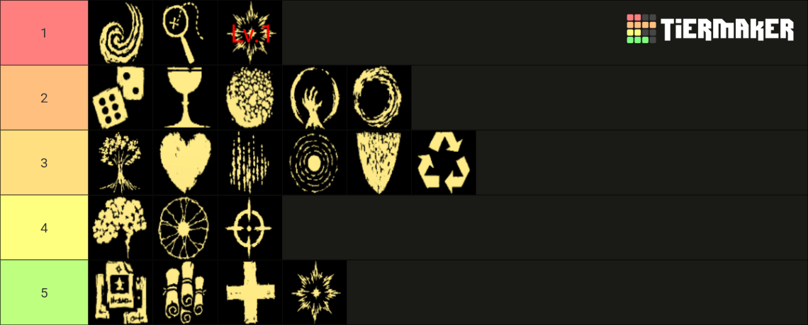
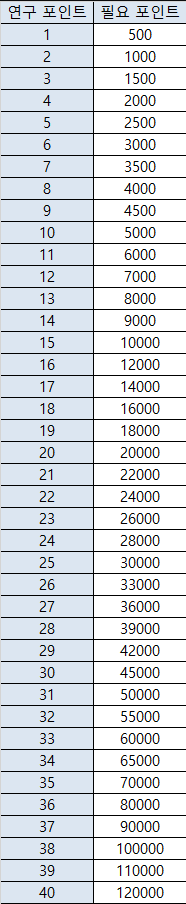
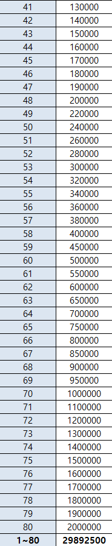

# 研究

## 研究について

{ width="189" height="330" }

魔法やAFと違い、ゲームが始まる前からステータス等を強化しておける能力です。ゴールドを使って研究ポイントを獲得し、強化したい能力を選んで振り分けましょう。

下の表で各段階強化後の値を記載します。

それぞれに1(高)〜21(低)の振り分け優先順位を設定しています。

## 研究一覧

| 画像 | 名前 | 優先順位 | 詳細 |
| --- | --- | --- | --- |
| { width="40" height="40" } | 知能 | 16 | 攻撃力+5/10/15/20/25/30% |
| { width="40" height="40" } | 生命力 | 10 | 最大HP+20/30/40/50/60/70%　ライフオーブの回復量+10/15/20/25/30/35% |
| { width="40" height="40" } | マナ精製 | 6 | 経験値獲得量+5/8/11/14/17/20% |
| { width="40" height="40" } | 高速詠唱 | 7 | クールタイム-2/4/6/8/10/12% |
| { width="40" height="40" } | 狙撃 | 18 | クリティカル率+1/2/3/4/5/6% |
| { width="40" height="40" } | 抵抗力 | 13 | 被ダメージ軽減率+5/10/15/20% |
| { width="40" height="40" } | 機敏 | 9 | 回避率+5/10/15/20% |
| { width="40" height="40" } | 加速 | 1 | 移動速度+5/10/15/20% |
| { width="40" height="40" } | 再生 | 20 | HP自動回復率+0.05/0.1/0.15/0.2% |
| { width="40" height="40" } | 探索 | 2 | アイテム獲得範囲+20/30/40/50% |
| { width="40" height="40" } | 魔力発散 | 17 | サイズ+3/6/9/12% |
| { width="40" height="40" } | 集中 | 12 | 持続時間+5/10/15/20% |
| { width="40" height="40" } | リサイクル | 14 | マナ回収で返還される経験値+10/15/20/25% |
| { width="40" height="40" } | 分析 | 19 | 魔法の選択肢が4つになる確率+5/10/15/20/25% |
| { width="40" height="40" } | 祝福 | 11 | ルーンの効果時間+10/20/30% |
| { width="40" height="40" } | 覚醒 | 3[^1]、21 | レベルアップするたび爆発を起こし、HPを回復 5/10/15/20/25% |
| { width="40" height="40" } | 成長 | 8 | レベルが20上昇するたび 攻撃力と最大HP+2/3/4/5% |
| { width="40" height="40" } | 支援 | 15 | ゲーム開始時、周囲に発生するマナオーブの数+10/20/30/40/50/60% |
| { width="40" height="40" } | 幸運 | 4 | アイテムのドロップ頻度+10/15/20/25/30% |
| { width="40" height="40" } | 戦利品 | 5 | 宝箱のドロップ頻度+5/8/11/14/17/20% |

合計96ポイント

{ width="1140" height="460" }

## リサーチポイントにかかる費用

- 韓国のプレイヤーが検証してくれていたので、それを引用いたします。左側がポイントの数で、右側の費用に対応しています。
  - 81〜107ポイントの費用は、80ポイントの費用から増加しません。

{ width="186" height="904" }

{ width="185" height="901" }

81 2000000

107 2000000

[^1]: 余裕があれば1ポイント振り分けておくと序盤に役立つ
