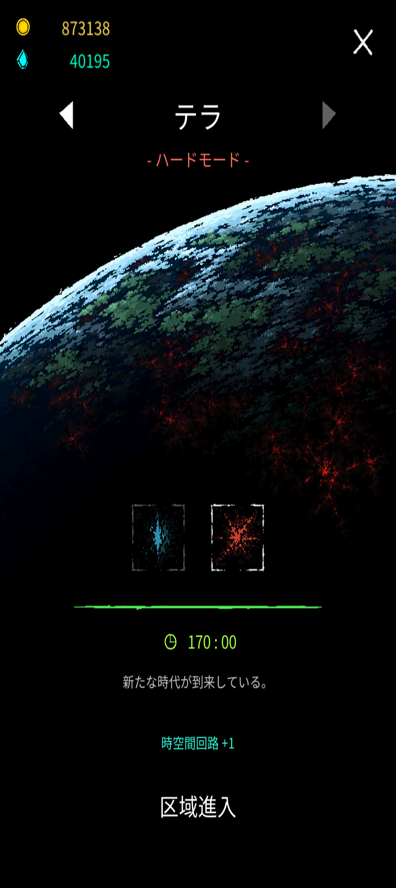

# テラ(ハード)

[テラ](terra.md) >テラ(ハード)

**注意！非公式用語を多用しているページです！分からない用語があれば[用語集](glossary.md)までどうぞ！**

{ width="720" height="1612" }

## 攻略

## v0.982

### 序盤(0:00～12:30ウェーブ終了まで)

- ビルド構築

初動は7:30までに融合を一つ作ることを目標に動いていこう。おすすめの融合は花火、ゲート、ヘルファイアのどれか。単に融合素材を揃えるだけでは融合可能になる25レベルに届かないので、加速や探索、高速詠唱といったパッシプ魔法や、他の融合の素材を集めるなどしてレベルを上げていくと良い。

7:30をこえてからは、すぐさま12:30に備えてもう一つ融合を作る必要がある。素材だけでなく、シールドや幽体化、魔法陣に霜柱といったサポート魔法や、生命力や集中といったパッシプ魔法を集めてレベルを上げていこう、目標は70レベル。

- 立ち回り

序盤は自キャラは非常に打たれ弱い。極力被弾を避けつつ、積極的に体力や防御力を強化するAFを集めていきたい。最初にシールドを1レベル取っておくと少し楽に動けるようになる。

また、12:30から、ウェーブ内での立ち回りを意識する必要があるだろう。被弾を避けるのは勿論だが、ウェーブ開始時に上方向に動き続けておくことでデカい敵の出現位置をずらしたり、幽体化などの無敵時間を活用して、デカい敵になるべく攻撃を当てるようにすると良い。

### 中盤(12:30～35:00ウェーブ終了まで)

- ビルド構築

25:00までに100レベルに到達することが次なる目標。レベル上げを加速させられるエーテルのようなAFを取れれば一番だが、無くてもマナ回収を極力減らすことで100レベル到達が近づくはずだ。

レベルの余り具合を見ながら、津波(極点)を取ったりパッシプ魔法を揃えていくと良いだろう。

なお、魔法やAFの取り方を拘らずに到達できるのはここまでです('\_')

- 立ち回り

25:00まではあまり考えることがない。3つめの融合はあまり直ぐ作らず、90レベルぐらいで取るのが少しお得だ、というぐらいだろうか(マナ回収しなければいけない魔法の選択のときに、融合でお茶を濁せるため)。25のウェーブでは、火力が極端に足りない場合(例；攻撃200,増幅50、他ステータスは初期値)を除いて簡単に攻略できるはずだ。

きちんとしたステータスチェックは32:30が最初だろう、十分な火力が無ければここで残機を失ってもおかしくない。ガイアや神聖不可侵、アカシックレコードなどを揃えて、攻撃500、攻撃力増幅150あるのが最低ラインだろう(他の火力関連ステータスは初期値)。

### 終盤(35:00～70:00)

- **ビルド構築**

最初の鬼門、37:30を超えるには(厳密には、楽に越えるには。後述のビルドでなくてもちょー頑張れば越えられます)ビルド構築が限定されてくる。その中でも何通りかパターンがあるが、ここでは最も安定して70に到達できるビルドを紹介する(かなり立ち回りの難しいビルドなので、もっと楽なビルドが良い！という人は、参考記録の方を見てね)。

- **クラス・実験体**

大魔法使い・大魔法使い

- **魔法**

花火、ゲート、ヘルファイア--計44レベル

津波(極点)、霜柱(絶対零度)、シールド(再構築)、幽体化(蜃気楼)、魔法陣(魔力開放)--計28レベル

加速、高速詠唱、探索、集中、知能、生命力--20レベル

残り13レベル(アカシックレコード込み)は特殊強化魔法や、その他のパッシプ魔法に振り分けましょう。

- **AF**
  - 伝説

キューブ、アカシックレコード、アクセラレータ、ウロボロス、契約の箱、死神の鎌、神聖不可侵、ガイア、魔剣、金銀財宝--計10個(全11個中なので、要求高め。金銀財宝は妥協可能ではある)

- - その他必須AF

童話の本、肉、歯車、力場、生態シールド、重力球、世界樹の葉、ムーンクリスタル、懐中時計、ゼンマイ装置、蜘蛛の巣、二番目の心臓、霊魂、龍の息吹、増幅器、結界、平和条約、冥府、ヒドラ、血液パック、HPポーション、マンドレイク

これらの他にも、移動速度やクールタイム減少を強化するAFや、防御力を上げるAFも必要

- 立ち回り

前提として、このビルドはクールタイム減少を最大限減らすことを目標としていて、それが達成されているものとして解説を進める。

37:30ウェーブは、基本的には12:30と変わらないが、敵の硬さや移動速度が違う。ウェーブの周囲をグルグル動きながら、敵の群れとつかず離れずの距離を保とう。幽体化か白ルーンによる無敵時間中は、デカい敵に攻撃を入れるチャンスなので、ヘルファイアの攻撃がなるべく当たるように立っておくと良い。

40:00ウェーブでは初手の契約の箱に拘る必要がある時間だ(この先の52:30や65:00も同様)。

初手契約の箱から青ルーンを出すことでシタデルを全て倒そう。当然、出なかった場合はアプリを一度閉じて開き直し、再び初動からやり直し。何度も繰り返して、青ルーンが引けるまで待とう(これが所謂箱ガチャ)。箱ガチャ成功後、敵に囲まれるが、力場効果で潜り抜けられる。力場をウェーブ外で消費していたならリセ。再び箱ガチャしてください…

以降のウェーブはずっとこのような作業の繰り返し。70ウェーブは要求ステータスが非常に高く、ほぼ突破不可能という感じです。70がゴールだ！

## v0.981

### 0:00～2:30ウェーブ終わりまで

攻撃範囲が広く、クールタイムが短めで、火力の高い融合魔法を作りたい。理想は花火を2：30までに作ること。テラと違い、ウェーブにシタデル(青ルーンで死ぬタイプのデカいやつ)が出るので、融合魔法が無いと少し苦労する。

テラよりマナオーブが集まりづらいので、その点も気を付けて。

### 2:30～5:00ウェーブ終わりまで

優秀な融合魔法を一つ持っていれば、突破は容易。

ウェーブではテラでは出なかったデカいの(世界樹の実落とすやつ)が出てくる。若干固くて、投射体を飛ばす攻撃をしてくるので、ちょっとうざい。

商人に入るまでにマナオーブが1000集まっていれば上出来。

### 5:00～7:30ウェーブ終わりまで

例の如く、テラと違いウェーブにデカいのが出てくる。

また、12分に備えて、ここらで2つ目の融合魔法の素材を揃えて置きたい。楽に超えるなら、ゲートや不死鳥がオススメだ。

### 7:30～10:00ウェーブ終わりまで

商人さんから一番楽に、多めにAFを買える時間。マナオーブが2000あると理想的。

ウェーブの内容は、かつてのテラ12分といっしょ。

### 10:00～12:30ウェーブ終わりまで

テラハード最初の関門、テラウェーブ。

自キャラの周囲を大きなニセホムンクルス達が囲み、投射体を飛ばしてくる等する、操作の忙しい時間。

強力な融合魔法を2つは持って挑みたい。

花火と不死鳥、あるいは花火とゲートなら安定して突破出来るはずだ。

### 12:30～15:00ウェーブ終わりまで

この時間から、ウェーブ内外ともにエリート敵(赤いモンスター)が出現するようになる。倒すと高確率でピンク色のマナオーブ落とすので嬉しい。

商人から安定して3〜4個AFが買えるようになるので、積極的にエリート敵を倒していこう。

### 15:00～17:30ウェーブ終わりまで

この時間から、究極魔法完成急ぐべく、レベル上げの速度を気にしてほしい。25分までに100レベルに到達するように、オーロラやサファイア、特異点やエーテルといったAFを活用してレベル上げを加速させていくのが良いだろう。

### 17:30～20:00ウェーブ終わりまで

ここでレベル75以上になっていなければ、レベル上げが遅いということです。理想はここで90を超えること！

### 20:00～22:30ウェーブ終わりまで

特段変わった事もない時間だが、レベルだけは気にしてほしい。ここで100レベル到達が理想だ。

### 22:30～25:00ウェーブ終わりまで

テラウェーブが好評につき再登場。

大きな変化はなく、単に敵のステータスが強くなっているだけ。強い融合魔法が3つあれば簡単に超えていける。

### 25:00～37:30ウェーブ終わりまで

しばらく小康区間が続いた後に、37:30のテラウェーブ。レベルをMAXにしていれば(そしてマナシールドを持っていれば)簡単に越えていけるが、そうでないなら少し大変。

敵の移動速度が速いので、前もって自キャラの移動速度を上げたり、敵の移動速度を下げておくのが良いだろう。

### 37:30～40:00ウェーブ終わりまで

旧バージョンでは一つの区切りとなっていたが、現在はビルドによっては簡単に越えられる。

究極魔法＋マキナで走っていれば、サクッと敵を倒すだけである。但し、最終的な生存可能な時間は3融合の方が長い。

シタデルの出現数が増えているので、開幕シタデルに囲まれて圧死という危険がある。幽体化や白ルーンをウェーブの開幕に合わせよう。

その他の3融合での攻略法はテラと全く変わらないので、コピペしたものを貼っておきます↓

基本的な越え方は、敵の攻撃をかわし続けることだが…その難易度はそれなりに高い。文章よりも動画が参考になると思うので、まずはこちらをどうぞ→<https://youtu.be/uwgu8EKbEYQ?feature=shared>

また、40分以降、商人さんのAF販売価格が高すぎて少ししか買えないことが多発する。それを防ぐ為に、ウェーブ終了後の空間でマナオーブを集めることをお勧めする、動画はこちら→<https://youtu.be/OWg93FVXxdw?feature=shared>

では、ここから40分での立ち回り、考え方を解説しよう。

契約の箱のクールタイムを争う時間が始まる。

まず、CDR77、duration155ほど用意できていれば、幽体化はctは9.5s、durationは8.5程になっているはずである。

この場合、二回の幽体化発動後に契約の箱が発動する。

よって、契約の箱発動までにある2度の幽体化が発動していない区間を凌げれば、一先ず1回目の契約の箱発動まで漕ぎつけるわけだ。

(このような区間(契約の箱発動までにある幽体化が発動していない区間)をvulnerable time=VTと便宜上呼称する。)

VT中、第一に考えるべきは被弾を避けることだ。先述したようなステータスであれば、シールドのCTは5.5sとなっているはずであるので、VT中ではシールドが1回しか回復しない。そのため、初回のVTでは計5枚、2回以降では計4枚盾があるというのが基本の状況であるから、被弾する回数は盾の残存枚数以下に抑えなければならない。そこで重要なのが、敵の群れから離れて、ウェーブエリア内の空いている場所を素早く見つけ、たどり着くことである。ウェーブ侵入後、敵はプレイヤーの周囲を囲むようにせまってくるため、まずはこの囲みを脱さねばならない。この際、無為に群れを突っ切ろうとするのでは無く、一旦エリアの端っこまで引き付けてから脱することが肝要で、こうすることで敵の動きを統制し、常に敵群がいない場所をエリアに作ることが出来る(ただし、平和条約を所有している前提で)。敵のいない場所は位置が変わり続けるので、常に自分も動いて、敵のいない場所を追いかけることで被弾を減らし、VTをやり過ごそう。

さて、VTをやり過ごす動きの参考動画として次の二つの動画内の、52:30ウェーブの動きを紹介したい。40:00と敵の構成が同じなので、最も参考にしやすいはずである。

リンクはこちら

<https://youtu.be/yqcX6omXkLk?feature=shared>

<https://youtu.be/0g5RbQTL8KA?feature=shared>

holy chest発動に漕ぎつけても、それで終わりじゃあない。

発動されるのは、青ルーンか白ルーンでなければならない。その他のルーンが発動された場合は、力場が残っていれば再びVTへ、そうでなければリセットしよう。

さて、青ルーンか白ルーン、どちらが出るかで立ち回りが変わるので、それぞれ簡単に説明する。

先ず、青が出た貴方。おめでとうございます、もう2回VTを楽しんで！

白が出た貴方は、シールドの枚数をウェーブ突入時と同じ状況に戻せる上、次の箱までのVTを1回分減らせる。でもよそ見は厳禁です

上記のように、ウェーブはVT→VT→holychest青or白、青ならば再びVT→VT→契約の箱,白ならばVT→契約の箱というように進行するのが理想である。この繰り返しならば、およそ5回の契約の箱発動でウェーブが終了する。

しかし、現実的には青と白を発動させ続けることは困難であるように思われるかもしれない。

けれど、安心してほしい、何もずっと青や白を発動させ続ける必要は無い。

仮に全7回契約の箱が発動するなら、2回は赤や黄色で良い。

全10回なら5回は青でも白でもなくてよいのだ。

ただし、契約の箱の発動回数が増えるほど、VTの難易度は上がっていくことには留意されたし。

また、敵のよけ方について、諸注意をお伝えしておきたい。

敵を避ける際は、常に動き続けなければならない訳ではない。

敵の多寡や、凍結・ゼンマイの効果による敵の一時停止に合わせて動きを止めて、時間を稼ごう。

また、敵群に囲われているがシールドが尽きているときは、力場効果に頼ってぬける、それもできないなら被弾覚悟で最も敵の層が薄い場所に突っ込んでしまおう。

最終的な被弾数は減らせるはずだ。

なお、上記の状況で、holy chestやcloakingの発動まで1,2秒まで迫っているときは、動かず発動を待つ方が良い。回避が発動するように祈ろうね。

また、にっちもさっちもいかないときは、残機を減らす前にリセット(アプリを一旦閉じて、再び開くこと)をお勧めする。残機は終盤に残しておくのが得策。

### 40:00～50:00ウェーブ終わりまで

42,45ウェーブでやることは40といっしょ、47は超簡単なので説明不要だと思う。22:30の時間かかる版というだけのはなし。50ウェーブあたりから火力が通用しづらくなってくるぞ。

### 50:00以降の攻略

## v0.972

### 0:00～2:30ウェーブ終わりまで

攻撃範囲が広く、クールタイムが短めで、火力の高い融合魔法を作りたい。理想は花火を2：30までに作ること。テラと違い、ウェーブにシタデル(青ルーンで死ぬタイプのデカいやつ)が出るので、融合魔法が無いと少し苦労する。

テラよりマナオーブが集まりづらいので、その点も気を付けて。

### 2:30～5:00ウェーブ終わりまで

優秀な融合魔法を一つ持っていれば、突破は容易。

ウェーブではテラでは出なかったデカいの(世界樹の実落とすやつ)が出てくる。若干固くて、投射体を飛ばす攻撃をしてくるので、ちょっとうざい。

商人に入るまでにマナオーブが1000集まっていれば上出来。

### 5:00～7:30ウェーブ終わりまで

例の如く、テラと違いウェーブにデカいのが出てくる。

また、12分に備えて、ここらで2つ目の融合魔法の素材を揃えて置きたい。楽に超えるなら、ゲートや不死鳥がオススメだ。

### 7:30～10:00ウェーブ終わりまで

商人さんから一番楽に、多めにAFを買える時間。ジェムが2000あると理想的。

ウェーブの内容は、かつてのテラ12分といっしょ。

### 10:00～12:30ウェーブ終わりまで

テラハード最初の関門、テラウェーブ。

自キャラの周囲を大きなニセホムンクルス達が囲み、投射体を飛ばしてくる等する、操作の忙しい時間。

強力な融合魔法を2つは持って挑みたい。

花火と不死鳥、あるいは花火とゲートなら安定して突破出来るはずだ。

### 12:30～15:00ウェーブ終わりまで

この時間から、ウェーブ内外ともにエリート敵(赤いモンスター)が出現するようになる。倒すと高確率でピンク色のマナオーブ落とすので嬉しい。

商人から安定して3〜4個AFが買えるようになるので、積極的にエリート敵を倒していこう。

### 15:00～17:30ウェーブ終わりまで

この時間から、究極魔法完成急ぐべく、レベル上げの速度を気にしてほしい。25分までに100レベルに到達するように、オーロラやサファイア、特異点やエーテルといったAFを活用してレベル上げを加速させていくのが良いだろう。

### 17:30～20:00ウェーブ終わりまで

ここでレベル75以上になっていなければ、レベル上げが遅いということです。理想はここで90を超えること！

### 20:00～22:30ウェーブ終わりまで

特段変わった事もない時間だが、レベルだけは気にしてほしい。ここで100レベル到達が理想だ。

### 22:30～25:00ウェーブ終わりまで

テラウェーブが好評につき再登場。

大きな変化はなく、単に敵のステータスが強くなっているだけ。強い融合魔法が3つあれば簡単に超えていける。

### 25:00～37:30ウェーブ終わりまで

しばらく小康区間が続いた後に、37:30のテラウェーブ。レベルをMAXにしていれば(そしてマナシールドを持っていれば)簡単に越えていけるが、そうでないなら少し大変。

敵の移動速度が速いので、前もって自キャラの移動速度を上げたり、敵の移動速度を下げておくのが良いだろう。

### 37:30～40:00ウェーブ終わりまで

旧バージョンでは一つの区切りとなっていたが、現在はビルドによっては簡単に越えられる。

究極魔法＋マキナで走っていれば、サクッと敵を倒すだけである。但し、最終的な生存可能な時間は3融合の方が長い。

シタデルの出現数が増えているので、開幕シタデルに囲まれて圧死という危険がある。幽体化や白ルーンをウェーブの開幕に合わせよう。

その他の3融合での攻略法はテラと全く変わらないので、コピペしたものを貼っておきます↓

基本的な越え方は、敵の攻撃をかわし続けることだが…その難易度はそれなりに高い。文章よりも動画が参考になると思うので、まずはこちらをどうぞ→<https://youtu.be/uwgu8EKbEYQ?feature=shared>

また、40分以降、商人さんのAF販売価格が高すぎて少ししか買えないことが多発する。それを防ぐ為に、ウェーブ終了後の空間でマナオーブを集めることをお勧めする、動画はこちら→<https://youtu.be/OWg93FVXxdw?feature=shared>

では、ここから40分での立ち回り、考え方を解説しよう。

契約の箱のクールタイムを争う時間が始まる。

まず、CDR77、duration155ほど用意できていれば、幽体化はctは9.5s、durationは8.5程になっているはずである。

この場合、二回の幽体化発動後に契約の箱が発動する。

よって、契約の箱発動までにある2度の幽体化が発動していない区間を凌げれば、一先ず1回目の契約の箱発動まで漕ぎつけるわけだ。

(このような区間(契約の箱発動までにある幽体化が発動していない区間)をvulnerable time=VTと便宜上呼称する。)

VT中、第一に考えるべきは被弾を避けることだ。先述したようなステータスであれば、シールドのCTは5.5sとなっているはずであるので、VT中ではシールドが1回しか回復しない。そのため、初回のVTでは計5枚、2回以降では計4枚盾があるというのが基本の状況であるから、被弾する回数は盾の残存枚数以下に抑えなければならない。そこで重要なのが、敵の群れから離れて、ウェーブエリア内の空いている場所を素早く見つけ、たどり着くことである。ウェーブ侵入後、敵はプレイヤーの周囲を囲むようにせまってくるため、まずはこの囲みを脱さねばならない。この際、無為に群れを突っ切ろうとするのでは無く、一旦エリアの端っこまで引き付けてから脱することが肝要で、こうすることで敵の動きを統制し、常に敵群がいない場所をエリアに作ることが出来る(ただし、平和条約を所有している前提で)。敵のいない場所は位置が変わり続けるので、常に自分も動いて、敵のいない場所を追いかけることで被弾を減らし、VTをやり過ごそう。

さて、VTをやり過ごす動きの参考動画として次の二つの動画内の、52:30ウェーブの動きを紹介したい。40:00と敵の構成が同じなので、最も参考にしやすいはずである。

リンクはこちら

<https://youtu.be/yqcX6omXkLk?feature=shared>

<https://youtu.be/0g5RbQTL8KA?feature=shared>

holy chest発動に漕ぎつけても、それで終わりじゃあない。

発動されるのは、青ルーンか白ルーンでなければならない。その他のルーンが発動された場合は、力場が残っていれば再びVTへ、そうでなければリセットしよう。

さて、青ルーンか白ルーン、どちらが出るかで立ち回りが変わるので、それぞれ簡単に説明する。

先ず、青が出た貴方。おめでとうございます、もう2回VTを楽しんで！

白が出た貴方は、シールドの枚数をウェーブ突入時と同じ状況に戻せる上、次の箱までのVTを1回分減らせる。でもよそ見は厳禁です

上記のように、ウェーブはVT→VT→holychest青or白、青ならば再びVT→VT→契約の箱,白ならばVT→契約の箱というように進行するのが理想である。この繰り返しならば、およそ5回の契約の箱発動でウェーブが終了する。

しかし、現実的には青と白を発動させ続けることは困難であるように思われるかもしれない。

けれど、安心してほしい、何もずっと青や白を発動させ続ける必要は無い。

仮に全7回契約の箱が発動するなら、2回は赤や黄色で良い。

全10回なら5回は青でも白でもなくてよいのだ。

ただし、契約の箱の発動回数が増えるほど、VTの難易度は上がっていくことには留意されたし。

また、敵のよけ方について、諸注意をお伝えしておきたい。

敵を避ける際は、常に動き続けなければならない訳ではない。

敵の多寡や、凍結・ゼンマイの効果による敵の一時停止に合わせて動きを止めて、時間を稼ごう。

また、敵群に囲われているがシールドが尽きているときは、力場効果に頼ってぬける、それもできないなら被弾覚悟で最も敵の層が薄い場所に突っ込んでしまおう。

最終的な被弾数は減らせるはずだ。

なお、上記の状況で、holy chestやcloakingの発動まで1,2秒まで迫っているときは、動かず発動を待つ方が良い。回避が発動するように祈ろうね。

また、にっちもさっちもいかないときは、残機を減らす前にリセット(アプリを一旦閉じて、再び開くこと)をお勧めする。残機は終盤に残しておくのが得策。

### 40:00～47:30ウェーブ終わりまで

42,45ウェーブでやることは40といっしょ、47は超簡単なので説明不要だと思う。22:30の時間かかる版というだけのはなし。

### 47:30～50:00ウェーブ終わりまで

50分が、ハードになって最もつらくなった時間だろう。敵の移動速度が上がったことで、敵を避ける難易度が大幅に上昇した。この時間にはもう結界を持っていないとダメかもしれない。それくらい被弾しやすい時間となっている。基本的な動きは37:30と同じなので、ステータス(移動速度や防御)をしっかり強化していれば、後は慣れの問題になる。兎に角やりこむべし。

### 50:00～52:30ウェーブ終わりまで

恒例のシタデルウェーブ。やることは40といっしょ。しかしながら、1回の被弾で受けるダメージの上昇によって、雑な動きが許されなくなっているため、いざというときのために、なるべく力場を残していられるよう立ち回るのが無難。

### 52:30～67:30ウェーブ終わりまで

ここまでのウェーブを越えているなら、67:30までは消化試合のようなもの。被ダメが上昇し、被弾すると必ず結界が発動するようになってるので、慎重に立ち回る必要があるが、52:30越えているなら大丈夫だと思う。

因みに究極魔法+マキナだとこの辺りが限界だと思われる、お疲れ様でした。

### 67:30～70:00ウェーブ終わりまで

前環境と同じく、鬼門である。契約の箱の箱が2回に1回白ルーンを発動してくれれば無死でいけるが、ここまでに残機を1残してこれているなら、残機を使ってしまっても良いかもしれない。

参考動画を貼っておきます→<https://youtu.be/WmX_SOykftM?si=hqfQLkm3i3E8Ev9t>

### 70:00～75:00ウェーブ終わりまで

やることは47～50といっしょ。被弾を避けていけば良いだけ。

### 75:00～77:30ウェーブ終わりまで

40の怠い版。開幕青ルーンか白ルーンで凌げ。

### 80:00～82:30ウェーブ終わりまで

一番大変と言っても過言でない時間。まずウェーブ外が大変、敵の移動速度が自キャラとほぼいっしょでめっちゃ固いので全然殺せない。そしてウェーブ内も大変。ただ白ルーンを出して削り続けるだけではじり貧で、先にこちらの残機が尽きる。青ルーンと白ルーンを交互に出していくのが理想だが、あまりにも運ゲーすぎるので、1つ2つ残機が削れるくらいの覚悟はしておこう。

参考動画どうぞ→<https://youtu.be/z4MCXqFXvRU?si=fQ1ZxGjZKqMBMK22>

### 82:30～87:30ウェーブ終わりまで

いつものサクサク区間。敵の移動速度が速いので気を抜けないけどね

### 87:30～90:00ウェーブ終わりまで

いつものデカい敵が周囲を囲んでくる時間。

開幕青ルーン、あるいは開幕に幽体化を合わせ幽体化が切れると共に白ルーン発動で越えていける。

### 90:00～92:30ウェーブ終わりまで

非常に苦しい時間。箱ガチャしましょう。なんなら全部青ルーン出しましょう。

参考動画貼っておきます→<https://youtu.be/NaZAm3FRBRI?si=N0qvlhgoQZgUzaDL>

### 92:30～95:00ウェーブ終わりまで

上に同じ。もう運ゲーでしかない。
