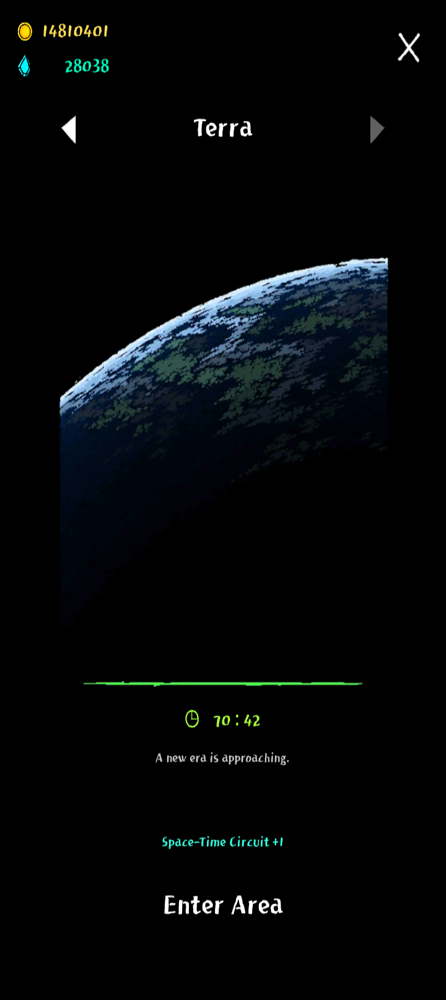

# テラ

[深層区域](deep-zone.md)>　テラ

**注意！非公式用語を多用しているページです！分からない用語があれば[用語集](glossary.md)までどうぞ！**

**最新の攻略情報は[テラ(ハード)](terra-hard.md)のページで確認出来ます！**

ステージ進入と同時に[オベリスク](basics.md)が出現し、55個前後のマナオーブとレジェンドアーティファクト、大量の経験値を入手することが出来る。

## 攻略

| + | 最新環境 | v0.982    v0.964開始時 ステージ侵入と同時に出現するオベリスクは単に伝説AFを貰えるだけでなく、最大で14レベル分の経験値を取得できる。予め使う融合魔法を決めておいて、計画的に素材となる魔法を集めていこう。 開始時オベリスク取得後～2分半のウェーブ終了まで クールタイムの短い魔法([魔力弾](../magic/magic-bolt.md)Lv4以上、[精霊](../magic/spirit.md)、[電気ショック](../magic/electric-shock.md)、[感電地帯](../magic/electric-zone.md)等)を複数揃えておこう。また、深層区域と比べて、敵の出現数が格段に多いのでかなり動きが制限される。反面、多くの敵が出現するということは、必然得られる金[^1]や経験値の量も多い。   敵に当たらないスレスレを動くことで、マナビーズを拾いながらも敵に触れないで立ち回ることが可能だ。テラでは早くに融合魔法を取らなければならない(理由は後述)のでマナ回収も多様して融合素材を揃えていこう。 2分半〜7分半のウェーブまで 最初の商人さん出現区間。金が1000ほどあると望みのAFが大体購入できる。   この区間で融合魔法を最低でも１つつくってしまうと後が楽になる。 7分半〜12分半ウェーブ終了まで テラを初めてプレイする人にとっての大きな壁とも言える区間。融合魔法が無ければ突破は難しい。   ここを超えるために、序盤から融合素材を集める必要があったというわけ。   2つ融合魔法を揃えておくことを強くおすすめしたい。特に、クールタイムの短めな魔法を一つは持っておこう。   9分からの商人さんを忘れずに。 12分半〜15分まで 最初の再走判断基準時間。この時点で必須伝説AF5つ(詳細は参考記録を参照)が一つも揃っていなければ再走するべきだろう。商人の販売価格も高くなってくるので、AF購入は吟味の上でどうぞ。 17分半〜22分半のウェーブ終了まで この時点で必須伝説AF5つが揃っていなければ再走。また、一部の弱い融合魔法(魔法のtier表でご確認下さい)では25分のウェーブは突破出来ない。高頻度に攻撃する融合、広範囲に攻撃する融合どちらも取得しておくのがおすすめ。 22分半ウェーブ終了～25分ウェーブ終了まで いわゆるテラウェーブ。   出現する敵が人型の敵だけになり、常にあちこちから攻撃が飛んでくる。とはいえ、しっかりしたビルドを組んでいれば突破は難しくない。また、この時点で報酬ジェムは200(本来は400だが、入場料が200なので。また、リロールはしていないことが前提)であり、同じ時間で120しか貰えない深層区域と比べれば報酬は非常に多い。金策するならテラ25分突破時点までいってリタイア、を繰り返すのがお勧めだ。 25分〜35分ウェーブ終了まで 25分のウェーブを突破したビルドなら、大抵35分までは楽にいけるだろう。問題は35分のウェーブ。ステータス要求が非常に高い、圧倒的な足切りウェーブであり、生半可なビルドの通過を許さない。融合魔法tier表のA〜Sランクの融合を1つ、2つは入れておく事をおすすめする。また、これまでのウェーブは立ち回りを拘る必要は無かったが、ここからはいつルーンを使うか、敵の群れをどう避けるか等、考えて動く必要がある。 35分ウェーブ終了後～37分半ウェーブ終了まで 第二回テラウェーブ。基本的に最初のテラウェーブと同じで、苦労することは無い。ただし、高い攻撃力や攻撃増幅、高いクールタイム減少値を要求される。 37分半ウェーブ終了後～40分ウェーブ終了まで さて、ここが前環境との大きな変更点である。おもちゃの城ナーフ、敵出現数や強化幅変更に伴い、越え方は大きく変わった。基本的な越え方は、敵の攻撃をかわし続けることだが…その難易度はそれなりに高い。文章よりも動画が参考になると思うので、まずはこちらをどうぞ→<https://youtu.be/uwgu8EKbEYQ?feature=shared>   また、40分以降、商人さんのAF販売価格が高すぎて少ししか買えないことが多発する。それを防ぐ為に、ウェーブ終了後の空間でマナオーブを集めることをお勧めする、動画はこちら→<https://youtu.be/OWg93FVXxdw?feature=shared>       では、ここから40分での立ち回り、考え方を解説しよう。   契約の箱のクールタイムを争う時間が始まる。   まず、CDR77、duration155ほど用意できていれば、幽体化はctは9.5s、durationは8.5程になっているはずである。   この場合、二回の幽体化発動後に契約の箱が発動する。   よって、契約の箱発動までにある2度の幽体化が発動していない区間を凌げれば、一先ず1回目の契約の箱発動まで漕ぎつけるわけだ。   (このような区間(契約の箱発動までにある幽体化が発動していない区間)をvulnerable time=VTと便宜上呼称する。)   VT中、第一に考えるべきは被弾を避けることだ。先述したようなステータスであれば、シールドのCTは5.5sとなっているはずであるので、VT中ではシールドが1回しか回復しない。そのため、初回のVTでは計5枚、2回以降では計4枚盾があるというのが基本の状況であるから、被弾する回数は盾の残存枚数以下に抑えなければならない。そこで重要なのが、敵の群れから離れて、ウェーブエリア内の空いている場所を素早く見つけ、たどり着くことである。ウェーブ侵入後、敵はプレイヤーの周囲を囲むようにせまってくるため、まずはこの囲みを脱さねばならない。この際、無為に群れを突っ切ろうとするのでは無く、一旦エリアの端っこまで引き付けてから脱することが肝要で、こうすることで敵の動きを統制し、常に敵群がいない場所をエリアに作ることが出来る(ただし、平和条約を所有している前提で)。敵のいない場所は位置が変わり続けるので、常に自分も動いて、敵のいない場所を追いかけることで被弾を減らし、VTをやり過ごそう。   さて、VTをやり過ごす動きの参考動画として次の二つの動画内の、52:30ウェーブの動きを紹介したい。40:00と敵の構成が同じなので、最も参考にしやすいはずである。   リンクはこちら   <https://youtu.be/yqcX6omXkLk?feature=shared>   <https://youtu.be/0g5RbQTL8KA?feature=shared>   holy chest発動に漕ぎつけても、それで終わりじゃあない。   発動されるのは、青ルーンか白ルーンでなければならない。その他のルーンが発動された場合は、力場が残っていれば再びVTへ、そうでなければリセットしよう。   さて、青ルーンか白ルーン、どちらが出るかで立ち回りが変わるので、それぞれ簡単に説明する。   先ず、青が出た貴方。おめでとうございます、もう2回VTを楽しんで！   白が出た貴方は、シールドの枚数をウェーブ突入時と同じ状況に戻せる上、次の箱までのVTを1回分減らせる。でもよそ見は厳禁です   上記のように、ウェーブはVT→VT→holychest青or白、青ならば再びVT→VT→契約の箱,白ならばVT→契約の箱というように進行するのが理想である。この繰り返しならば、およそ5回の契約の箱発動でウェーブが終了する。   しかし、現実的には青と白を発動させ続けることは困難であるように思われるかもしれない。   けれど、安心してほしい、何もずっと青や白を発動させ続ける必要は無い。   仮に全7回契約の箱が発動するなら、2回は赤や黄色で良い。   全10回なら5回は青でも白でもなくてよいのだ。   ただし、契約の箱の発動回数が増えるほど、VTの難易度は上がっていくことには留意されたし。   また、敵のよけ方について、諸注意をお伝えしておきたい。   敵を避ける際は、常に動き続けなければならない訳ではない。   敵の多寡や、凍結・ゼンマイの効果による敵の一時停止に合わせて動きを止めて、時間を稼ごう。   また、敵群に囲われているがシールドが尽きているときは、力場効果に頼ってぬける、それもできないなら被弾覚悟で最も敵の層が薄い場所に突っ込んでしまおう。   最終的な被弾数は減らせるはずだ。   なお、上記の状況で、holy chestやcloakingの発動まで1,2秒まで迫っているときは、動かず発動を待つ方が良い。回避が発動するように祈ろうね。   また、にっちもさっちもいかないときは、残機を減らす前にリセット(アプリを一旦閉じて、再び開くこと)をお勧めする。残機は終盤に残しておくのが得策。  42～45 やるべきことは40のウェーブといっしょ、ただ、火力要求値の上昇によってウェーブが長引きやすく、敵攻撃力上昇によって被弾が重くなっていく。より高い精度で敵を避けていかなければならない。 47～50 フリーパス区間。ここで死ぬならマジサバ向いてないよ。 52攻略 新たな壁へようこそ。   52:30では、結界の所持、移動速度170前後という前提条件をクリアした上で、VTを高いプレイ精度でやりすごすことが要求される。   先述した動画内で、52:30ウェーブを突破しているので、参考にしてほしい。   なお、動画内では残機を減らしてしまっているが、正確にプレイすれば残機を減らさず越えることも出来る。   尤も、その為にはholychestから青もしくは白を出し続ける必要があるが 55攻略 52:30とやることはいっしょ、といったら怒る？   でも実際、やることは変わらない、残機を減らしたくないならholychestから青か白を発動させ続ければ良いし、残機を使って無理やり越えても良い。まぁここで残機を減らすと後が大変だけど(自戒の念)   55:00のウェーブを越える動画のリンクを貼っておくので、立ち回りの参考にしれ貰えればと思う。   動画では残機を消費しているが、前述の通り、死ななくても良いのよ？(くっそしんどいけどねマジで) 57攻略 上記動画ではここで死んでしまっているが、これはholychestで青や白を発動させる苦行をしなかったため。実際には残機を減らさずに越えられるはずである。   また、移動速度は175以上が望ましいことは動画から分かるだろう 60～65 ここもフリーパス区間である。おおホムンクルスよ、ここで死ぬとは情けない！ 65ウェーブ攻略 さて、鬼門、65分について。やるべきことは40とは変わらないが、プレイの精度は非常に高度なものを要求される。はっきりいって、ワンダーランド(シナジー)無しでここを攻略するのは苦行そのもの(箱ガチャで、白ルーン8連を要求されるため)なので、ワンダーランドを必ず持っていきたい。動画があるので、こちらで詳しい立ち回りを確認していただきたい。   →<https://youtu.be/wethk9Xzwws?feature=shared> 67ウェーブ攻略 またしても鬼門である。   ワンダーランドの有無で、やることが変わる。   ワンダーランドがあるなら、何も考えずただ走ってたら、いつの間にか越えてます。   ワンダーランドが無いときは大変。   先ず、ウェーブ突入時に、幽体化発動まで3秒くらいになるように合わせることから始めたい(怠い)。   このとき、契約の箱発動まで20秒以内だと好ましい(怠い)。   最初の幽体化が切れるのと同じくらいのタイミングで、契約の箱が発動するわけだが、このとき発動すべきルーンは、白か青だけ、それ以外はリセットするほかない(しなければ残機を失う)。   白か青、どちらが発動するかによって対応を分けよう。   まず、白が発動した場合、これは超イージーで、次のルーンも白であることを祈りつつ、溶岩地帯の近くでじっとしていればいい。切れる3秒くらいまえから敵群を抜けるために走り出すとちょうどよくルーン効果が切れるだろう。   青ルーンが発動した場合、残機を溶かさないためには、高い精度で敵避けをしなくてはいけない。   青ルーン発動後は周囲を敵に囲まれるので、その敵群の裏へ、**盾2枚**で抜けられると良い。その後、幽体化発動までの時間、力場発動込みで、純粋な被弾を1回に抑えられなければ再走してください。抑えられたなら、次のVTを力場なしで被弾0に抑える時間が始まります。ここで被弾をしてしまうと、次の箱が青だった場合残機を溶かすことになるので、再走となります。大変だね   纏めると、   白→白→……→白のサイクル、   白→青→白→青→……→白or青のサイクル、   青→白→青→白→……→白or青のサイクル、   .   .   .   .   .   .   といったように、必ず2回に1回は白ルーンが発動しなければ、容易に無死で越えることが出来ない、ということだ。   もしも貴方が超絶技巧の持ち主で、絶対に敵に触れることがないというなら、全部青でも良い、大体青6回で終わるよ。   箱ガチャ甘えるなということです。       上の動画で仔細を確認されたし。 70ウェーブ攻略 めちゃくちゃ怠いです。   敵がアホみたいに固いので、時間がかかる→プレイミスが起きやすい   上の動画で攻略を確認してね♡ |
| --- | --- | --- |

| + | こっちは古いほうです | v0.956開始時 ステージ侵入と同時に出現するオベリスクは単に伝説AFを貰えるだけでなく、最大で14レベル分の経験値を取得できる。予め使う融合魔法を決めておいて、計画的に素材となる魔法を集めていこう。 開始時オベリスク取得後～2分半のウェーブ終了まで クールタイムの短い魔法([魔力弾](../magic/magic-bolt.md)Lv4以上、[精霊](../magic/spirit.md)、[電気ショック](../magic/electric-shock.md)、[感電地帯](../magic/electric-zone.md)等)を複数揃えておこう。また、深層区域と比べて、敵の出現数が格段に多いのでかなり動きが制限される。反面、多くの敵が出現するということは、必然得られる金[^2]や経験値の量も多い。   敵に当たらないスレスレを動くことで、マナビーズを拾いながらも敵に触れないで立ち回ることが可能だ。テラでは早くに融合魔法を取らなければならない(理由は後述)のでマナ回収も多様して融合素材を揃えていこう。 2分半〜7分半のウェーブまで 最初の商人さん出現区間。金が1000ほどあると望みのAFが大体購入できる。   この区間で融合魔法を最低でも１つつくってしまうと後が楽になる。 7分半〜12分半ウェーブ終了まで テラを初めてプレイする人にとっての大きな壁とも言える区間。融合魔法が無ければ突破は難しい。   ここを超えるために、序盤から融合素材を集める必要があったというわけ。   9分からの商人さんを忘れずに。 12分半〜15分まで 最初の再走判断基準時間。この時点で必須伝説AF5つ(詳細は参考記録を参照)が一つも揃っていなければ再走するべきだろう。商人の販売価格も高くなってくるので、AF購入は吟味の上でどうぞ。 17分半〜22分半のウェーブ終了まで この時点で必須伝説AF5つが揃っていなければ再走。また、一部の弱い融合魔法(魔法のtier表でご確認下さい)では25分のウェーブは突破出来ない。高頻度に攻撃する融合、広範囲に攻撃する融合どちらも取得しておくのがおすすめ。 22分半ウェーブ終了～25分ウェーブ終了まで いわゆるテラウェーブ。   出現する敵が人型の敵だけになり、常にあちこちから攻撃が飛んでくる。とはいえ、しっかりしたビルドを組んでいれば突破は難しくない。また、この時点で報酬ジェムは200(本来は400だが、入場料が200なので。また、リロールはしていないことが前提)であり、同じ時間で120しか貰えない深層区域と比べれば報酬は非常に多い。金策するならテラ25分突破時点までいってリタイア、を繰り返すのがお勧めだ。 25分〜35分ウェーブ終了まで 25分のウェーブを突破したビルドなら、大抵35分までは楽にいけるだろう。問題は35分のウェーブ。ステータス要求が非常に高い、圧倒的な足切りウェーブであり、生半可なビルドの通過を許さない。融合魔法tier表のA〜Sランクの融合を1つ、2つは入れておく事をおすすめする。また、これまでのウェーブは立ち回りを拘る必要は無かったが、ここからはいつルーンを使うか、敵の群れをどう避けるか等、考えて動く必要がある。 35分ウェーブ終了後～37分半ウェーブ終了まで 第二回テラウェーブ。この辺りから火力によるごり押しは通用しなくなってくる。高いクールタイム減少値を要求されるのはもちろん、幽体化やシールド等を駆使して契約の箱のクールタイム開けまで延命する立ち回りが必要となる。プレイスキルの差が、残基の消費数の差を生む区間である。 37分半ウェーブ終了後～40分ウェーブ終了まで **持ち物検査のお時間**。必須伝説AFはもちろん、おもちゃの城無しでの突破は不可能。おもちゃの城が引けるように、ただ祈ろう。   また、40分のウェーブ内では平常時とは違った立ち回りが要求される。箱ガチャも併用して少しでも残機を残せる立ち回りを心掛けよう。   下の動画は箱ガチャはしていないがその他の動きの参考になると思うので、立ち回りに困ったら是非活用してほしい。   <iframe class="video" src="https://www.youtube.com/embed/T6pA5xGZZ48" allowfullscreen loading="lazy"></iframe>   ゲーム開始からの通しの動画はこちらをどうぞ   <iframe class="video" src="https://www.youtube.com/embed/sObdc0MuS6c" allowfullscreen loading="lazy"></iframe>    40分ウェーブ終了後〜 以降はウェーブ中よりもウェーブ外の時間の方が敵の攻撃が苛烈になってくる。   お祈りが貴方を救うかもしれません。 |
| --- | --- | --- |

[^1]: 画面左上に記載されている、商人との取引に使うヤツのこと
[^2]: 画面左上に記載されている、商人との取引に使うヤツのこと
