# 実験体

## 実験体について

{ width="189" height="297" }

実験体とは、ジェム800を消費して獲得出来る、[クラス](classes.md)と同名のスキンのようなものです。

獲得すると、どの実験体を選んでいても発動する常在効果を解放したり、各実験体に応じたAFをステージ進入時に持ち込めたりします。

以下は実験体の名称、持ち込めるAF、常在効果の一覧です。

特に強力な実験体はTier**A**、**S**として色を変更しています。

## 実験体一覧

| 画像 | 実験体名 | 持ち込めるAF | 常在効果 |
| --- | --- | --- | --- |
| { width="30" height="40" } | 魔法使い | 魔弾の射手 | [魔力弾](../magic/magic-bolt.md)ダメージ量5%増加 |
| 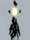{ width="30" height="40" } | 天文学者 | コアエネルギー | [衛星](../magic/satellite.md)ダメージ量5%増加 |
| 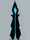{ width="30" height="40" } | **氷結師** | ムーンクリスタル | [霜柱](../magic/frost-nova.md)ダメージ量5%増加 |
| 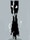{ width="30" height="40" } | 呪術師 | ミョルニル | [落雷](../magic/thunderstorm.md)ダメージ量5%増加 |
| 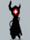{ width="30" height="40" } | ウォーロック | 次元の扉 | [隕石落下](../magic/meteor.md)ダメージ量5%増加 |
| { width="30" height="40" } | 魔道学者 | 魔晶石 | 攻撃力2%増加 |
| { width="30" height="40" } | 召喚師 | ワンド | [精霊](../magic/spirit.md)ダメージ量5%増加 |
| 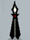{ width="30" height="40" } | ビショップ | イージス | 受けるダメージ量2%減少 |
| 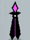{ width="30" height="40" } | 神秘術師 | 異界の触手 | [怪光線](../magic/arcane-ray.md)ダメージ量5%増加 |
| 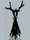{ width="30" height="40" } | ドルイド | 芭蕉扇 | [つむじ風](../magic/cyclone.md)ダメージ量5%増加 |
| { width="30" height="40" } | 火炎術師 | フェニックスの弓 | [火炎球](../magic/fireball.md)ダメージ量5%増加 |
| { width="30" height="40" } | ソーサラー | 電力ケーブル | [電気ショック](../magic/electric-shock.md)ダメージ量5%増加 |
| { width="30" height="40" } | 錬金術師 | 機械の腕 | [エネルギー弾](../magic/energy-bolt.md)ダメージ量5%増加 |
| 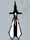{ width="30" height="40" } | 学者 | スターライト | マナ獲得量2%増加 |
| { width="30" height="40" } | 魔女 | 硫黄 | [溶岩地帯](../magic/lava-zone.md)ダメージ量5%増加 |
| { width="30" height="40" } | 電荷術師 | ロボット | [感電地帯](../magic/electric-zone.md)ダメージ量5%増加 |
| { width="30" height="40" } | 調律者 | 萬波息笛 | [津波](../magic/tsunami.md)ダメージ量5%増加 |
| { width="30" height="40" } | **大魔法使い** | 黒猫 | すべての魔法のクールタイム1%減少 |
| { width="30" height="40" } | 考古学者 | ピラミッド | アイテム獲得半径5%増加 |
| 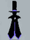{ width="30" height="40" } | 魔術師 | エーテル矢 | クリティカル率1%増加 |
| 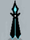{ width="30" height="40" } | メイジ | 雪華の冠 | [吹雪](../magic/blizzard.md)ダメージ量5%増加 |
| { width="30" height="40" } | 戦闘魔法使い | ゲイ・ボルグ | [閃光ショック](../magic/flash-shock.md)ダメージ量5%増加 |
| 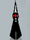{ width="30" height="40" } | ウォーロード | 龍の息吹 | [焼却](../magic/incineration.md)ダメージ量5%増加 |
| 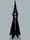{ width="30" height="40" } | 黒魔法使い | エクソシズム | すべての魔法の大きさ2%増加 |
| { width="30" height="40" } | **ジャック・オー・ランタン** | ランタン | 回避率1%増加 |
