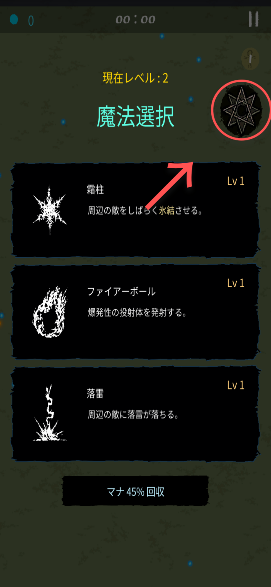
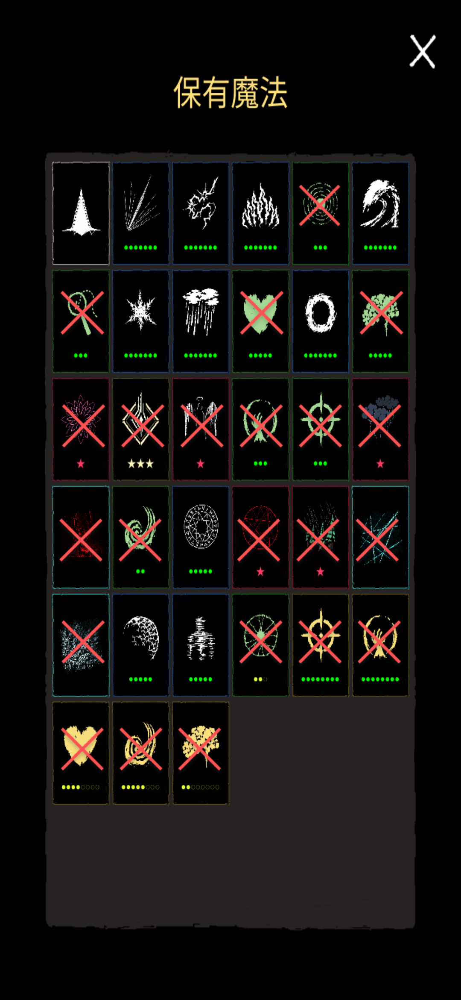
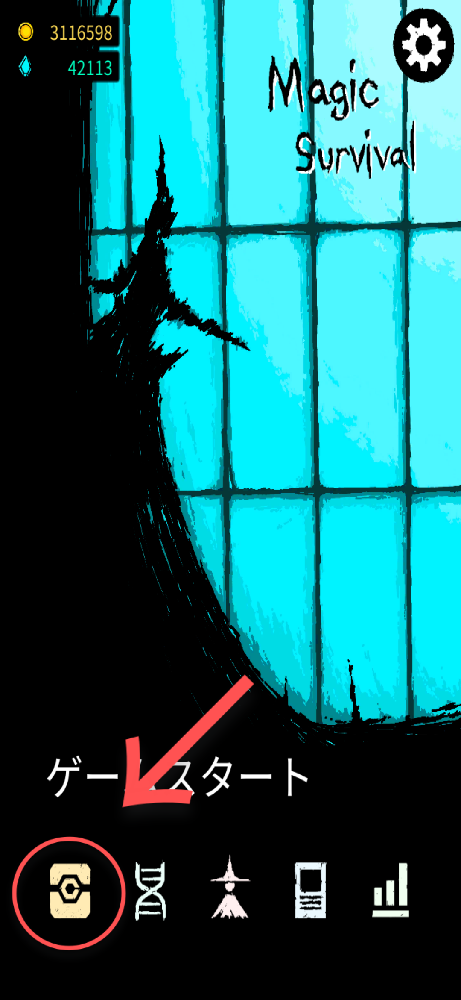
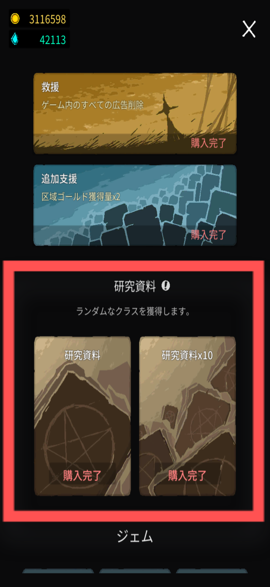
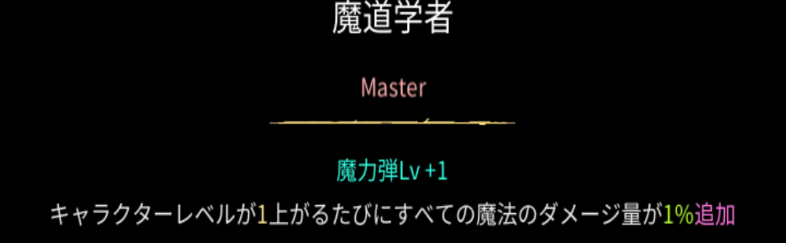
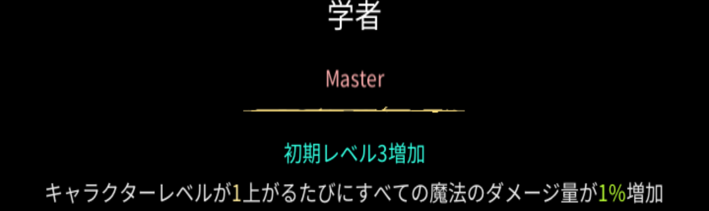
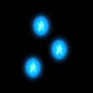
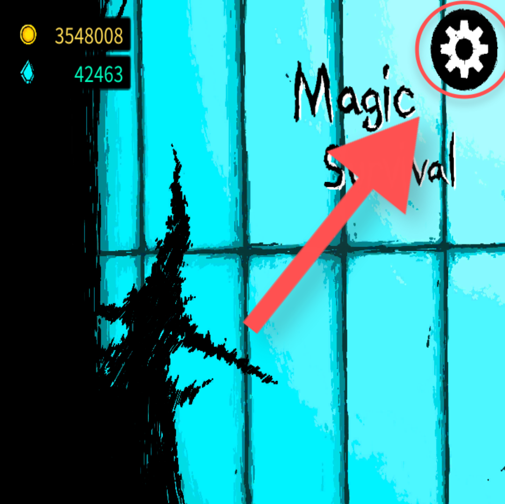
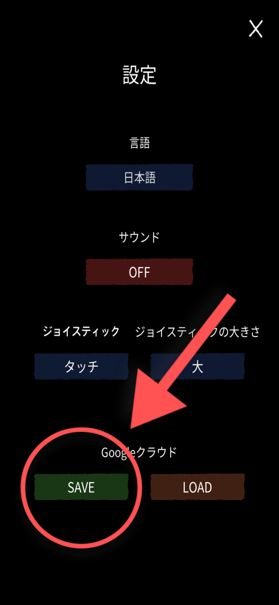
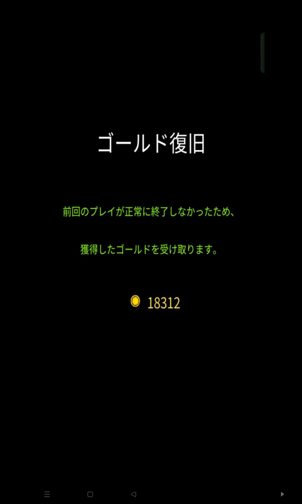

# よくある質問

編集履歴

- 2025/4/20
  - 軽微な表現,見た目の修正

---

## 金策

- Discordでの質問が散見されるため, こちらに明記
- 可能ならテラハード25分クリア後に自決
  - 難しいならテラか深層で代替可能
- おすすめのビルドはv0.982現在では花火アセンションです。残りの融合はご自由に

## 用語

### オベリスクって何？

- ウェーブを攻略すると出現する白色か黒色の尖塔。触れるとアーティファクトを獲得できる。
  - 詳しくは[基礎情報](../database/basics.md)へ

### 遺物箱って何？

- ごくまれに出現する白色の宝箱。触れると特別アーティファクトを獲得できる。
  - 詳しくは[基礎情報](../database/basics.md)へ

### 世界樹の果実って何？

- 緑色をした円形のアイテム。触れるとHPが全回復し、大量の経験値を獲得できる。
  - 詳しくは[基礎情報](../database/basics.md)へ

### ルーンって何？

- 様々な色や模様を持つ楕円形のアイテム。触れるとそれぞれ特殊な効果が発動する。
  - 詳しくは[基礎情報](../database/basics.md)へ

### ○○って何？

- その用語は[用語集](../database/glossary.md)か[基礎情報](../database/basics.md)のページに載ってるかも！
- 画面上部のページ検索に打ち込むと、その単語が使われているページが出るかも！
  - 無かったらコメント欄か[Discord](https://discord.gg/Xv9ehK6JsF)で遠慮なく聞いてね！

## 魔法

### 魔法全般（仮）

#### どの魔法が強いの？

- 上位ティアーまとめに強力な魔法を記載しているので参考にしてほしい。

#### 魔法のダメージ計算に関して

最終ダメージ＝攻撃力

×攻撃力増幅（％）

×魔法攻撃係数（％）

×魔法ダメージ増加率（％）×魔法ダメージ減少率（%）

×クラスによる追加ダメージ（%）（要検証）

×追加ダメージ増減率（％）

×クリティカル倍率（％）

- 魔法攻撃係数は魔法のレベルアップによって増加し、魔法ダメージ増加率はヘイロー等のAFや学者等のクラスボーナスによって増加する。
- [参考](https://m.cafe.naver.com/ca-fe/web/cafes/30012128/articles/18001?tc=cafe_member_profile)
- [参考](https://m.cafe.naver.com/ca-fe/web/cafes/30012128/articles/24648?fromList=true&menuId=2&tc=cafe_article_list)

### アクティブ魔法

#### 魔力弾の特性はどれがオススメ？

- lv４は貫通か花火。
  - アバターでデウス・エクス・マキナを使う際は、序盤～中盤は貫通が強く、終盤は花火が強い。
- lv７はドッペルゲンガー一択。

### パッシブ魔法

#### マナ回収で赤いパッシブ魔法を無限に習得できる？

- マナ回収の使用時はスペシャルパッシブ魔法とエンチャントは出現しないため、不可能。
  - また、プレイごとに出現するレベルと種類が固定されているため、ゲームを中断した後に再開しても変わらず出現する。

#### 黄色いパッシブ魔法は最大何レベルまで習得できる？

- 各8レベルずつ、最大で50レベル習得できる。
  - ジーニアスというシナジーを完成させれば60レベルまで習得できる。

### 融合魔法

#### 融合魔法って何？　どうやって作るの？

- 最大レベルに達した魔法を組み合わせて作る、とても強力な魔法
- レベルアップ画面右上の魔法陣をタップすると、習得できる融合魔法が表示される。
- レベル25、50、75に達するごとに1回ずつ融合可能回数が増える。

{ width="1080" height="2340" }

上図 魔法陣のマークが目印

#### オーバーマインドに関して

- [オーバーマインド](../magic/overmind.md)の説明にあるアクティブ魔法とは、魔力弾などの攻撃魔法や[シールド](../magic/shield.md)などの補助魔法のこと。
  - 知能やノーブレス、エンチャントなどはアクティブ魔法ではなくパッシブ魔法。
    - また、融合魔法もアクティブ魔法に含まれない。

{ width="1080" height="2340" }

上図 アクティブ魔法に含まれない魔法に赤い×印を付けた

#### アバターでブラスターや花火を発射できるの？

- アバターと同時にブラスターや花火（融合）を使用することはできないため、不可能。

#### プラズマ光線に関して

- クールタイム減少率72%程度で光線の本数が7本に増加する。
  - 一時的なクールタイム減少（魔法陣や幽体化、狂乱のルーン）は適用されない。
  - 8本は不可能

#### [デウス・エクス・マキナ](../magic/deus-ex-machina.md)に関して

- デウス・エクス・マキナの使用時は、1つの融合魔法を超強化し、それのみを用いて戦うことになる。
- デウス・エクス・マキナ使用時は、権能の領域を獲得しても4つ目の融合魔法を作成することはできない。
- また、アカデミーエリアをクリアしないとデウス・エクス・マキナは解放されない。

### 究極魔法

#### どの究極魔法が強いの？

- 上位ティアーまとめに強力な究極魔法を記載する予定。
  - 現状では、アーク、ストームブリンガー、インクィジター、クアンタムレーザーが強力だと推測される。

#### 究極魔法はどうすれば使用することができる？

- 指定のクラスと実験体を使用し、レベル100に到達することで習得することができる。
  - 機能自体は、都市をクリアすることで解放される。

#### 実験体は自由？

- クラスだけでなく、実験体も指定のものを使用する必要がある。
  - 例えば、ストームブリンガーを使用したい場合、呪術師のクラスと実験体を使用している必要がある。

#### 究極魔法はデウス・エクス・マキナと一緒に使える？

- 問題無く使用できる。

#### 発動条件は100レベル？　最大レベル？

- 100レベル。

#### 100レベル目に魔法の選択肢が出なかったけどバグ？

- 100レベル目は究極魔法の習得に使用されるため、通常の魔法を習得することはできない。

## アーティファクト

### アーティファクト全般（仮）

#### 選ばなかったアーティファクトはもう出てこない？

- 何度でも再出現する可能性はある。

#### アーティファクトはどう選ぶべき？（仮）

- 性能やグレードの高さ、ビルドにおける必須度を評価基準にして選ぶと良い。時間にもよるが、時にはグレードを無視することも大事。ビルドによって評価基準の重要度は多少変化するため注意。
  - 迷った時は、アーティファクトや上位ティアーまとめ、[スーパーチュートリアル](super-tutorial.md)のページを参考にしてほしい。
  - Discordで質問してみるのも手。

#### 所持できるアーティファクトの量に制限はある？

- 制限個数は明記されていないが、生存できる時間が有限のため無限に獲得することはできない。
  - また、海外プレイヤーの検証により、150〜160個のアーティファクトを獲得するとゲームが進行不能になることが明らかになっているため、実質的には150〜160個に制限されている。

#### 商人が販売しないAFは何？

- 商人は花束、黄金のルーレット、人工知能魔法、タロットカード、ユニコーン、コイン、フクロウを販売しない。

### ノーマル〜スペシャルアーティファクト

#### 融合素材を強化するAFに関して

- 融合素材を強化するAFは、融合魔法には効果がない。
  - 例：ブラスター（魔力弾+閃光ショック）にはゲイ・ボルグ、キメラ、稲妻等の閃光ショックを強化するAFの効果は乗らない。
  - 手裏剣、エーテルの矢等の魔力弾を強化するAFの効果は乗る。
    - AFを融合する前に獲得するか後に獲得するかは関係ない。

#### サファイア、ランタン、オーロラ、マーキュリーの違いは？

- サファイア、オーロラはマナ獲得量（レベルアップ用）のみを増加させる。
- ランタン、マーキュリーはマナオーブからのマナ獲得量（レベルアップ用）とマナオーブ獲得量（商人用）を増加させる。

#### 生体シールドに関して

- 生体シールドによる追加HPは、ライフオーブか世界樹の果実によってのみ回復する。
- 生体シールドによる追加HPに対しては、ガイアの効果が乗ることはない。
  - 1200/600
- 例として、このように素のHPが600、生体シールドによる増加分との合計HPが1200あるとする。
  - この場合、ガイアの効果は素の600HP分にのみ適用され、攻撃力90%増加となる。

#### ワンド、異界の触手に関して

- ワンド、異界の触手によって増加するのは、それぞれ精霊、怪光線のダメージのみ。

#### ユニコーンに関して

- 選択肢は通常のレベルアップと同様に増減する(要検証)。

#### アンデッド、プラズマ、怪しいポーションに関して

- アンデッドはHP×0.75
- プラズマはサイズ×0.8からの-20%（要検証）。
- 怪しいポーションは×0.9からの-10%。

#### 賢者の石に関して

- 実験体によってゲーム開始時から所持している場合、賢者の石の石の効果によって出現するマナオーブの数は減少する。

#### 幾何学に関して

- マナ回収をしても赤パッシブは出ない。

### レジェンドアーティファクト

#### 伝説AFは何個でも獲得できるの？

- エリアによって最大数が定められている。以下に黄金のルーレット抜きの最大数を記載している。
  - 配列地〜仮想エコは9個(要検証)
  - 深層区域は10個
  - テラ/テラ(ハード)は11個

#### デスペラードに関して

- 歯車で発動を早めることはできない。

#### 金銀財宝に関して

- フィールド上の宝箱はセーブされないため、ゲームを中断するタイミングによっては再開した際に宝箱が消滅する。

#### 魔剣に関して

- 即死と書かれてこそいるが、エリートモンスターやボスモンスターにも効果がある。

#### DNAに関して

- ウェーブ攻略時に出てくるやつ(オベリスク、壊れたオベリスク)を獲得すると増幅、HPが増加する。
- 最終的な増加量は50%程度に落ち着く。

#### ジョーカーに関して

- 効果発動時、クリティカル倍率にクリティカル倍率から100%を引いた値が加算される。
  - 例として、クリティカル倍率が350%の場合、効果発動時、350%+250%で600%となる。

#### エクリプスに関して

- 敵のHPが減るにつれて追加ダメージ量が増加する
  - 敵Hp100%の時、1.0倍
  - 敵Hp50%の時、1.225倍
  - 敵HP0%の時、1.45倍

#### アイアンメイデンと女伯爵の相乗効果に関して

通常、女伯爵はエリートモンスター撃破時に爆発を発生させ敵最大体力の25%のダメージを与えるが、アイアンメイデンや黒魔法使いの爆発と同時に発動すると、カウンテスの爆発によるダメージも敵最大体力の75%になる。

### シナジー関連

#### シナジーはどうすれば発動する？

- 条件となるAFを全て獲得することで発動する。
  - AFを獲得すること以外の条件は存在しない。

#### シナジーを発動するとAFは消える？

- シナジーを発動してもAFは消えない。

#### どのシナジーが強いの？

- 条件AFが入手しやすく元々ビルドに必要であるシナジーや、火力、生存力に大きく貢献するような効果を持ったシナジーが強力であると考える。
  - アーティファクトページにシナジーのTierや優先度を記載しているため、参考にしてほしい。

#### シナジーに必要なAFと強力なAFのどちらを取るべき？

- シナジーは狙っても完成するか分からないというリスクがあるため、基本的には強力なAFを獲得することをオススメする。
  - しかしながら、条件となる高レアAFを持っていたり条件自体が簡単であったりするなど、シナジーを発動させる目処が立っている状態であれば、シナジーに必要なAFを獲得するのも良いだろう。

#### オラクルの効果は×1.3？　それとも+30？

- ×1.3
  - 例えば、加速の効果であれば20から26になるということ(要検証)。悲しいかな50にはならない。

#### デッドアイでウィドウメイカーの効果量は増加する？

- デッドアイの効果によってクリティカル発動率が100%に変化しても、ウィドウメイカーの効果量は変動しない。

## その他

### クラス

#### クラスはどうやって強化するの？

- ショップ画面から研究資料を購入したり、エリアの初クリア報酬を獲得したりすることでクラスを強化できる。

{ width="1080" height="2340" }

ショップ

{ width="1080" height="2340" }

研究資料

#### クラスのレベル上げと実験体の解放はどちらを優先すべき？

- 大魔道士(黒猫)とジャック・オー・ランタン(ランタン)の実験体を解放した後は、基本的にクラスのレベル上げを優先して良い。

#### 魔術師の変換先に関して

- 魔力弾の変換先であるランダムな投射体とは、火炎球、電気ショック、エネルギー弾、精霊の4つのこと。
  - 変換先が融合魔法でも、同様に変化する[^1]。

#### 魔法ダメージ追加と増加の違いは？（仮）

- 追加は掛け算、増加は足し算（要検証）
  - 魔道学者なら×2、学者なら+100

{ width="1080" height="334" }

追加

{ width="1080" height="322" }

増加

### レベル

#### レベルに上限はある？

- 基本的には100レベルが上限。
  - アカシックレコードやデウス・エクス・マキナ等の効果によって上限を引き上げることもできる。
    - レベルMAX後は、50レベルが上限の特殊なレベルが解放される。
- レベル1の状態でゲームがスタートするため、新たに習得できるレベルは99個（要検証）

#### レベル101以降の必要経験値量に関して

- レベル101以降のレベルアップに必要な経験値量は、レベル100時の必要経験値量と変わらない。

#### マナ回収って何？　やっても大丈夫？

- マナ回収とは
  - レベルアップ時に画面下部に出てくる、魔法の選択肢をリロールする機能のこと。
  - 魔法を習得せずにレベルアップするわけではないので、行っても問題は無い。
- 例
  - 50レベルになるタイミングでマナ回収を行うと、レベルは49のままとなる。
  - そこでもう一度50レベルになると、先程とは異なる魔法の選択肢が現れる。
- したがって、マナ回収を行うことで、時間はかかるが戦略的に魔法を習得できる。

#### 成長強化魔法に関して

- レベル最大に達した後に習得する成長強化魔法（黄色のパッシブ魔法）は、レベルとして扱われない。
  - 103+30
- 例
  - レベル103に達した後に成長強化魔法を30レベル分習得した場合
  - アカシックレコードやクラスボーナスの対象となるのは前半の103レベル分のみ
- 経験値のゲージは青色と同様に扱われる

#### ウェーブ攻略後にエーテルでレベルアップできる？

- ウェーブのゲージを削り切った状態では、肉、世界樹の葉、エーテル、物質錬成等の効果は発動しないため不可能。ボスモンスターが生存していても同様。
  - ウェーブ攻略後にマナオーブを無限に獲得する方法があるため、似たようなことは可能（現在修正済み）
    - <https://youtu.be/EJ9LmqWvM9M?si=zDnbe55hy0mNPe3p>

<iframe class="video" src="https://www.youtube.com/embed/EJ9LmqWvM9M" allowfullscreen loading="lazy"></iframe>

### ステータス

#### 増加と増幅って何が違うの？　どっち優先？

- 強化するステータスが異なる。増加では攻撃力が強化され、増幅では攻撃力増幅が強化される。
  - 魔法の威力は攻撃力×攻撃力増幅×その他諸々で計算されるため、均等に強化するべきだが、強いて言えばAFのグレードで優先するステータスを分けると良い。
    - 英雄、特別AFは魔力の泉やマーリンのマントなどの増幅AFを優先。
    - 伝説AFはガイア、タイタン、ウランなどの増加AFを優先。

#### ステータスの増減に関して

- 増えるものは加算、減るものは乗算

（HP自動回復量除く）

- 被ダメ減、クールタイム減、サイズ減（要検証）、HP減等
  - アンデッドは最大HP×0.75

怪しいポーションは移動速度×0.9

- - プラズマはサイズ×0.8からの-20%（要検証）

#### 回避率の上限は何%？

- 49%

#### 防御力の上限は何%？

- 87%

#### 移動速度の上限は何%？

- 237
  - コレは死亡時に発生する烙印のバグで33増加することによるものであり、また表示には反映されない狂乱のルーンや幽体化の効果も存在するため、プレイ時の上限ではない

### アイテム

#### マナオーブは取らないと消える？

- 時間経過で消失する
  - 世界樹の果実やルーン等のアイテムも同様に時間経過で消失する。
    - それぞれ消失までの時間は異なる（要検証）

#### 商人との取引に必要なマナオーブに関して

- フィールド上に存在するマナオーブを獲得することで増加する。
  - マナオーブのグレードによって獲得量が異なる（下記参照）
- ランタン、マーキュリーによってマナオーブ獲得量を増やすことが出来る。また、その効果は重複する。
  - マナオーブ獲得量は小数点以下も計算されている。

{ width="189" height="189" }

マナオーブ獲得量初期値は１

{ width="189" height="189" }

マナオーブ獲得量初期値は1　

{ width="189" height="189" }

マナオーブ獲得量初期値は5

#### ミミックや魔法陣(物質錬成)によって出現するアイテムは？

- 高確率でマナオーブを生成。
- 低確率でライフオーブや世界樹の実、ランダムなルーンを生成。
- さらに低い確率でセル(ゴールドがもらえるやつ)を生成。

### モンスター

#### エリートモンスターって何？

- 赤い縁取りがされている強力なモンスター。詳しくは[基礎情報](../database/basics.md)へ。
  - シタデル（黒い丸型の大きな敵）はエリートモンスターではない。

### その他

#### ステータス画面に関して

- 他の画面に一瞬移動した後すぐにマジサバの画面に戻ることで、AF獲得時やレベルアップ時にもステータス画面を確認できる。

#### プレイ中にゲームを閉じたらどうなる？

- オートセーブ地点から再開することができる。
  - アーティファクトの獲得や魔法の習得をやり直すことができるため、タップミスをしてしまった際などに行われることが多い。ランの後半において、死を回避するために行われることもある。
    - リセと呼ばれている。
    - マナオーブやルーン、宝箱などフィールド上のアイテムはセーブされないため、注意が必要。

#### クラウドセーブに関して

- ゴールドやジェムの所有額やエリアの最高タイムなど、ゲームの状況を保存する機能。設定画面から行うことができる。

{ width="1080" height="1079" }

設定

{ width="1080" height="2340" }

クラウドセーブ

#### ゴールド復旧はどうすれば直る？（仮）

{ width="1200" height="2000" }

- 残念ながら、即座に直す確実な方法は確立されていない。
  - ゴールド復旧の画面を何回もタップして放置したり、ゲームを閉じたり開いたりすることで直る可能性があるかもしれない。
    - 画面を連打したら直ったという報告が多数確認されているため、試してみると良いだろう

#### 無限モードが解放されない

#### 深層区域はどうすればクリアできる？

- 25分を突破することでクリアとなる。
  - クリアのためのビルドや戦略は、上位ティアーまとめ、[深層区域](../database/deep-zone.md)、参考記録、好記録集などのページを参考にしてほしい。
    - [discord](https://discord.gg/pqGRNeauMr)でアドバイスを求めるのも良いだろう。

#### テラはどうすればクリアできる？

- 25分を突破することでクリアとなる。
  - クリアのためのビルドや戦略は、上位ティアーまとめ、[テラ](../database/terra.md)、参考記録、好記録集などのページを参考にしてほしい。
    - [discord](https://discord.gg/pqGRNeauMr)でアドバイスを求めるのも良いだろう。

#### テラに挑みたいけどジェムを失いたくない

- テラに入場する前にクラウドセーブを行うことでジェムの個数が保存されるため、ジェムが減ってしまった場合でもロードすることでセーブ時の個数に戻すことができる。

#### テラとテラのハードモードは何が違うの？

- ウェーブボスの数、テラウェーブの敵、ウェーブの構成等が異なる。また、報酬が50ジェム多い。
  - 序盤が難しくなっているため、注意が必要

他になにかあればこちらまで→<https://discord.gg/pqGRNeauMr>

[^1]: 魔力の刃を除く
