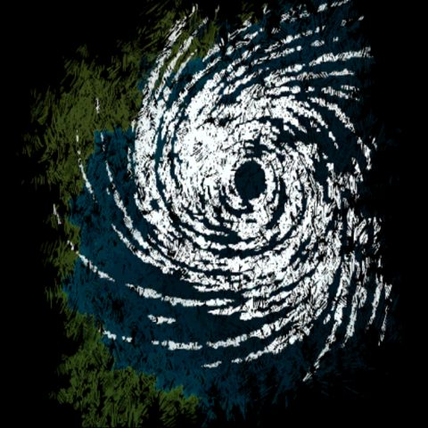
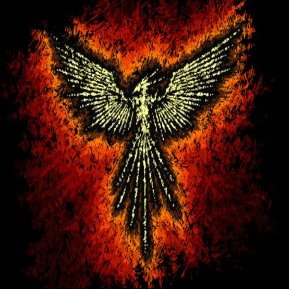
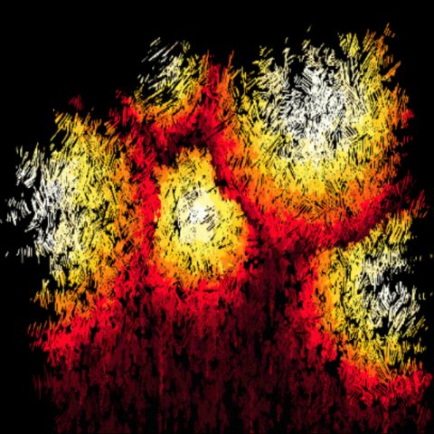
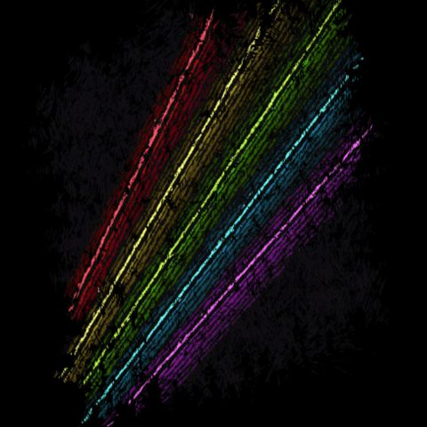
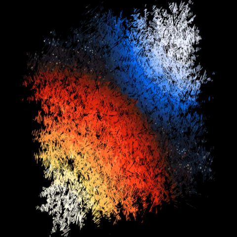
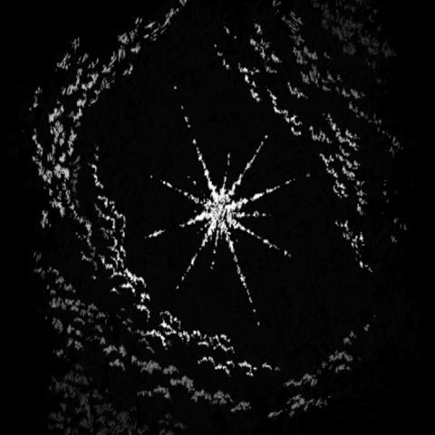

  

    
    
    
    
    
    
  

  <canvas class="ms-top__orbs" aria-hidden="true"></canvas>
  <h1 class="ms-top__title">
    
    wiki
    非公式攻略wiki
  </h1>

<svg class="ms-top__defs" aria-hidden="true" focusable="false">
  <filter id="ms-rough">
    <feTurbulence type="fractalNoise" baseFrequency="0.05" numOctaves="2" seed="11" />
    <feDisplacementMap in="SourceGraphic" scale="4" />
  </filter>
</svg>

ここは Magic Survival (マジックサバイバル) の非公式wikiです。[@wiki](https://w.atwiki.jp/magicsurvival/) から移転しました。経緯は [このwikiについて](about.md) をご覧ください。

- **大体の疑問は [よくある質問](guide/faq.md) で解決しますよ！**
- 解決しなければこっちまで > [初心者向け情報まとめ](guide/beginners.md)
- 当wikiに参加したい方はこちら > **[メンバ希望の方へ](editors/join.md)**
- wiki内記事へのご意見・ご要望は [Discord](https://discord.gg/scXvWqmCZG) にて受付中です。

## wiki内案内

-   :material-auto-fix:{ .lg .middle } **[魔法(紹介&tier)](database/magic.md)**

    ---

    全魔法の性能と tier

-   :material-diamond-stone:{ .lg .middle } **[アーティファクト(紹介&tier)](database/artifacts.md)**

    ---

    全アーティファクトの効果と tier

-   :material-account-group:{ .lg .middle } **[クラス](database/classes.md)**

    ---

    各クラスの特徴

-   :material-book-open-variant:{ .lg .middle } **[スーパーチュートリアル](guide/super-tutorial.md)**

    ---

    はじめての人向けの解説

-   :material-help-circle:{ .lg .middle } **[よくある質問](guide/faq.md)**

    ---

    困ったらまずここ

-   :material-history:{ .lg .middle } **[アップデート履歴](database/updates.md)**

    ---

    各バージョンの変更点と環境の変化

-   :material-party-popper:{ .lg .middle } **[イベント](events.md)**

    ---

    アンケート・クイズ・共通テスト

-   :material-forum:{ .lg .middle } **[Naver Cafe (韓国)](https://m.cafe.naver.com/ca-fe/magicsurvival?tc=article)**

    ---

    アップデートの告知はこちら

そのほかのページは、左のメニュー (スマホでは左上の :material-menu:) から辿れます。

## 注意事項 {#notice}

※当wikiは非公式の攻略wikiです。情報の妥当性や正確性について保証するものではなく、一切の責任を負いかねます。

※当wikiを利用することによって生じるいかなる損害も当サイトでは補償致しません。

※ご利用につきましては自己責任となりますのでご注意ください。

※また、当wikiおよびwiki管理人はMagic Survival運営様とは一切関係がありません。wiki管理人にエラーなどについて問い合わせないようお願いします。

※当wikiの文章は [CC BY-SA 4.0](https://creativecommons.org/licenses/by-sa/4.0/deed.ja) で提供しています。「マジサバwiki 編集者一同」と当wikiの URL を表記し、同じライセンスで公開すれば、転載・改変できます。

※ゲームの画像 (スクリーンショットを含む)・ゲーム内テキスト・データの権利は LEME会社に帰属し、上記のライセンスの対象外です。
