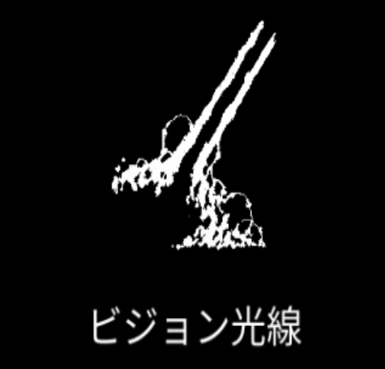

# 怪光線

{ width="475" height="456" }

### 基本情報

| lv毎のステータス |  |  |  |  |  |
| --- | --- | --- | --- | --- | --- |
| 1 | すべての物体を貫く光線を発射する。 |  |  |  |  |
| 2 | ダメージ+20%、数+1 | 4 | ダメージ+20%、数+1 | 6 | ダメージ+20%、数+1 |
| 3 | ダメージ+20%、数+1 | 5 | ダメージ+20%、数+1 | 7 | 特性習得 |

### 特性

| 反射 |
| --- |
| 怪光線の生成時、反対側に追加で生成する。 ダメージ+50%、生成間隔-50% 融合魔法:[火の息](fire-breath.md)、[プリズム乱射](prism-barrage.md)の習得に必要。 |
| 破壊光線 |
| 生成された怪光線が速いスピードで回転する。 ダメージ2倍、クールタイム+50% 融合魔法:[プラズマ光線](plasma-ray.md)、[エネルギー飽和](energy-saturation.md)の習得に必要。 |
| 電磁波放射 |
| 怪光線が1～生成個数だけランダムな向きに生成され、 0.5秒間隔でダメージを与える。 持続時間4倍 融合魔法:[テラ電流](tera-current.md)の習得に必要。 |
