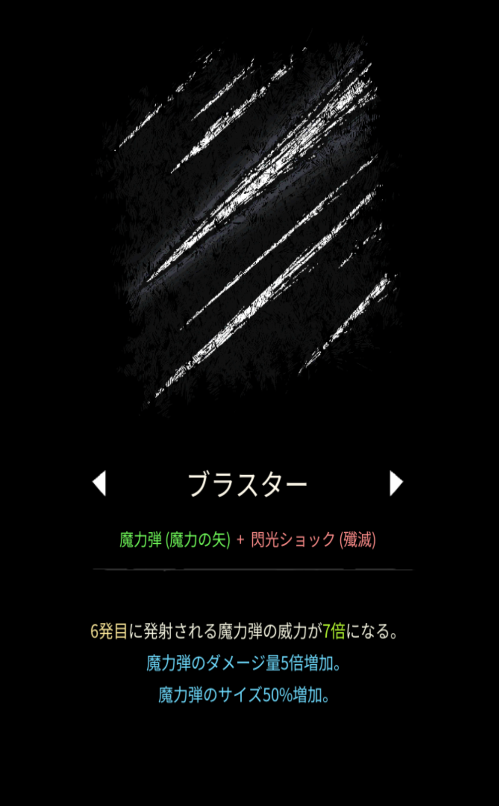
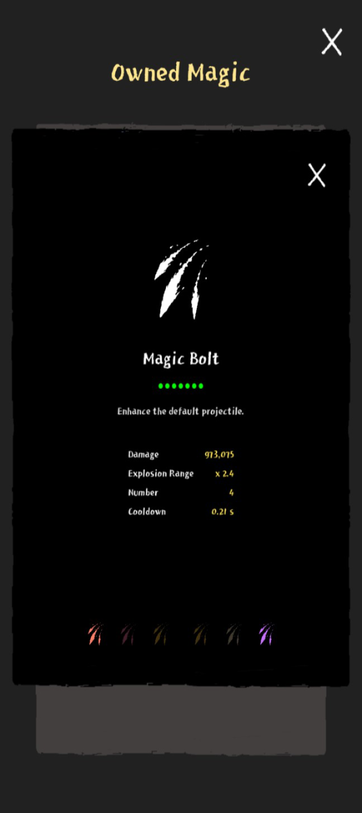

# ブラスター

## 基本情報

### 評価

**C**

- 出力

ダメージは基本は20万から30万ほどだが、ステータスが強力になるとここまで伸びる。

- 競合相手との比較

魔力弾を食い合うのは花火、閃光ショックを食い合うのはゲート、エクシディウムあたりだろうか。

どれもブラスターより強力な競合相手である一方、これらが使えなくなっても、不死鳥と合わせて使えばビルドとしては纏まるので、どうするかはお好みでどうぞ

### 動画

<iframe class="video" src="https://www.youtube.com/embed/aORWFbx0FTY" allowfullscreen loading="lazy"></iframe>
