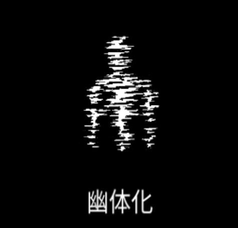

# 幽体化

### 基本情報

| lv毎のステータス |  |  |  |
| --- | --- | --- | --- |
| 1 | しばらくの間、すべての物体を通過して移動速度が上昇する。 |  |  |
| 2 | 持続時間+30% | 4 | 持続時間+30% |
| 3 | 持続時間+30% | 5 | 特性習得 |

### 特性

| 蜃気楼 |
| --- |
| 持続時間+80% |
| 空間の歪み |
| 持続時間終了時、キャラクターの周りに 強力な爆発を起こす。 融合魔法:[テレポート](teleport.md)の習得に必要。 |
| 魂の収穫 |
| 幽体状態中、敵を倒すとHP0.1%回復し、 得られるマナは33%増える |

### 使い方
