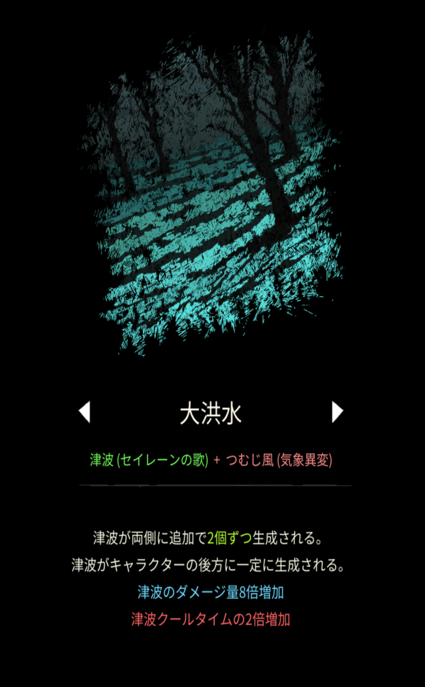

# 大洪水

## 基本情報

{ width="1003" height="1620" }

### 評価

**E**

- 出力

うんち。

- 競合相手との比較

いない。ｗ

- 特記事項

究極魔法のメガ津波を使う際の初動として使うと悲惨なので、最後に融合しよう。

### 動画

<iframe class="video" src="https://www.youtube.com/embed/ROLiuvE9ny8" allowfullscreen loading="lazy"></iframe>
