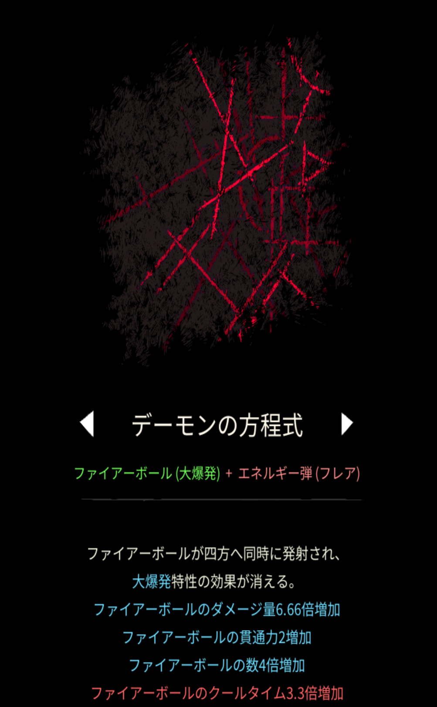

# デーモンの方程式

## 基本情報

{ width="1003" height="1620" }

### 評価

**E**

- 出力

弱い。

- 競合相手との比較

コスモスが競合相手である。相手が悪すぎる。

- 特記事項

究極魔法のネメシスを使う際は、最後にデーモンの方程式を融合することをオススメする。弱いので、こいつでは12:30を凌げない。

### 動画

<iframe class="video" src="https://www.youtube.com/embed/_sWpZeyG2Ys" allowfullscreen loading="lazy"></iframe>
