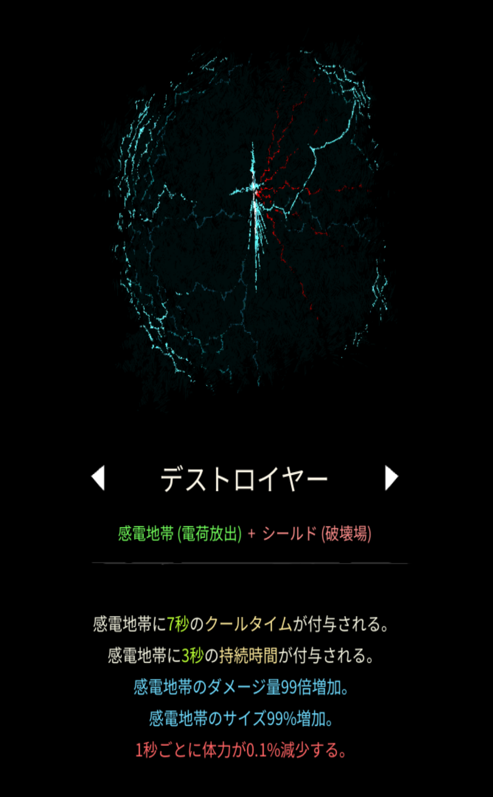

# デストロイヤー

## 基本情報

{ width="1003" height="1620" }

### 評価

**×**

ダメージ増加量はトップレベル。だからと言ってぶっちぎりで攻撃力が高いわけでもなければ、重いクールタイムに短い持続時間、おまけにシールドを消費するのがネックすぎる。マイスナー効果の方が強いです...。

### 動画

<iframe class="video" src="https://www.youtube.com/embed/Fij-1NTgBhU" allowfullscreen loading="lazy"></iframe>
