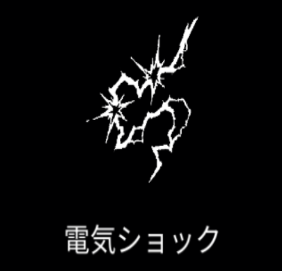

# 電気ショック

{ width="475" height="456" }

### 基本情報

| lv毎のステータス |  |  |  |  |  |
| --- | --- | --- | --- | --- | --- |
| 1 | ランダムな方向に電気を放出する。 |  |  |  |  |
| 2 | ダメージ+20%、数+1 | 4 | ダメージ+20%、数+1 | 6 | ダメージ+20%、数+1 |
| 3 | ダメージ+20%、数+1 | 5 | ダメージ+20%、数+1 | 7 | 特性習得 |

### 特性

| 連続稲妻 |
| --- |
| 電気ショックが1～3回連続する(敵に当たると連鎖して発生)。 ダメージ量+50% 融合魔法:[以気御剣](flying-swords.md)、[雷炸裂](thunder-burst.md)、[電流暴走](power-surge.md)、[雷の心](heart-of-thunder-old.md)の習得に必要。 |
| 高出力 |
| 50%の確率でダメージ2.5倍の投射体が発生。 クールタイム-15% |
| 超伝導 |
| 電気ショックが周辺の敵に向かって順次生成される。 ダメージ3倍、サイズ2倍 融合魔法:[テラ電流](tera-current.md)、[マイスナー効果](meissner-effect.md)の習得に必要。 |

### 使い方

後日筆記予定
