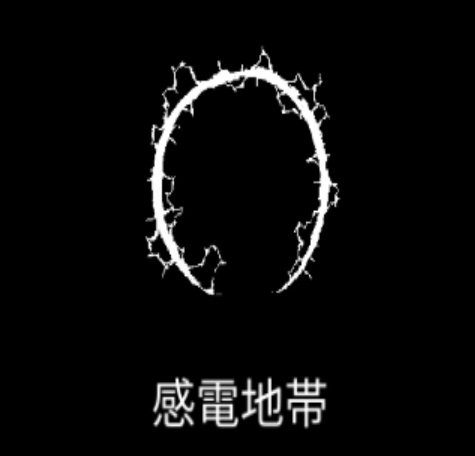

# 感電地帯

### 基本情報

| lv毎のステータス |  |  |  |  |  |
| --- | --- | --- | --- | --- | --- |
| 1 | 周辺の敵に周期的にダメージを与える。 |  |  |  |  |
| 2 | サイズ+15% | 4 | サイズ+15% | 6 | ダメージ;50% |
| 3 | ダメージ+50% | 5 | サイズ+20% | 7 | 特性習得 |

### 特性

| 電荷放出 |
| --- |
| ダメージ+80%、サイズ+30% 融合魔法:[雷の調律](thunder-attunement.md)の習得に必要。 |
| EMP |
| 感電地帯で4回ダメージを与えた敵を気絶させる。 ダメージ間隔-10% 融合魔法:[マイスナー効果](meissner-effect.md)の習得に必要。 |
| 火のオーラ |
| 感電地帯は周期的に拡張し、消えることを繰り返す。 周期はダメージ間隔が短いほど速くなる。 1回の拡張で、1つの敵に複数回ヒットすることはない。 ダメージ5倍、ダメージ間隔5倍 融合魔法:氷の心、[スーパー台風](super-typhoon.md)の習得に必要。 |

### 使い方

後日筆記予定
