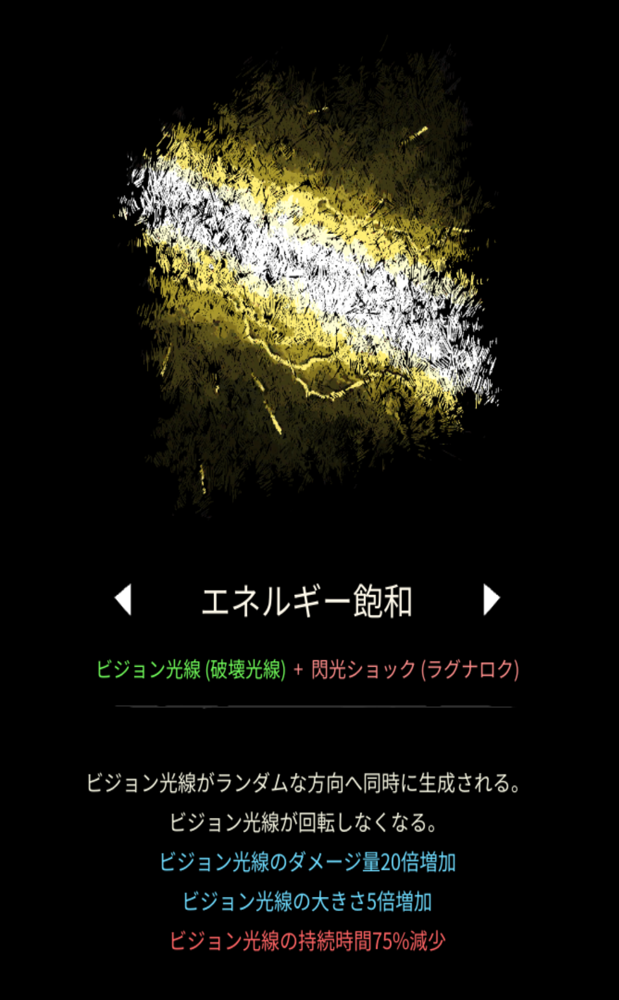

# エネルギー飽和

## 基本情報

### 評価

**B**

- 出力

弱い。

- 競合相手との比較

ゲートが最大手。コスモスと併用する際、どっちを選ぶかは好みで選んで良い。

- 特記事項

透明度調節機能使用推奨。

### 動画

<iframe class="video" src="https://www.youtube.com/embed/XDCKoZ9QKJI" allowfullscreen loading="lazy"></iframe>
