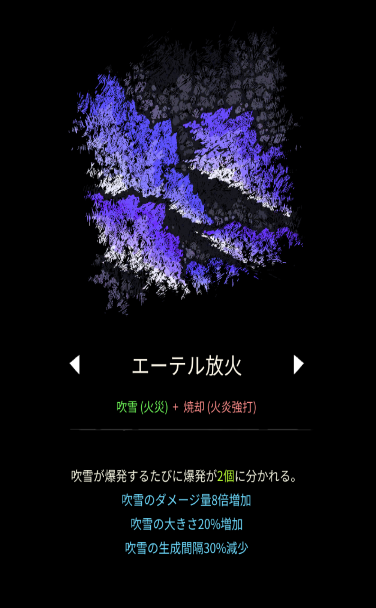

# エーテル放火

## 基本情報

{ width="1003" height="1620" }

### 評価

**E**

- 出力

かす。

- 競合相手との比較

攻撃範囲が狭く火力も出ない、おまけに凍結もできない。同じ素材を使用する[ヘルファイア](hellfire.md)の完全下位互換である。

### 動画

<iframe class="video" src="https://www.youtube.com/embed/WkivcIkQx6g" allowfullscreen loading="lazy"></iframe>
