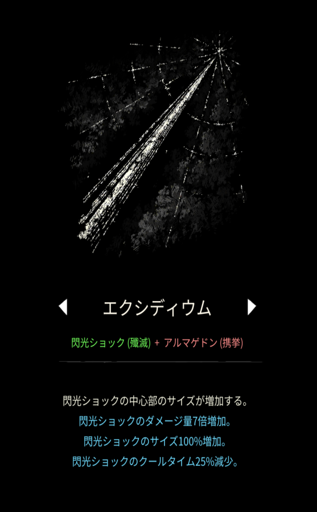
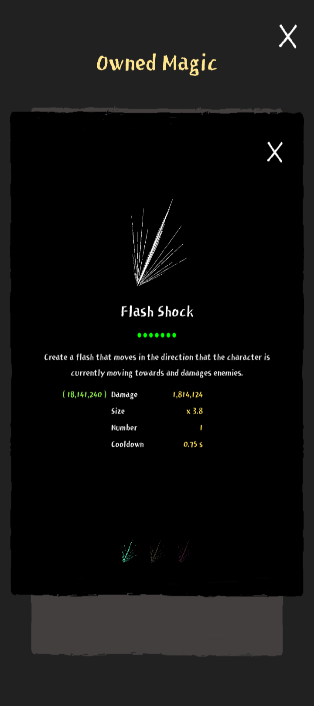

# エクシディウム

## 基本情報

{ width="1003" height="1620" }

### 評価

**D**

- 出力

{ width="720" height="1612" }

- 競合相手との比較

競合最大手はゲート。AF要求度は同じ、視界はゲートが勝り、瞬間火力はエクシディウムが上。

兼用する魔法次第でもどちらが良いかは異なってくるので、好みで選んで下さい。

### 動画

<iframe class="video" src="https://www.youtube.com/embed/2dH3lK_r62w" allowfullscreen loading="lazy"></iframe>
