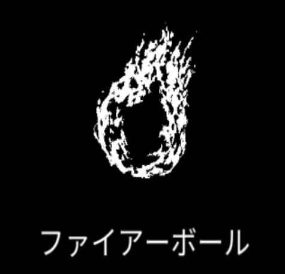

# 火炎球

{ width="475" height="456" }

### 基本情報

| lv毎のステータス |  |  |  |  |  |
| --- | --- | --- | --- | --- | --- |
| 1 | 爆発する弾を発射する。 |  |  |  |  |
| 2 | 数+1 | 4 | サイズ+20% | 6 | ダメージ+50% |
| 3 | ダメージ+50% | 5 | 数+1 | 7 | 特性習得 |

### 特性

| 大爆発 |
| --- |
| 1度に発射する火炎球のうち1つだけ、ダメージ量とサイズが1.5倍増加する。 火炎球のダメージ+80% 融合魔法:[デーモンの方程式](demon-equation.md)の習得に必要。 |
| 毒ガス |
| 火炎球の爆発が拡張しながら3回ダメージを与える。 火炎球のダメージ-30% 融合魔法:[冬の嵐](winter-storm.md)の習得に必要。 |
| 星座 |
| 火炎球がランダムな位置に発射され、キャラクターに沿って短時間存続する。 火炎球の移動速度が徐々に減少する。 火炎球の貫通力+1 融合魔法:[百鬼夜行](night-parade.md)、[原点爆発](origin-blast.md)の習得に必要。 |

### 使い方

後日筆記予定
