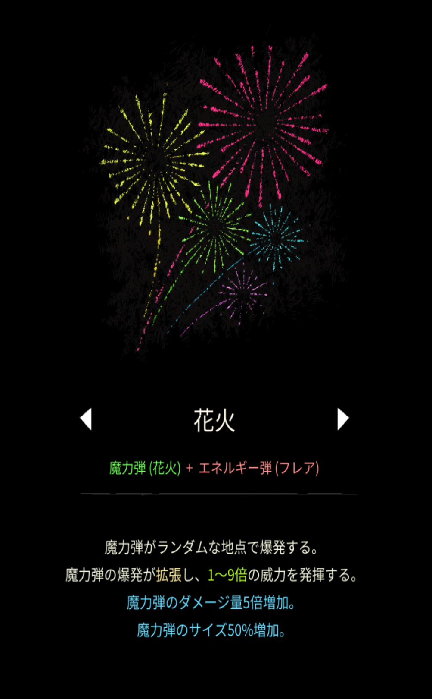
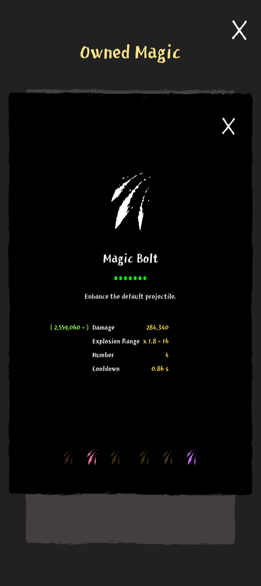

# 花火

## 基本情報

{ width="1003" height="1620" }

### 評価

**A**

- 出力

{ width="720" height="1612" }

盛りに盛れば500万くらいいくと思う。

- 競合相手との比較

ブラスターが競合だが、出力では圧倒しているので、基本的にこちらを使う方が良いことが多い。

- 特記事項

究極魔法の序盤を凌ぐのに良い。

### 動画

<iframe class="video" src="https://www.youtube.com/embed/NKhUQ6Ww9Bw" allowfullscreen loading="lazy"></iframe>
