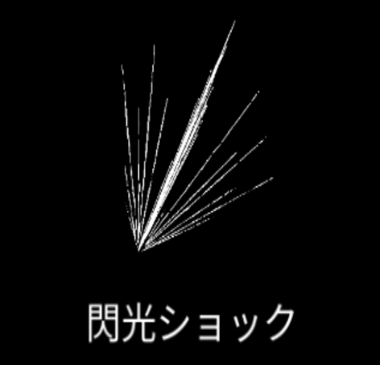

# 閃光ショック

{ width="475" height="456" }

### 基本情報

| lv毎のステータス |  |  |  |  |  |
| --- | --- | --- | --- | --- | --- |
| 1 | キャラクターの移動方向にフィールドを横切る閃光が生成され、敵にダメージを与える。 |  |  |  |  |
| 2 | サイズ+15% | 4 | サイズ+15% | 6 | ダメージ+50% |
| 3 | ダメージ+50% | 5 | クールタイム-20% | 7 | 特性習得 |

### 特性

| 殲滅 |
| --- |
| 閃光ショックの中心部のダメージ10倍 サイズ+30% 融合魔法:[魔力の窓](spear-of-magic-old.md)の習得に必要。 |
| ラグナロク |
| 閃光ショックの生成半径が広がる。 数+5、クールタイム2倍 融合魔法:[エネルギー飽和](energy-saturation.md)の習得に必要。 |
| 悪魔の爪 |
| 閃光ショックの発生位置、発生方向がランダムになる。 両側に追加で生成される。 発動するごとに攻撃回数が1回増えていき、4回で初期化される。 ダメージ+33%、サイズ-50% 融合魔法:[フレンジー](frenzy.md)の習得に必要。 |

### 使い方
