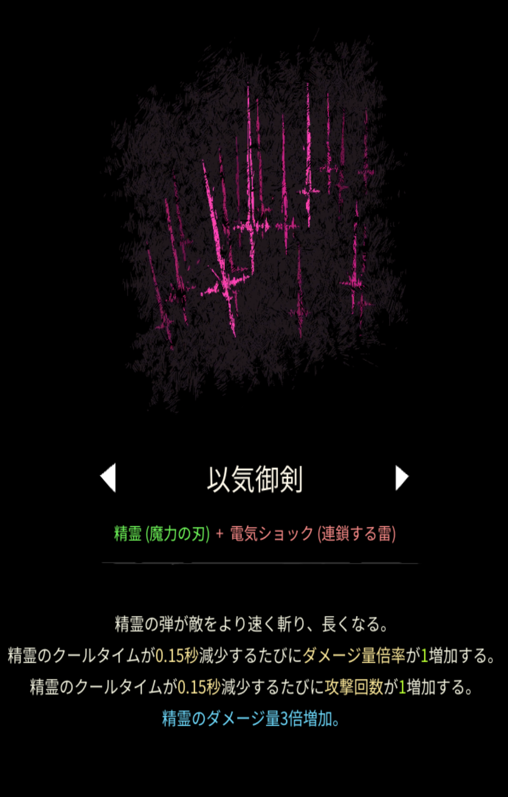

# 以気御剣

## 基本情報

### 評価

**E**

- 出力

ゴミ。

- 競合相手との比較

勝てるわけがない。うんち。

- 特記事項

見た目魔法。人気だけの魔法。弱い。究極も弱い。うんち。

### 動画

<iframe class="video" src="https://www.youtube.com/embed/1bdRZjP8FvQ" allowfullscreen loading="lazy"></iframe>
