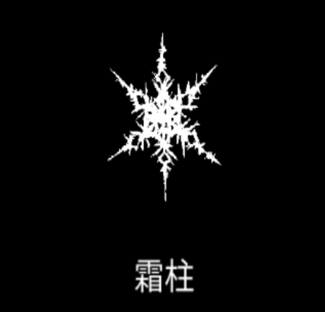

# 霜柱

{ width="475" height="456" }

### 基本情報

| lv毎のステータス |  |  |  |  |  |
| --- | --- | --- | --- | --- | --- |
| 1 | 周辺の敵をしばらく氷結させる。 |  |  |  |  |
| 2 | サイズ+15% | 4 | クールタイム-15% | 6 | ダメージ+50% |
| 3 | ダメージ+50% | 5 | サイズ+20% | 7 | 特性習得 |

### 特性

| 絶対零度 |
| --- |
| 霜柱の攻撃範囲より外の敵も氷結させる。(※ダメージはない？) 氷結効果の持続時間+25% |
| 氷河期 |
| 霜柱が連続で3回爆発する。 爆発の度にダメージとサイズは1.5倍増加していく。 サイズ-20%、クールタイム2倍 融合魔法:[雪花開花](snowflake-bloom.md)、氷の心の習得に必要。 |
| 地震 |
| 氷結能力が失われる代わりに、敵を気絶させるようになる。 ダメージ2倍、サイズ+25% 融合魔法:[大亀裂](great-rift.md)の習得に必要。 |

### 使い方

後日筆記予定
