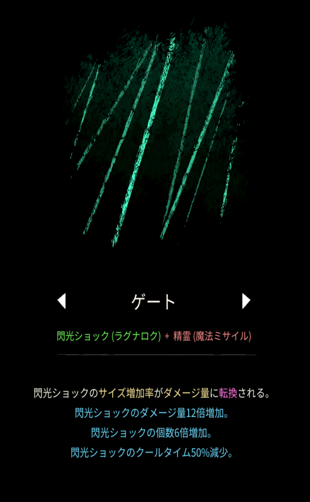
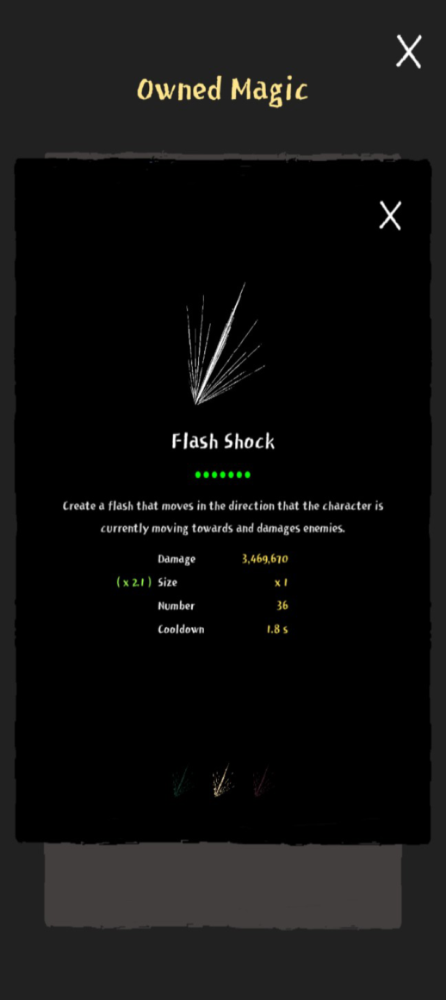

# ゲート

## 基本情報

{ width="1003" height="1620" }

### 評価

**A**

- 出力

{ width="720" height="1612" }

火力を盛りまくると800万くらいはいきます

- 競合相手との比較

閃光ショックを食い合う、ブラスターやエクシディウムがライバル。

ブラスターと併用出来なくとも、ブラスターより強力な花火と併用できるので、ブラスターとの素材被りは気にしなくて良い。また、エクシディウムとの比較は、火力を一点集中させるか分散させるかという違いしかないので、好きな方を選べば解決する。

### 動画

<iframe class="video" src="https://www.youtube.com/embed/NaZAm3FRBRI" allowfullscreen loading="lazy"></iframe>
