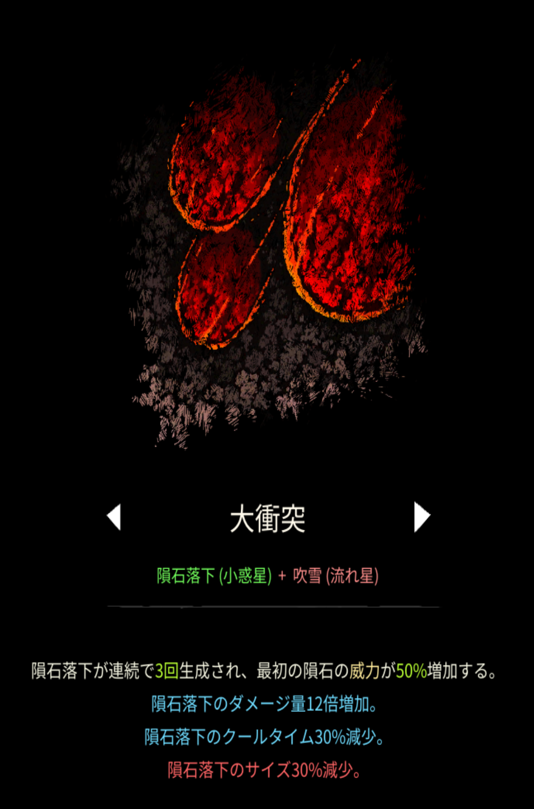
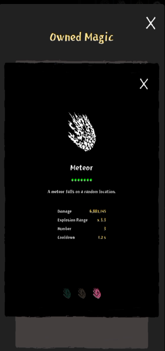

# 大衝突

## 基本情報

{ width="1034" height="1565" }

### 評価

**B**

- 出力

{ width="332" height="704" }

MAX800万くらいまで伸びる。

- 競合相手との比較

競合は不死鳥だろう。あちらより最大火力は上だが、あちらはAF要求が高くなく、残機増加効果まである。どちらが良いかは他に使う融合魔法と相談してきめたい。

- 特記事項

序盤(25分まで)は火力に困らない。

### 動画

<iframe class="video" src="https://www.youtube.com/embed/UN5txc9eSUM" allowfullscreen loading="lazy"></iframe>
