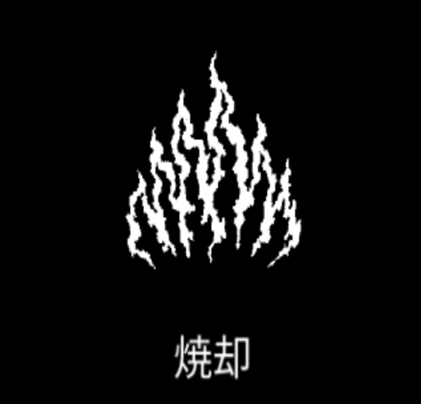

# 焼却

{ width="475" height="456" }

### 基本情報

| lv毎のステータス |  |  |  |  |  |
| --- | --- | --- | --- | --- | --- |
| 1 | 前方に炎を発射する。 |  |  |  |  |
| 2 | 数+6 | 4 | サイズ+20% | 6 | ダメージ+50% |
| 3 | ダメージ+50% | 5 | 数+6 | 7 | 特性習得 |

### 特性

| 火炎強打 |
| --- |
| 焼却を発射するにつれ、威力とサイズが増加していく。 (最大倍率:ダメージ4倍、サイズ1.5倍) 数+25% 融合魔法:[エーテル放火](ether-arson.md)、[インフェルノ](inferno.md)の習得に必要。 |
| 放火魔 |
| 焼却を発射するたびに、同量のダメージを与える小さな炎を2個生成する。 クールタイム-20% |
| ケルベロスの炎 |
| 焼却が両側に追加で発射される。 ダメージ+30%、射程距離+20% 横のサイズ-33%、数-33% 融合魔法:[火の息](fire-breath.md)、[炎の嵐](firestorm.md)の習得に必要。 |

### 使い方

#### プレイヤーの向いている方向に向かって炎を連続して放射する魔法

- 攻撃力が高めな上に連続攻撃のため、一点突破や突撃に向いている
  - HPMPリソースや宝箱を確保したい時、敵を薙ぎ倒しつつ向かうことが出来る様になる為、突撃の結果が生存に繋がるという場合も多い
- また、その場で回転してプレイヤーを取り囲む敵に炎を浴びせる、といった使い方も出来る
- 迎撃向きの魔法が多いこのゲームで唯一**攻勢をかけられる魔法**と言っても過言ではなく、また迎撃も不可能ではないという、中々に使い勝手の良い魔法である

(以下旧バージョン情報)

- タレントはいずれも優秀であり、どれを取得するか非常に悩ましい
  - **ヘルファイア**はダメージと射程の増加である。
    - 射程の増加と大きさの増加は異なるので注意。射程増加はより遠くに届くというだけで、左右には一切影響がない
    - 硬い敵を倒しやすくなり、さらに攻撃範囲も広がる。即死特化でもない限り、他のタレントより優先して取った方が良いだろう
  - **ディフュージョン**は炎の大きさ増加。より広範囲に攻撃が可能となる
    - 特に**効果範囲が横に広がる**ため、突撃時に左右から襲われにくくなる
    - 迎撃時にもより多数の敵に炎を浴びせたり出来るが、迎撃に関しては他のタレントの方が優れるだろうか
  - **パイロメニアック**は弾数の増加であり、より長く炎を放出出来る様になる
    - 攻撃可能時間の延長は相対的に**無防備な時間の減少**を意味し、安全な時間が増えるということでもある
    - ただし攻撃力そのものは上がらないので、高耐久の敵が突っ込んできても止められないという点には留意すべき
  - **バーニングガス**はクールダウンの短縮、つまり直接的に無防備な時間を減らせるということである
    - 欠点もパイロメニアックと同じものが当てはまる
    - パイロメニアックとどちらを取るかは悩ましい。他のアビリティやアーティファクトとの兼ね合いを考慮して選択すると良いだろう
