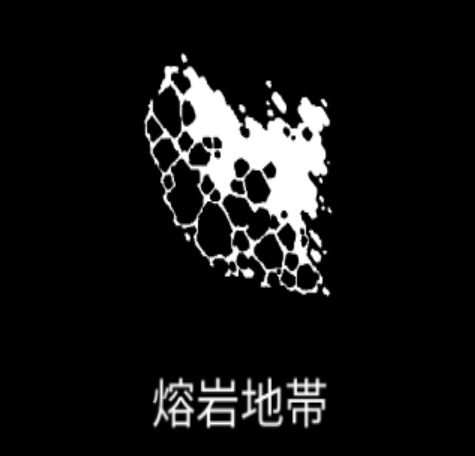

# 溶岩地帯

{ width="475" height="456" }

### 基本情報

| lv毎のステータス |  |  |  |  |  |
| --- | --- | --- | --- | --- | --- |
| 1 | 一定時間持続して敵にダメージを与える溶岩地帯を生成する。 |  |  |  |  |
| 2 | 数+1 | 4 | サイズ+20% | 6 | ダメージ+50% |
| 3 | ダメージ+50% | 5 | 数+1 | 7 | 特性習得 |

### 特性

| 融解 |
| --- |
| 同じ敵に溶岩地帯でダメージを与えるたびに、 その敵へのダメージ+5%(最大30%) クールタイム-15% 融合魔法:[インフェルノ](inferno.md)の習得に必要。 |
| 噴火口 |
| 数2倍、サイズ-20%、持続時間-20% |
| マグマ噴出 |
| 溶岩地帯が1つに統合される。 溶岩地帯の数1毎にサイズ+30% ダメージ2倍、クールタイム+50% 融合魔法:[溶鉱炉](furnace.md)の習得に必要。 |
