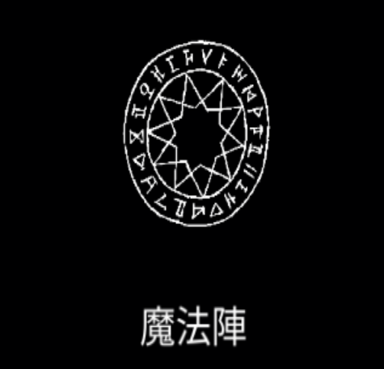

# 魔法陣

{ width="475" height="456" }

### 基本情報

| lv毎のステータス |  |  |  |
| --- | --- | --- | --- |
| 1 | 持続時間の間、攻撃力を増幅させる。(初期:25%) |  |  |
| 2 | 効果量+5%、持続時間+20% | 4 | 効果量+5%、持続時間+20% |
| 3 | 効果量+5%、持続時間+20% | 5 | 特性習得 |

### 特性

| 魔力解放 |
| --- |
| 発動中、すべての魔法のクールタイム-15% 魔法陣のクールタイム-15% 融合魔法:[無限動力](infinite-power.md)の習得に必要。 |
| 物質錬成 |
| 発動時、キャラクターの周辺にランダムなアイテムを5つ生成する。 マナ獲得量+15% 融合魔法:[創造の扉](door-of-creation.md)の習得に必要。 |
| 大魔法陣 |
| 攻撃力増幅の効果量が2倍になる。 持続時間+33%、クールタイム+33% 融合魔法:[オーバーマインド](overmind.md)の習得に必要。 |

### 使い方
