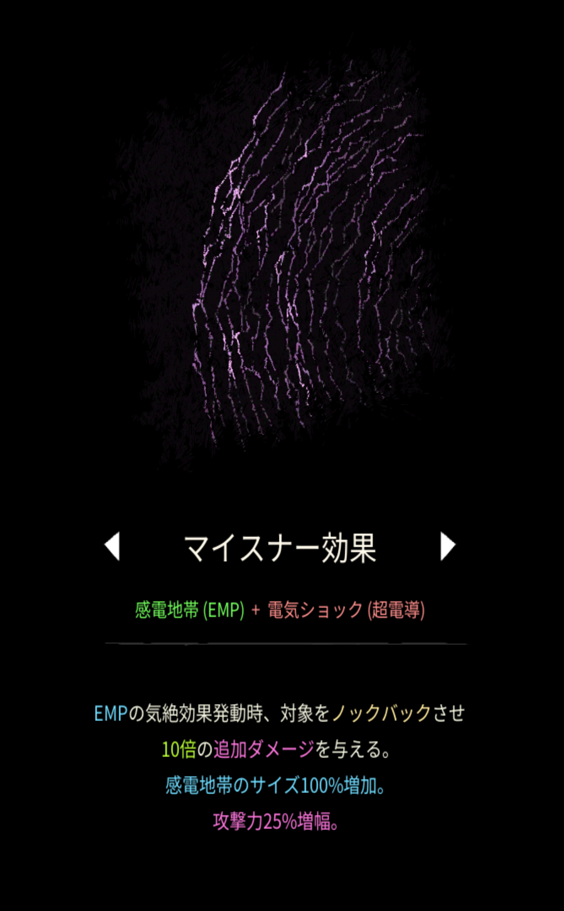

# マイスナー効果

## 基本情報

### 評価

**D**

- 出力

融合していない霜柱と同じくらい。

- 競合相手との比較

特にいない。

- 特記事項

感電地帯をベースとした融合魔法の中で一番強い。火力は低いもののサポートとしては役立つ。

### 動画

<iframe class="video" src="https://www.youtube.com/embed/6t5Dkt9Fl9U" allowfullscreen loading="lazy"></iframe>
