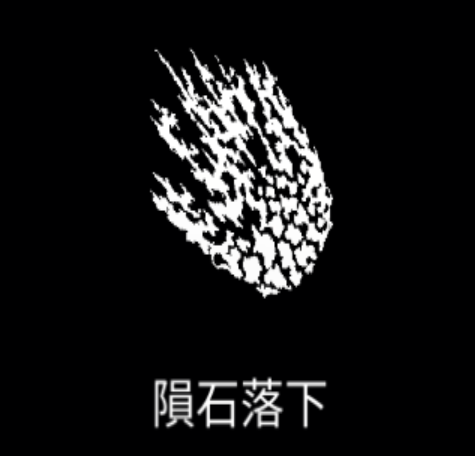

# 隕石落下

{ width="475" height="456" }

### 基本情報

| lv毎のステータス |  |  |  |  |  |
| --- | --- | --- | --- | --- | --- |
| 1 | ランダムな地点に隕石を落とす。 |  |  |  |  |
| 2 | 数+1 | 4 | サイズ+20% | 6 | ダメージ+50% |
| 3 | ダメージ+50% | 5 | 数+1 | 7 | 特性習得 |

### 特性

| 火山爆発 |
| --- |
| 隕石がすぐに爆発して噴火口を残し、毎秒25%分のダメージを与える。 (噴火口の持続時間:3秒) 融合魔法:[溶鉱炉](furnace.md)、[大亀裂](great-rift.md)、[炎の嵐](firestorm.md)の習得に必要。 |
| 流星群 |
| 数3倍、生成間隔(≠クールタイム)-30% ダメージ-25%、サイズ-25% 融合魔法:[蒼天の怒り](wrath-of-the-heavens.md)、[戦争気候](war-climate.md)の習得に必要。 |
| 小惑星 |
| 隕石が1つに統合される。隕石の数1つ毎にサイズ+50% ダメージ3倍、クールタイム2倍 融合魔法:[ヒペリオン](hyperion-old.md)、[大衝突](great-collision.md)の習得に必要。 |

### 使い方

後日筆記予定
