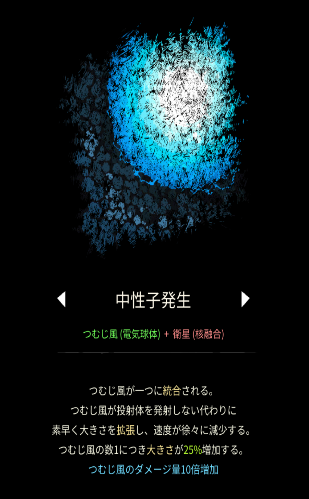

# 中性子発生

## 基本情報

### 評価

**E**

- 出力

うんちっち。

- 競合相手との比較

特にいない。

- 特記事項

究極魔法のオメガを使うとき、当然こいつも使うわけだが、序盤は火力が通用するので最初に融合しても構わない。

### 動画

<iframe class="video" src="https://www.youtube.com/embed/GZXUCz2wAkI" allowfullscreen loading="lazy"></iframe>
