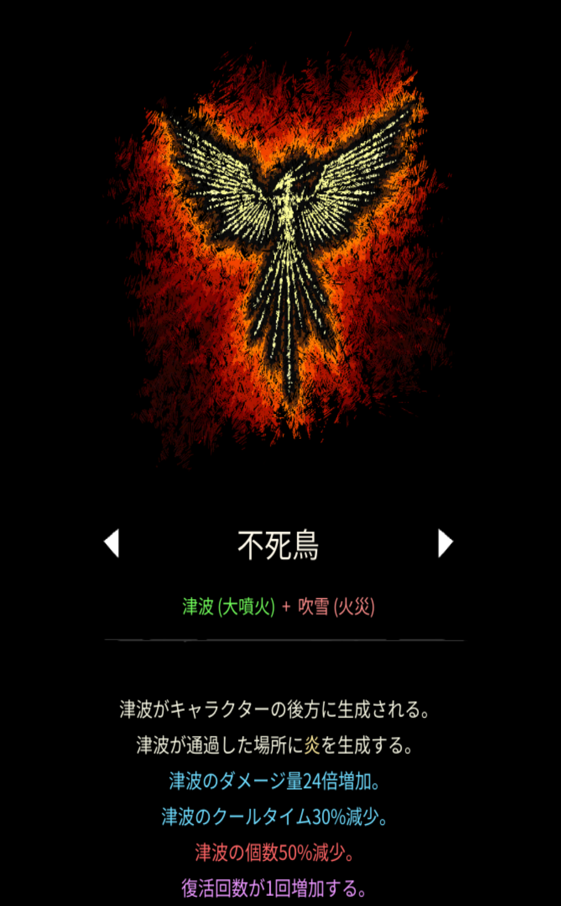
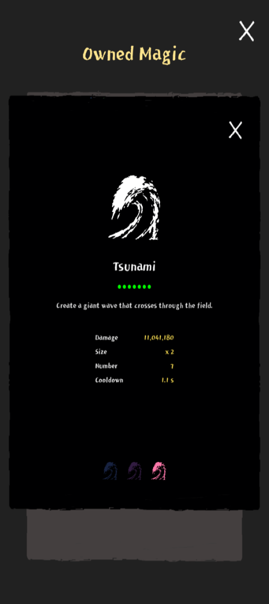

# 不死鳥

## 基本情報

### 評価

**B**

- 出力

基本は200〜400万ほど、ステータスが強ければここまで伸びる。

- 競合相手との比較

強力な競合相手としては、雪花開花が上げられる。あちらはこちらより火力面では劣るが、吹雪を使えるというのが主張。この辺りは好みで別れるのかなと思います。

### 動画

<iframe class="video" src="https://www.youtube.com/embed/DtsuEMmqgZc" allowfullscreen loading="lazy"></iframe>
