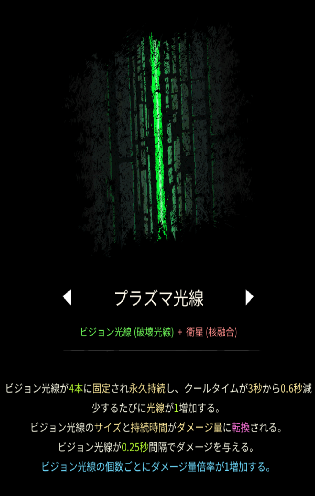

# プラズマ光線

## 基本情報

### 評価

**E**

- 出力

弱い。

- 競合相手との比較

競合相手は特にない。

- 特記事項

究極魔法のクオンタムレーザーを使う際に、初動として使うには良い魔法である。

### 動画

<iframe class="video" src="https://www.youtube.com/embed/UCPB2PKOPJA" allowfullscreen loading="lazy"></iframe>
