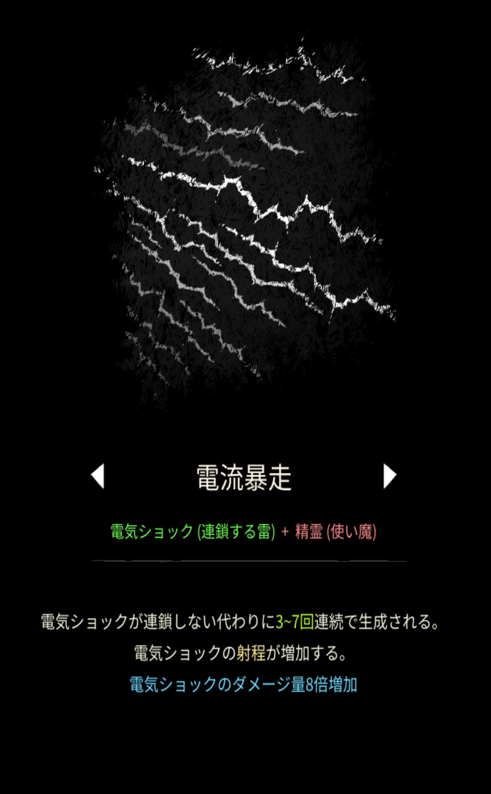

# 電流暴走

## 基本情報

{ width="1003" height="1620" }

### 評価

**E**

- 出力

弱い。

- 競合相手との比較

ゲートが最大の競合相手。勝てない。

- 特記事項

攻撃頻度と範囲は屈指の高さがあるので、死神の鎌を使う際ちょっとだけ便利。

### 動画

<https://discord.com/channels/1339606528017174630/1366297817861066782/1400691267888742452>
