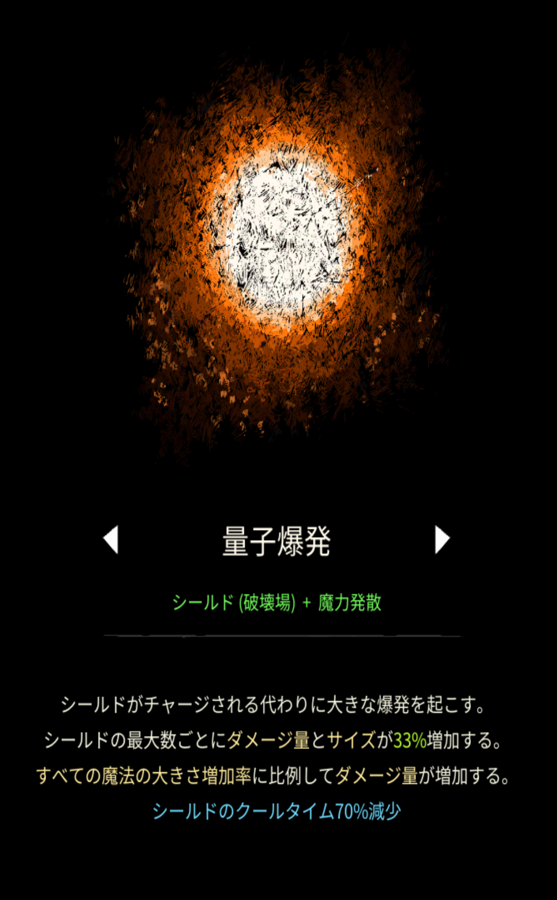

# 量子爆発

## 基本情報

{ width="1003" height="1620" }

### 評価

**E**

- 出力

単発ダメージは花火と同等でも花火の20分の1くらい。なんで？？？

- 競合相手との比較

シールド。当然勝てない。

- 特記事項

使う際はビショップが一番こいつを活かせる。

### 動画

<iframe class="video" src="https://www.youtube.com/embed/LQe35i7PYYc" allowfullscreen loading="lazy"></iframe>
