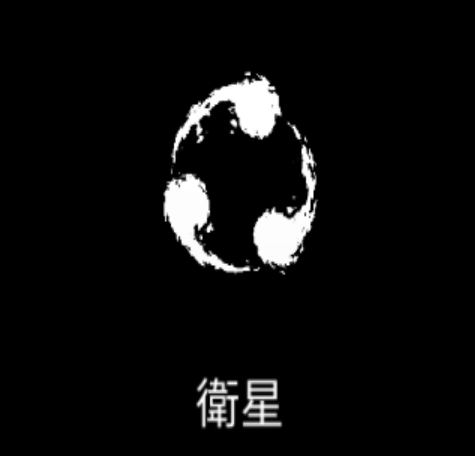

# 衛星

### 基本情報

| lv毎のステータス |  |  |  |  |  |
| --- | --- | --- | --- | --- | --- |
| 1 | キャラクターの周りを回転する衛星を生成する。 |  |  |  |  |
| 2 | ダメージ+20%、数+1 | 4 | ダメージ+20%、数+1 | 6 | ダメージ+20%、数+1 |
| 3 | ダメージ+20%、数+1 | 5 | ダメージ+20%、数+1 | 7 | 特性習得 |

### 特性

| 反重力 |
| --- |
| 回転速度が3倍まで徐々に速くなっては、 元の速度に戻ることを繰り返す。 融合魔法:[ボルテックス](vortex.md)の習得に必要。 |
| 鬼火 |
| 衛星が2重の円状に生成される。 数2倍、回転速度+33%、サイズ-33% 融合魔法:[百鬼夜行](night-parade.md)、[雷の調律](thunder-attunement.md)の習得に必要。 |
| 核融合 |
| 衛星が1つに統合され、0.3秒間隔でダメージを与える。 合成前の衛星の数がnなら、ダメージ&サイズn倍 回転速度-50% 融合魔法:[中性子発生](neutron-emission.md)、[プラズマ光線](plasma-ray.md)、[ヒペリオン](hyperion-old.md)の習得に必要。 |

### 使い方

後日筆記予定
