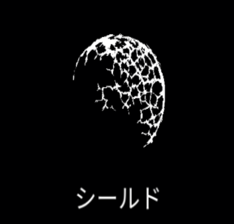

# シールド

{ width="475" height="456" }

### 基本情報

| lv毎のステータス |  |  |  |
| --- | --- | --- | --- |
| 1 | ダメージを1回防ぐシールドを生成する。(初期状態:2枚まで展開可能) |  |  |
| 2 | クールタイム-10% | 4 | クールタイム-10% |
| 3 | クールタイム-10% | 5 | 特性習得 |

### 特性

| バリア |
| --- |
| シールド最大チャージ数２増加 |
| 再構築 |
| 1度の発動でシールドが2枚展開される。 最大展開数が1増える。 クールタイム+20% |
| 破壊場 |
| シールドが消えたとき、 短時間持続する爆発を4回起こし敵にダメージを与える 融合魔法:[反作用](reaction.md)、[量子爆発](quantum-explosion.md)、[テレポート](teleport.md)の習得に必要。 |

### 使い方

クールタイム毎にシールド無し→赤→青→黄→白の順番で展開され、1回ダメージを受けるたびに1つ破壊される。

防御面ではバリアが優秀。たかが1秒の無敵時間だが、これに命を救われることも少なくない。

再構築を選択すれば、ビショップの攻撃力up能力の効果を最大化できる。

破壊場も防御性は悪くない。派生する3つの合成魔法はいずれも面白い効果を持つが、実用性は微妙。
