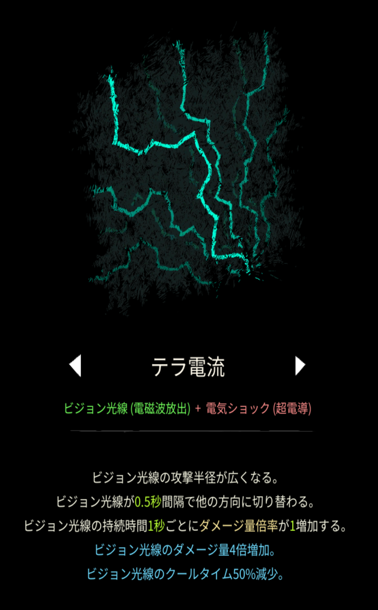
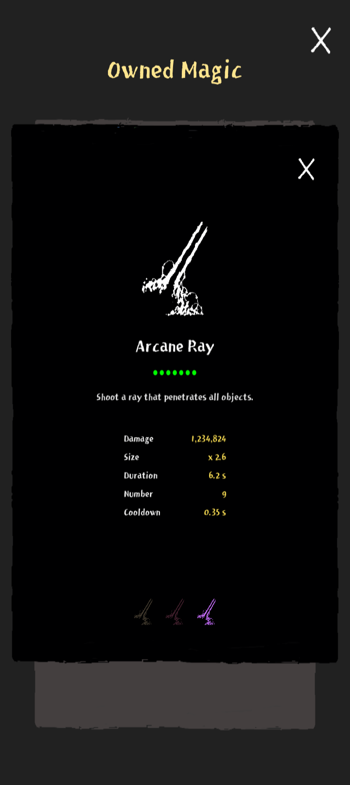

# テラ電流

## 基本情報

### 評価

**D**

- 出力

- 競合相手との比較

競合相手といえるほどの相手はいないが、そもそもテラ電流の独自性能が無い。

- 特記事項

序盤の安定剤として使ってあげよう。

気持ちは楽になる。魔法の枠は無駄になる。

### 動画

<https://youtube.com/shorts/lZF2hS89kK8?si=l3_BJuvmVJ_UwQwx>
