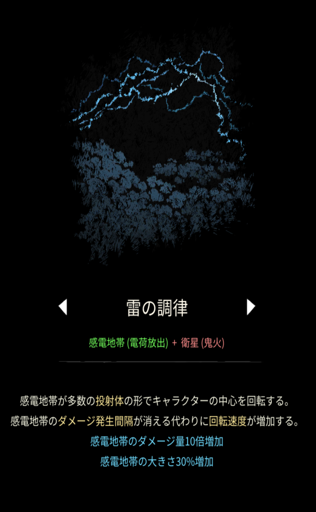

# 雷の調律

## 基本情報

{ width="1003" height="1620" }

### 評価

- 出力

融合魔法最弱。感電地帯の内側へのダメージが無くなり、エフェクトに直撃しないとダメージを与えられなくなる。サイズを上げると半径が上がり、より攻撃を当てにくくなり、囲まれた時に押しつぶされる。おまけに火力も低く、序盤以外で全く役に立たないだろう。

- 競合相手との比較

いない。

- 特記事項

弱いので使うと損をする。

### 動画

<iframe class="video" src="https://www.youtube.com/embed/vBxWRyBDdQQ" allowfullscreen loading="lazy"></iframe>
