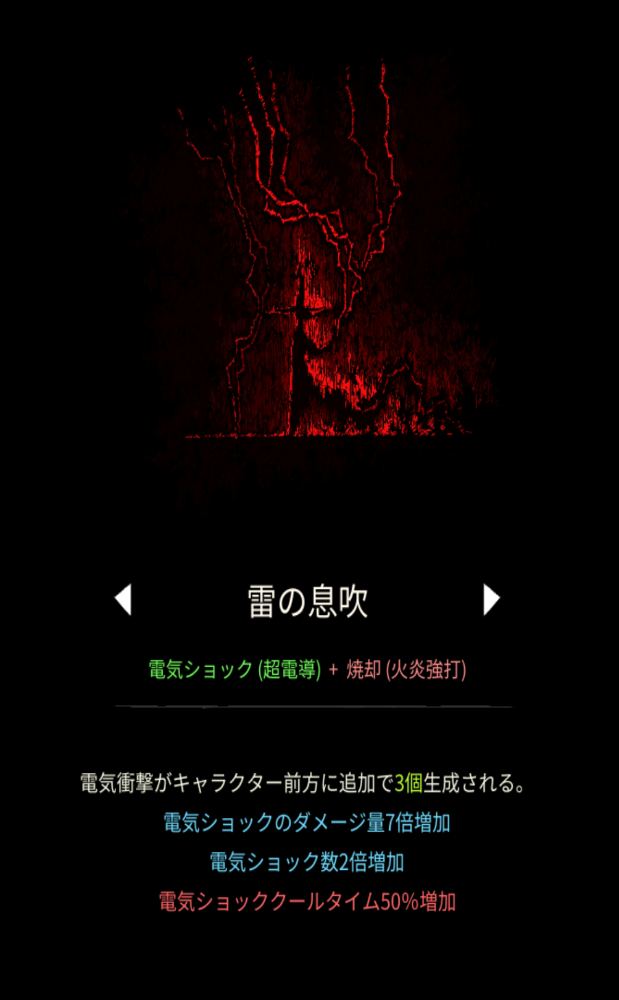

# 雷の息吹

## 基本情報

{ width="1003" height="1620" }

### 評価

**D**

死神の鎌の即死効果を起動するのにちょっとだけ使える。

### 動画

<iframe class="video" src="https://www.youtube.com/embed/nQNstIR5_Qc" allowfullscreen loading="lazy"></iframe>
