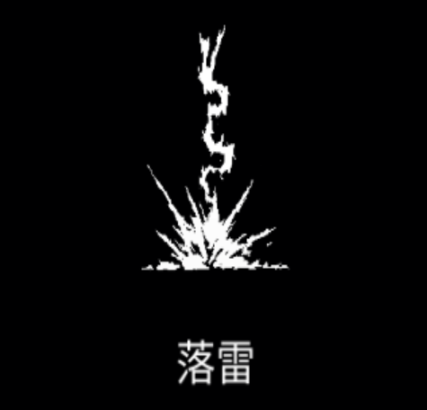

# 落雷

### 基本情報

| lv毎のステータス |  |  |  |  |  |
| --- | --- | --- | --- | --- | --- |
| 1 | 周辺の敵に雷が落ちる |  |  |  |  |
| 2 | ダメージ+20%、数+1 | 4 | ダメージ+20%、数+1 | 6 | ダメージ+20%、数+1 |
| 3 | ダメージ+20%、数+1 | 5 | ダメージ+20%、数+1 | 7 | 特性習得 |

### 特性

| 晴天の霹靂 |
| --- |
| 落雷が1～3回連続して生成される。 クールタイム-25% 融合魔法:[雷炸裂](thunder-burst.md)の習得に必要。 |
| 雷爆発 |
| 落雷が着弾時に爆発し、拡張する。 落雷が順次ランダムな位置に生成される。 ダメージ+80% 融合魔法:[蒼天の怒り](wrath-of-the-heavens.md)の習得に必要。 |
| 審判 |
| 落雷が1つに統合される。 落雷の爆発周辺の敵には半分のダメージを与える。 落雷の数1毎に、サイズ+20% ダメージ5倍、クールタイム2倍 融合魔法:[軌道爆撃](orbital-bombardment.md)の習得に必要。 |

### 使い方

後日筆記予定
