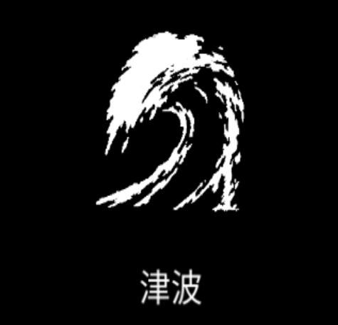

# 津波

{ width="475" height="456" }

### 基本情報

| lv毎のステータス |  |  |  |  |  |
| --- | --- | --- | --- | --- | --- |
| 1 | 巨大な波を起こしてフィールドを横切る。 |  |  |  |  |
| 2 | 数+3 | 4 | クールタイム-15% | 6 | ダメージ+50% |
| 3 | ダメージ+50% | 5 | 数+3 | 7 | 特性習得 |

### 特性

| 極点 |
| --- |
| 津波が四方から同時に生成され、敵を氷結させる。 融合魔法:[雪花開花](snowflake-bloom.md)の習得に必要。 |
| セイレーンの歌 |
| 津波がキャラクターの付近で、移動方向に向けて生成される。 クールタイム-50%、数-50% 融合魔法:[大洪水](deluge.md)の習得に必要。 |
| 大噴火 |
| 津波の生成半径が広がる。 ダメージ2倍、サイズ+10%、クールタイム+30% |

### 使い方

後日筆記予定
