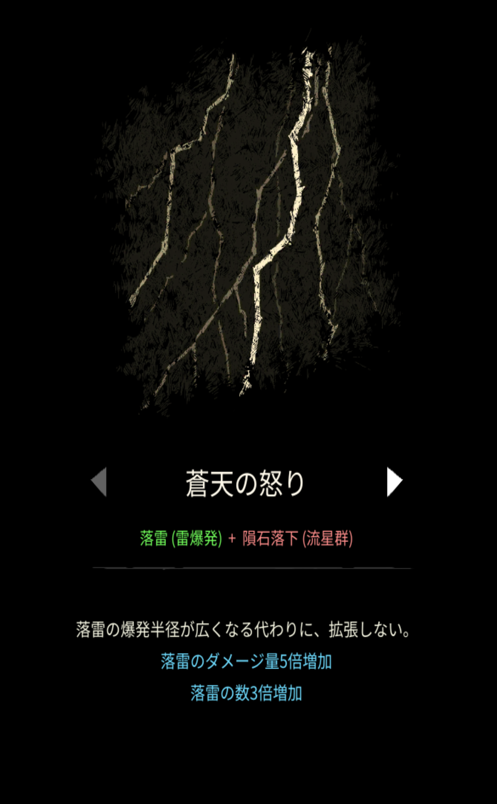

# 蒼天の怒り

## 基本情報

### 評価

**E**

- 出力

ゴミ。究極あるのでそっち推奨。

- 競合相手との比較

全ての点で負けている。比較しなくて良い。

- 特記事項

究極があるのでそちらが使いやすいはず。当然その際に使用することになるはずだが、**絶対にこの魔法は最後に融合しよう**。

### 動画

<iframe class="video" src="https://www.youtube.com/embed/3SrlcKtcEv8" allowfullscreen loading="lazy"></iframe>
