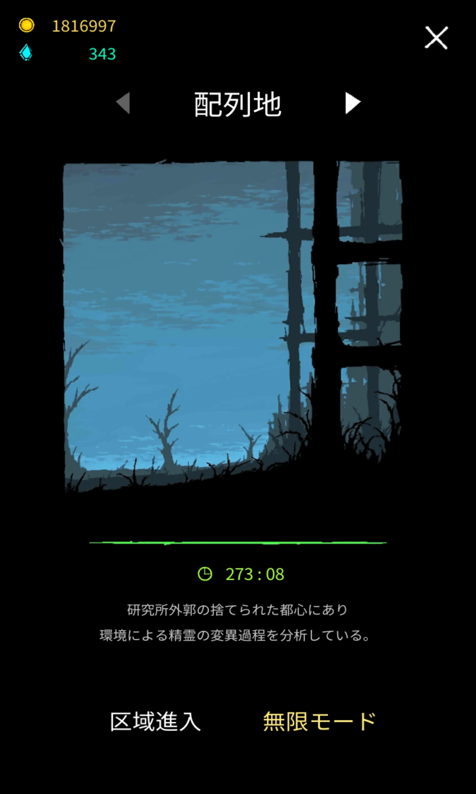

# 配列地

配列地 > [実験室](laboratory.md)

{ width="1200" height="2000" }

## 攻略

### 進め方

最初のステージだけあって非常に簡単。雑に融合を作っておけば勝手に突破しているだろう。

何か聞きたいことがあればコメント欄でお願いします！

## ストーリー

### 序文

(和訳)研究所の外にある放棄された都市、そこにはスピリットの形成過程を調査するために分断された地域がある。

(原文)It is located in ana abandoned city outside the laboratory. Where the distircts divided to investigate the investigating process of the spirits.

### 召喚戦争(Summon War)

(和訳)その時、人類はスピリットとゴーレムを改善された召喚魔法、編成魔法として命令するだけでよかった。発展を滞らせることになったが誰も生活のために働く必要はなく、快楽主義により堕落した。国々の首脳は人々を元気づけるためだけの戦争で和解し始めた。しかしながら戦争で戦うのはペットだけで、人が参加しない戦争は別種の娯楽の餌食になってしまった。

(原文)All works that humans had to do were charged to spirits and golems as summon magic and formation magic has improved. No one had to work for a living, though it retsrted the development, and people got wasted by hedonism. The head of nations started compromised wars only to encourage the people. Only pets, however fought in the war, and the war without people fall prey to another kind of entertainment.

Journal、Progressより

解放条件 アレイゾーンを10分間以上一度生存

解放報酬 ゾーン「研究所(Laboratory)」開放

### ホムンクルス(Homunculus)

(和訳)スピリットは賢いが弱く、ゴーレムは力強いが単純だ。また新しいペットたちも基本のパターンを抜け出すことができなかった。娯楽の戦争は静かで反復的で退屈なものになった。そのためヒトの姿をもつ新しい生命体が創られた。それらは数十人の魔術師と同様の強さをもち、自分で考えるように設計された。その異常な挙動は彼らの寿命が極めて短いため防止できた。

(原文)The spirits were clever but weak and the golems were powerful but simple. New pets couldn’t break out of standard pattens as well. The war became static, repetitive and boring. Therefore, the new organism was created with a human figure. They were as strong as dozens of wizards and designed to think by themselves. The abnormal behavior could be prevented as their lifespan was a split second.

Journal、Progressより

解放条件 アレイゾーンを15分間以上二度生存

解放報酬 ポイント+300

### 翻訳中
