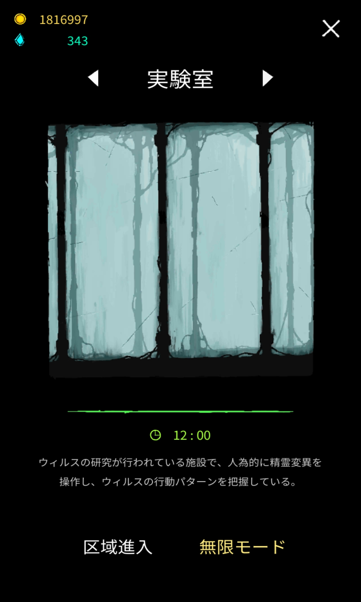

# 実験室

[配列地](array.md) >　実験室 > [下水道](sewer.md)

## ストーリー

### 序文

(和訳)スピリットを変異させたウイルスの行動パターンを調べる研究機関。

(原文)It is the research institution of the virus, finding behavior patterns of the virus by artificially modifying the virus.

### 群れ(Swarm)

(和訳)スピリットの変異体の基本編成。スピリット、集中したエネルギーは奇妙な有機共同体へと変形した。この変異ウイルスは、ゾンビや吸血鬼のように他を感染させるのではなく、親を複製することでその数を増やす。しかしながら自己複製ウイルスはある程度の刺激下でないと活性化しないため、刺激がなかったりそれを感知できないと動きが遅くなりやがて休眠状態になる。

従ってウイルスはできるだけ多くの刺激を得るために親の成長速度を操作する。戦争下の力関係を維持し、刺激のデータを持つ特別な魔法の粒子を広げ全てのスピリットと共有することで、継続的に活性化させることを可能にしているのである。

(原文)The basic formation of mutant spirit. Spirit, energy concentration, transformed into a mysterious organic community. This mutant virus increase their population in a way that made the hosts replicate themselves unlike zombies and vampire spread virus by approaching others to infect. Self-replicating virus, however can only activate during a certain degree of stimulation, so if there were no stimulus or it couldn’t sense it, it can slow down the virus movement and soon remain dormant.

Therefore, the virus manipulates the growth speed of host to get as much stimulation as possible. It keeps maintaining the balance of power in the war, and then spread special magic particles, containing the data of stimulation, to share it with all spirits so that they can continuously activate.

Journal、Experimentより

解放条件 研究所を10分間以上一度生存

解放報酬 ゾーン「下水道(Sewerage)」開放

### 翻訳中
